## CMakeLists

`set(CMAKE_AUTORCC ON)`：导入qt资源文件

设置应用图标

新建ico.rc

`IDI_ICON1 ICON DISCARDABLE "images/qt_logo_256x256.ico"`

```txt
qt_add_executable(appdemo1
    main.cpp
    ico.rc
)
```

在linux上

```c++
#include <QIcon>

app.setWindowsIcon("qrc:/image/qt_logo.png")
```

## 语法

### import

不会复制代码到QML文件，而是告诉QML引擎怎么去处理这个qml文件中的对象，QML文件可以访问相同路径下的其他qml文件

```js
import <ModuleIdentifier> [<Version.Number>][as <Qualifier>]

import QtQuick.Controls 2.15 as MyQuick

import：关键字
ModuleIdentifier：以点分URI表示法指定的标识符，唯一标识命名空间
Version.Number：版本号，在QT6后开始移除版本号
Qualifier：别名，一般自己的QML需要起别名
```

```js
import QtQuick
import QtQuick.Controls as MyQuick

Window {
    width: 640
    height: 480
    visible: true
    title: qsTr("Hello World")

    MyQuick.Button {
        id: button1
        width: 200
        height: 200
        anchors.centerIn: parent
        text: "BTN"
        font.pixelSize: 32
    }
}
```

如果是同目录下的qml文件不需要import，如果在不同目录，直接导入目录，不能导入具体文件

### id

每个对象都可以指定一个唯一的ID，打印出来是一段16进制数据，每次系统随机分配

- 唯一性
- 只读
- 非对象的属性，是QML的数据类型
- 必须以小写字母或者下划线开头
- 必须用字母、数字和下划线定义

### 属性

**声明属性**

对象的特性，可分配静态值，也可以非配动态表达式。可以被读取和修改

```js
[default] [required] [readonly] property <propertyType> <propertyName>
默认属性  必须属性    只读属性  关键字      	属性类型     	属性名，必须小写字母开头，JS关键字禁用
```

声明一个属性会隐式创建一个信号处理器

`on<PropertyName>Changed`

PropertyName:自定义属性的名字，并且要求首字母大写

**初始化**

`property <propertyType> <propertyName>:<value>`

**赋值**

`[<objectId>.]<propertyName>=value`

注意：属性值类型必须与属性要求的类型相匹配，支持类型自动转换

```js
Window {
    id: root
    width: 640
    height: 480
    visible: true
    title: qsTr("Hello World")
    // 定义属性
    property int data: 100
    property string dataStr: "测试"
    property int dataWidth: root.width

    Component.onCompleted: {
        console.log("dataValue: " + data)
        console.log("dataStrValue: " + dataStr)
        data = 999
        console.log("dataValue: " + data)
        console.log("dataWidth: " + dataWidth)
    }
}
```

也可以和函数绑定，直接拿到函数的返回值

**对象列表**

qt组件也是类型，所以可以定义组件列表，并拿到每一个组件和其子属性的值

```js
    // 定义属性
    property list <int> dataList: [1, 2, 3]

    Component.onCompleted: {
        console.log("dataList:"+ dataList[0])
        console.log("dataList_Length:"+ dataList.length)
    }
```

**属性组**

```js
font {pixelSize: 16; bold: true} // 属性组不需要冒号

font.pixelSize: 16
font.bold: true
```

**属性别名**

属性别名不需要分配一个新的存储空间，而是将新声明的属性作为一个已经存在的属性的直接引用

别名是双向绑定的，属性和别名任意一个改变都会更新对象，和引用一样

别名只能指向对象的属性	

`[default] property alisa <name> : <alias reference>`

```js
Window {
    id: root
    width: 640
    height: 480
    visible: true
    title: qsTr("Hello World")
    // 定义属性
    property alias aliasData: root.width

    Component.onCompleted: {
        console.log(aliasData)
    }
}
```

**只读属性**

```js
    // 定义属性
    readonly property int data: 100

    Component.onCompleted: {
        console.log(data)
        data++
        console.log(data)
        // TypeError: Cannot assign to read-only property "data"
    }
```

### 附加属性

**附加属性和附加信号处理器**

附加属性和附加信号处理器是一种允许对象使用额外的属性或信号处理器的机制，允许对象访问一些与个别对象相关的属性或者信号

**使用语法**

`<AttachingType>.<propertyName>`

`<AttachingType>.on<SignalName>`

```js
    ListView {
        width: 200
        height: 300
        model: 9
        focus: true

        delegate: Rectangle {
            width: 200
            height: 30
            color: ListView.isCurrentItem ? "red" : "blue"
        }
    }
```

### 方法/函数

可以执行某些处理或者触发其他的时间，可以关联到信号上，这样在发射信号的之后就会调用这个方法

```js
    function changeLabelFontSize(par)
    {
        return par + testLabel.font.pixelSize
    }

    Label {
        id: testLabel
        anchors.centerIn: parent
        font.pixelSize: 50
        color: "#ff0000"
        text: "TEST"
    }

    Button {
        id: btn1
        width: 200
        height: 100
        anchors.left: parent.left
        anchors.bottom: parent.bottom
        font.pixelSize: 50
        text: "-"

        onClicked: {
            testLabel.font.pixelSize = changeLabelFontSize(-1);
        }
    }

    Button {
        id: btn2
        width: 200
        height: 100
        anchors.right: parent.right
        anchors.bottom: parent.bottom
        font.pixelSize: 50
        text: "+"

        onClicked: {
            testLabel.font.pixelSize = changeLabelFontSize(1);
        }
    }
```

### 信号

**信号和信号处理器**

信号是发生事件的对象发射的通知

信号发射后可以通过信号处理器获得通知并进行处理

**信号处理器声明语法**

`on<Signal>`

on：固定关键字

Signal：信号名，首字母必须大写

onClick

**信号声明语法**

同一作用域信号必须唯一

```js
signal click1
signal click2()
signal click3(int a, int b)
signal click3(x: real, y: real)
```

**属性值改变信号**

QML类型提供内建属性值改变信号，属性值改变就会自动发出信号

```js
onTextChanged: {
    console.log("test change")
}
```

**Connections**

用于连接外部对象的信号，可以接收指定目标的任意信号

```js
Connections {
    target: button1
    
    function onClicked() {
        console.log("click!")
    }
}

Button {
    id: button1
}
```

**connect()**

将信号与动态创建的对象关联起来

```js
signal messageReceive(string person, string notice)

function sendToA(person, notice) {
    console.log("person: " + person + "  notice: " + notice)
}

function sendToB(person, notice) {
    console.log("person: " + person + "  notice: " + notice)
}

Component.onCompleted: {
    messageReceive.connect(sendToA)
    messageReceive.connect(sendToB)
}

Button {
    id: btn1
    width: 200
    height: 100
    anchors.centerIn: parent
    text: "test"

    onClicked: {
        messageReceive("li ming", "hello")
    }
}
```

### 枚举

提供了一组固定的命名选项

自定义的QML文件必须首字母大写

枚举名字必须首字母大写

`<Type>.<EnumerationType>.<Value>`

`<Type>.<Value>`

```js
import QtQuick
// Test.qml
Item {
    enum Fruit {
        Apple,
        Banana = 9,
        Orange
    }
}


Component.onCompleted: {
    console.log(Test.Fruit.Apple) // 0
    console.log(Test.Fruit.Banana) // 9
    console.log(Test.Fruit.Orange) // 10
}
```

### 基本类型

支持常见的数据类型

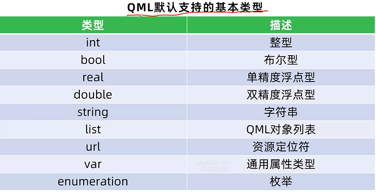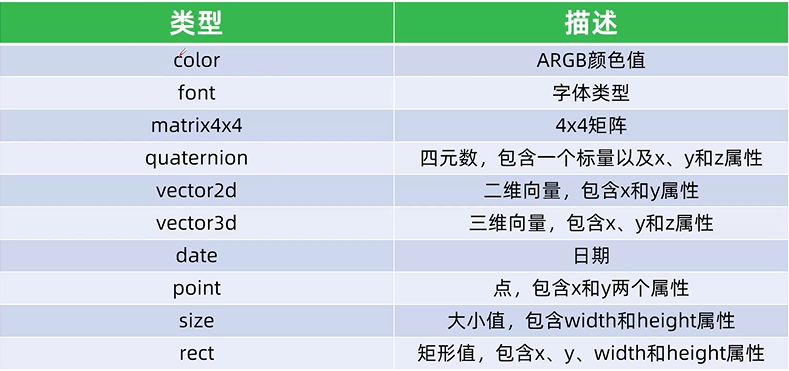

### 其他类型

**对象类型**

用于对象实例化，如Button，Rectangle

**js类型**

QtQuick支持Js对象和数组，可以创建任何标准的Js类型，例如Date，Array

```js
property var myArray: []
property var myDate: new Date()
```

### JS

辅助实现复杂的界面逻辑，扩展QML功能

主流是QML搭配C++实现完整的程序

执行效率远低于C++

过度使用JS会导致复杂度增加，可维护性增加

**属性绑定**

属性绑定可以是表达式、对象属性、JS函数

语法“属性：值”

属性绑定一旦被赋值，就会解除绑定关系

如果需要重新绑定使用Qt.binding()函数

**导入JS文件**

`import "script.js" as MyJS`

### 自定义QML组件

**定义对象类型**

必须以大写字母开头，不能包含除字母、数字和下划线以外的字符、这个QML文件被引擎识别为一个QML类型的定义

同一目录中的QML文件会被设置为自动使用

**自定义类型的可访问属性**

`property propertyType propertyName: value`


```js
// MyQml
Rectangle {
    color: "red"
    radius: height / 2
}

// main
MyQml {
    width: 100
    height: 100
    anchors.centerIn: parent
}
```

### 作用域

表达式可以访问那些变量

重名时的优先级

```js
Item {
	anchors.left: parent.left
}
```

QML文件每个组件都定义了一个逻辑作用域

每个文件都至少有一个根组件

`id.property`

## 元素

### Item

是所有可视化元素的基类，所有其他的可视化元素都集成自Item，他自身不会有任何的绘制操作，但是定义了所有可视化元素共有的属性

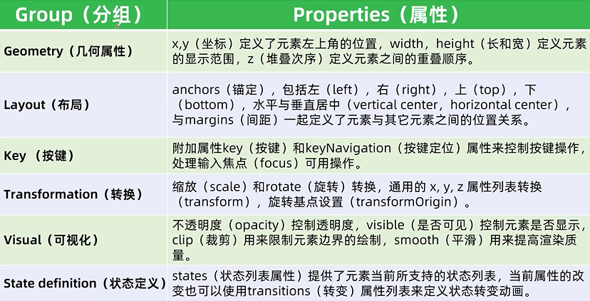

通常被用来作为其他元素的容器使用

属性opacity指定透明度，取值0.0~1.0

堆叠顺序z

可见性visible，虽然Item本身不可见，但可以用来分组其他可视对象

类似div

```js
Item {
    id: item1
    width: 100
    height: 100

    Rectangle {
        color: "blue"
        width: 100
        height: 100
    }
}
```

```js
Item {
    id: item1
    width: 100
    height: 100
    anchors.centerIn: parent

    Rectangle {
        id: rect1
        color: "red"
        width: 100
        height: 100
    }

    Text {
        id: t1
        text: qsTr("福")
        font.pixelSize: 50
        font.bold: true
        anchors.centerIn: parent
    }

    Component.onCompleted: {
        t1.rotation = 180
        rect1.rotation = 45
    }
}
```

### Rectangle

继承自item，使用纯色或者渐变填充一个矩形区域，并提供一个边框

```js
antialiasing: bool // 抗锯齿
border.width: int
border.color: color
color: color
grandient: any // 渐变色
radius: real
```

### Text

color：颜色

font：字体

clip：裁剪

wrapMode：换行

elide：省略

alignment：对齐

### Label

继承自Text，如果没有明确指定背景大小，会自动遵循控件的大小，

**文本样式**

style：文本样式（Text.Normal，Text.Outline,Text.Raised,Text.Sunken）

**高级属性**

font.underline,font,strikeout：下划线和删除线样式

elide：省略模式（Text.ElideLeft,Text.ElideRight,Text.ElideMiddle）

lineHeight和lineHeightMode：行高和行高模式

renderType：渲染类型（Text.QtRendering,Text.NativeRendering）

**字体font**

family，pointSize，weight

**对齐和布局**

horizontalAlignment水平对齐方式

verticalAlignment：垂直对齐方式

wrapMode：文本换行方式

**交互**

selectable：是否可以选择文本
truncated：文本是否可以被截断（只能用来判断文字是否被截断）展开收起

### TextInput

显示单行可编辑的纯文本

使用验证器validator或者输入掩码inputMask来实现输入限制

实际开发中常用TextField或TextEdit替代TextInput

```js
TextInput {
    validator: IntValidator{bottom: 11; top: 31;}
    // inputMask: ">AA_9_a"
    focus: true
    onEditingFinished: console.log(text)
}
```

**回显**

TextInput.Normal

TextInput.Password

TextInput.NoEcho

TextInput.PasswordEchoOnEdit

**信号处理器**

onAccepted()

onEditingFinished()

onTextEdited()

### TextEdit

多行可编辑的纯文本和富文本

canRedo：bool 重做撤销

color：color

contentWidth：real

font.family：string

padding：real

selectedTextColor：color

wrapMode：enumeration

**信号处理器**

onEditingFinished

**Flickable**

Textedit没有滚动条，搭配flickbble使用

## 布局

### 行列布局Row Column

布局管理器和锚都会占用大量内存和实例化，使用x，y，width，height等属性绑定能完成需求，则尽量不要使用布局管理器和锚

#### 行布局Row

```js
padding: real
spacing: real  // 间隔像素
Row {
    
}
```

#### 列布局Column

```js
Column {
    
}
```

行列布局

```js
Row {
    Column {
        
    }
}
```

### 栅格布局Grid

从左向右，从上向下

rows:int

columns:int

horizontalitemAlignment: enum

verticalitemAlignment: enmu

### 流布局 Flow

像流一样布局项目，自动排列子项，根据需要进行换行

flow: enum

layoutDirection: enumeration (显示方向)

### 布局过度 Transition

Positioners定位器具有add，move和populate属性，添加可以通过transition使这些操作具有动画效果

add：定位器创建完毕后，向定位器中添加控件时

move：定位器中删除控件时

populate：定位器第一次创建时，只会运行一次
```js
move: Transition {
    NumberAnimation(propeties: "x,y"; duration: 1000)
}
```

```js
Column {
    spacing: 10
    padding: 10
    focus: true

    Rectangle {color: "red"; width: 100; height: 100}
    Rectangle {id: rec2; color: "blue"; width: 100; height: 100}
    Rectangle {color: "green"; width: 100; height: 100}

    move: Transition {
        NumberAnimation {
            // targets: [rec2]
            properties: "x,y"
            duration: 2000
            easing.type: Easing.OutInCubic
        }
    }

    Keys.onSpacePressed: {
        rec2.visible = !rec2.visible
    }
}
```

### 重复器Repeater

用来创建大量相似的控件，包含一个model属性和一个委托delegate属性，委托用来将模型中的每个控件进行可视化显示

```js
Grid {
    x: 10
    y: 10
    spacing: 10
    rows: 5
    columns: 5

    Repeater {
        model: parent.rows * parent.columns

        Rectangle {
            width: 50
            height: 50
            color: "blue"

            Text {
                text: index
                font.pixelSize: 30
                anchors.centerIn: parent
                color: "#FFFFFF"
            }
        }
    }
}
```

### Anchors锚布局

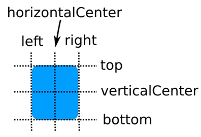

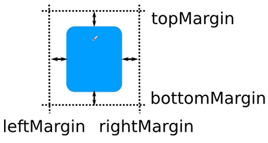

 ### 布局管理器Layouts

是一组在用户界面中用于排列项目的类型，不仅进行布局，而且改变项目的大小，所以更适用于需求改变用户界面大小的应用

`import QtQuick.Layouts`

主要包括RowLayout、ColumnLayout、GridLayout和StackLayout

 **特点**

对齐方式Layout.alignmen

可变大小Layout.fillWidth和Layout.fillHeight

大小约束Layout.minmumWidth、Layout.preferredWidth和Layout.maximumWidth

间距spacing、rowSpacing和columnSpacing

**StackLayout**栈布局管理器

管理多个项目，但只能显示一个项目。通过currentIndex设置当前显示项目，索引号从0开始

## 事件

### 触摸MouseArea

mouseX：real  当前鼠标的X坐标

mouseY：real  当前鼠标的Y坐标

enabled：bool 是否启用事件处理

pressed：bool  鼠标左键是否被按下

propagateComposedEvents：bool  是否允许组合事件

**信号**

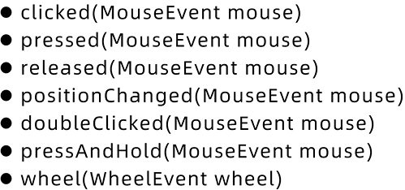

```js
MouseArea {
    anchors.fill: parent
    pressAndHoldInterval: 2000 // 长按时间 默认 800ms
    onPressed: {
        console.log("pressed")
    }
    onReleased: {
        console.log("release")
    }
    onClicked: {
        console.log("click")
    }
    onPressAndHold: {
        console.log("Hold")
    }
    onPositionChanged: {
        console.log(mouseX, mouseY)
    }
}
```

```js
Rectangle {
    width: 200
    height: 100
    color: "lightgray"

    MouseArea {
        anchors.fill: parent
        // 关键：必须启用悬停功能
        hoverEnabled: true

        // 鼠标移入事件
        onEntered: {
            parent.color = "lightblue";
            console.log("Mouse entered the area");
        }

        // 鼠标移出事件
        onExited: {
            parent.color = "lightgray";
            console.log("Mouse exited the area");
        }
    }
}
```

### 鼠标事件MouseEvent

结合MouseArea类型获取鼠标事件

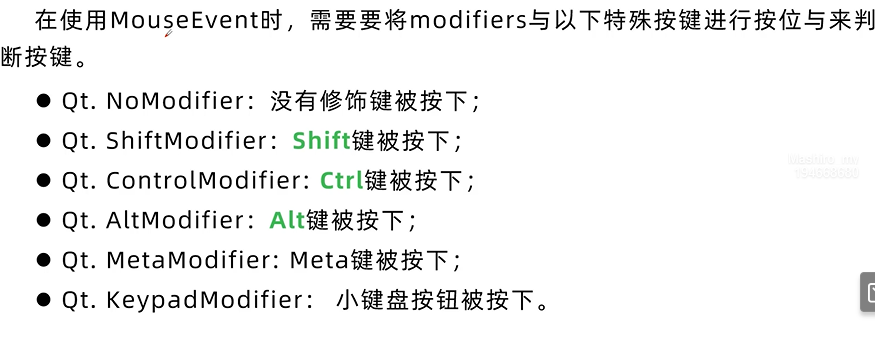

```js
Rectangle {
    width: 200
    height: 200
    color: "red"
    anchors.centerIn: parent

    MouseArea {
        anchors.fill: parent
        // 接收鼠标左键或者右键
        acceptedButtons: Qt.LeftButton | Qt.RightButton | Qt.MiddleButton

        onClicked: (mouse) => {
           if(mouse.button === Qt.RightButton)
           {
               console.log("right")
           }
           else if(mouse.button === Qt.LeftButton)
           {
               console.log("left")
           }
           else if(mouse.button === Qt.MiddleButton)
           {
               console.log("mid")
           }
        }
    }
}

// 多键盘控制
if((mouse.button === Qt.LeftButton) && (mouse.modifiers & Qt.ShiftModifier))
    {
        
    }
```

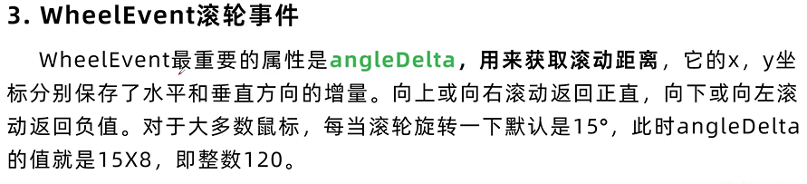

```js
Label {
    id: label1
    font.pixelSize: 18
    anchors.centerIn: parent
    color: "black"
    text: "test"
    width: 200
    height: 200

    MouseArea {
        anchors.fill: parent
        onWheel: (wheel) =>
         {
             if(wheel.modifiers & Qt.ControlModifier)
             {
                 if(wheel.angleDelta.y > 0)
                         {
                             label1.font.pixelSize += 5
                         }
             }
         }
    }
}
```

### 拖拽事件DragEvent

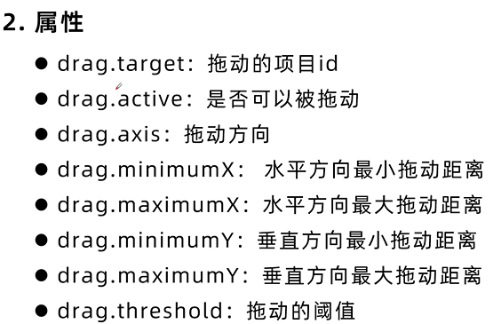

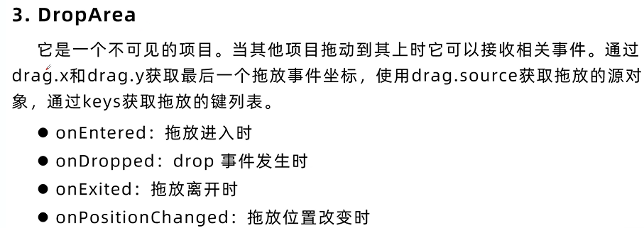

```js
Rectangle {
    id: father
    anchors.fill: parent

    Rectangle {
        id: son
        width: 50
        height: 50
        color: "red"

        MouseArea {
            anchors.fill: parent
            drag.target: son
            drag.axis: Drag.XAndYAxis
            drag.maximumX: father.width - son.width
            drag.minimumX: 0
            drag.maximumY: father.height - son.height
            drag.minimumY: 0
        }
    }
}
```

### 键盘事件KeyEvent

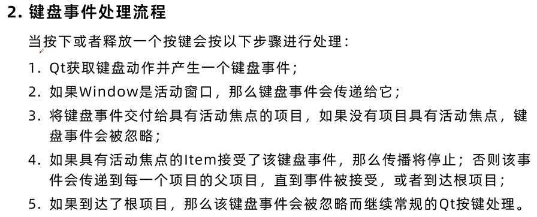

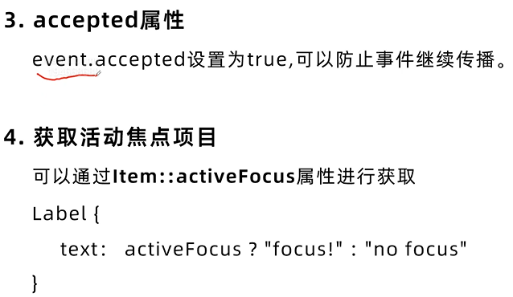

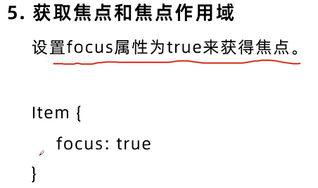

```js
Item {
    focus: true
    
    Label {
        ...
    }

    Keys.onPressed: (event) => {
        if(event.key === Qt.Key_Left)
            {

            }
    }
}
```

### 定时器Timer

```js
Timer {
    interverl: 1000
    repeat: true
    onTriggered: {}
}
```

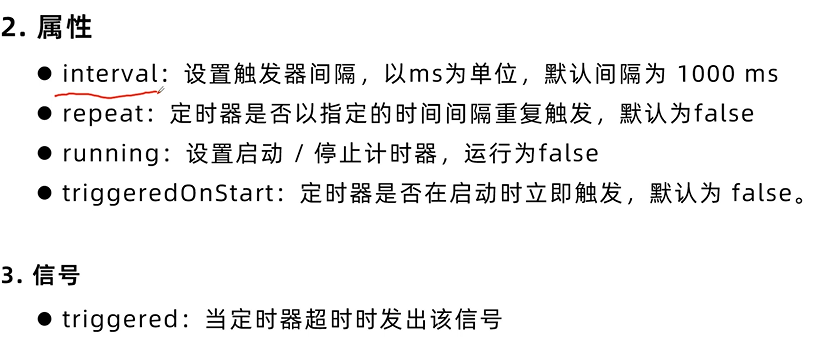

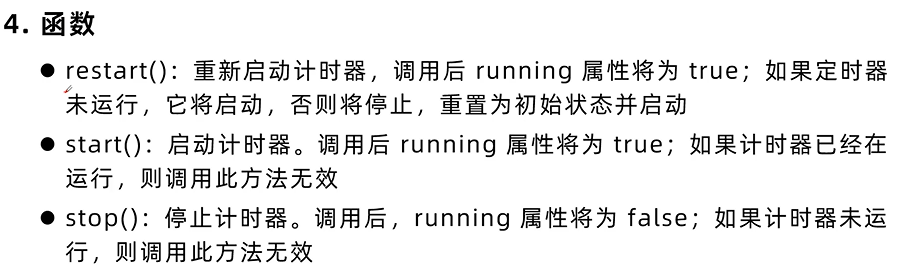

```js
property int num: 1

Label {
    id: label1
    text: num
    font.pixelSize: 32
    anchors.centerIn: parent
}

Timer {
    interval: 1000
    repeat: true
    triggeredOnStart: true
    running: true
    onTriggered: {
        num++
    }
}
```

### 自定义滑动区域SwipeArea

```js
Window {
    width: 640
    height: 480
    visible: true
    title: qsTr("Hello World")

    property int pressedX: 0
    property int pressedY: 0
    property int releasedX: 0
    property int releasedY: 0
    property int temp: 20

    readonly property var modes: {
        "NONE": 0,
        "UP": 1,
        "DOWN": 2,
        "LEFT": 3,
        "RIGHT": 4
    }

    function modeSelect(pX, pY, rX, rY) {
        var deltaX = rX - pX;
        var deltaY = rY - pY;
        var absDeltaX = Math.abs(deltaX);
        var absDeltaY = Math.abs(deltaY);

        if(absDeltaX < temp && absDeltaY < temp) {
            return modes.NONE;
        }

        if (absDeltaX > absDeltaY) {
            if (deltaX > 0) {
                return modes.RIGHT;
            } else {
                return modes.LEFT;
            }
        } else {
            if (deltaY > 0) {
                return modes.DOWN;
            } else {
                return modes.UP;
            }
        }
    }

    MouseArea {
        id: myMouseArea
        anchors.fill: parent

        onPressed: (mouse) => {
            pressedX = mouse.x
            pressedY = mouse.y
            console.log("Pressed: "+ mouse.x + " " + mouse.y)
        }
        onReleased: (mouse) => {
            releasedX = mouse.x
            releasedY = mouse.y
            console.log("Released: "+ mouse.x + " " + mouse.y)

            var result = modeSelect(pressedX, pressedY, releasedX, releasedY)

            switch(result)
            {
                case modes.NONE:
                    console.log("NONE")
                    break
                case modes.UP:
                    console.log("UP")
                    break
                case modes.DOWN:
                    console.log("DOWN")
                    break
                case modes.LEFT:
                    console.log("LEFT")
                    break
                case modes.RIGHT:
                    console.log("RIGHT")
                    break
            }
        }
    }
}
```

### loader

用于动态加载qml文件，可以加载qml文件或者组件对象

一般放在主qml文件中切换界面

source

**从加载的项目中接收信号**

任何从被加载的项目中发射的信号都可以使用Connections类型进行接收

```js
Connections {
    target: loader.item
    function onMessage(msg)
    {
        console.log(msg)
    }
}
```

```js
    Loader {
        id: loader
        source: "Home.qml"
    }

    Connections {
        target: loader.item

        function onMessage(msg)
        {
            if(msg === "page1")
            {
                loader.source = "page1.qml"
            }
            else if(msg === "page2")
            {
                loader.source = "page2.qml"
            }
        }
    }
```

## 控件

### window

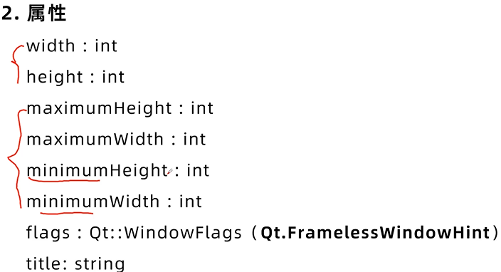

### 应用主窗口ApplicationWindow

ApplicationWindow是window的字类，该类型在window的基础上加了菜单栏menubar、头部header、脚部footer

**属性**

footer：item

header：item

menuBar：item

```js
ApplicationWindow {
    width: 640
    height: 480
    visible: true
    title: qsTr("Hello World")

    menuBar: MenuBar {

    }
    header: ToolBar {

    }
    footer: TabBar {

    }
}
```

### 控件基类型Control

是用户界面控件的基类型，大部分控件都继承自Control，而他又继承于Item，一般不直接使用该类型，而是使用它的众多子控件类型

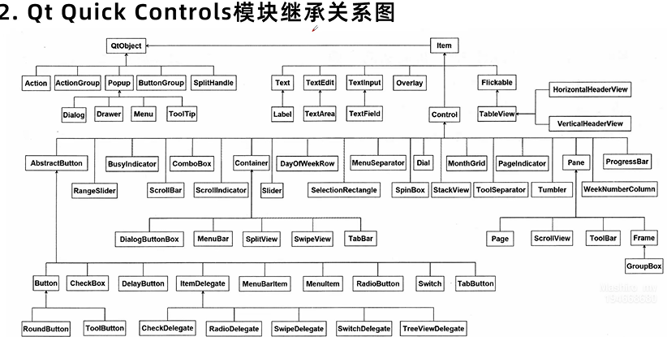

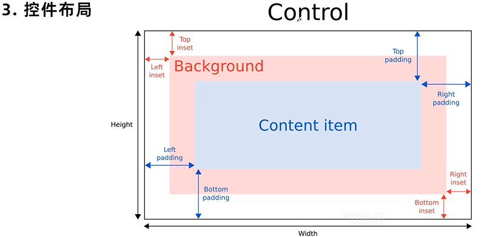

### 按钮button

继承自AbstractButton

**属性**

width:real

height:real

enabled:bool

text:string

down:bool 是否被按下

autoRepeat:bool 是否自动重复功能，按下不放自动触发点击事件

antoRepeatInterval:int  自动重复的时间间隔

**信号**

clicked()

pressed()

released()

doubleClicked()

pressAndHold()

toggled()

**自定义样式**

background：Rectangle{} / Image{}

contentItem：Text{}

**圆角按钮**

RoundButton

```js
Button {
    id: btn2
    x: 230
    y: 10
    width: 200
    height: 50
    text: "button2"
    hoverEnabled: false // 鼠标移入效果
    background: Rectangle {
        implicitWidth: parent.width
        implicitHeight: parent.height
        color: parent.down ? "gray" : "lightgray"
        radius: implicitHeight / 2
    }

    contentItem: Text {
        id: name
        text: qsTr("text")
        font: parent.font
        horizontalAlignment: Text.AlignHCenter
        verticalAlignment: Text.AlignVCenter
    }

}
```

### 复选框checkbox

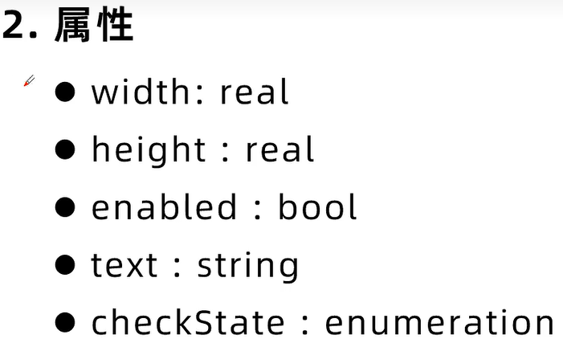

**信号**

checked

**自定义样式**

indicator：Item

```js
CheckBox {
    width: 100
    height: 100
    text: "1"
    checkState: Qt.Checked // 状态，未选中，选中，部分选中
    tristate: true // 三态开启

    onCheckStateChanged: {
        console.log("status" + checkState)
    }

    indicator: Item {
        width: parent.width
        height: parent.height
        Image {
            id: customCheckBoxImage
            source: "./img/btn.png"
        }
        Label {

        }
    }
}
```

### 单选框RadioButton

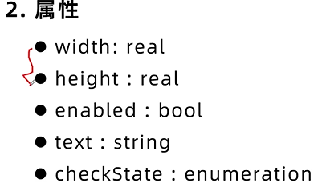

**信号**

checked

**自定义样式**

indicator：Item

```js
ColumnLayout {
    RadioButton {
        checked: true
        text: qsTr("first")
    }
    RadioButton {
        text: qsTr("Second")
    }
    RadioButton {
        text: qsTr("Third")
    }
}
```

### 按钮组ButtonGroup

包含一组互斥的按钮，本身是不可见的，一般是与RadioButton等控件一起使用，如果需要当中的按钮不再互斥，可以设置exclusive为false

**按钮互斥的两种方式**

加入到对应的ButtonGroup

加入到相同的布局

```js
    ButtonGroup {
        id: buttonGroup
        exclusive: true
    }
```

```js
ButtonGroup {
    id: radioBTN
}
RadioButton {
    x: 20
    y: 20
    text: "red"
    ButtonGroup.group: radioBTN
}
RadioButton {
    x: 20
    y: 40
    text: "blue"
    ButtonGroup.group: radioBTN
}
RadioButton {
    x: 20
    y: 60
    text: "green"
    ButtonGroup.group: radioBTN
}
```

### 延时按钮 DelayButton

是一个延时按钮，被选中并发出activated信号之前，有一个延迟，来防止意外按压

**属性**

delay: int

progress: real

transition: Transition

```js
DelayButton {
    x: 20
    y: 20
    width: 200
    height: 50
    delay: 2000
    progress: 0.8
    text: "按钮"

    onActivated: {
       console.log("btn")
    }
}
```

### 开关按钮Switch

**信号**

checked

**信号**

toggle

自定义样式

indicator: item

```js
Switch {
    onCheckedChanged: {
        console.log("check")
    }
    onToggled: {
        console.log("toggle")
    }

    indicator: Image {
        id: name
        source: "file"
    }
}
```

### 进度条ProgressBar

**属性**

from: real  起始

to: real 结束

position: real  0.0 - 1.0

value: real  当前的值

visualPosition: 视觉位置

**自定义样式**

background：Rectangle{}

contentItem: Item{}

```js
ProgressBar {
    id: progressBar
    x: 20
    y: 20
    width: 200
    height: 20
    from: 0
    to: 100
    value: 50

    background: Rectangle {
        implicitHeight: 200
        implicitWidth: 20
        color: "gray"
        radius: 3
    }
    contentItem: Item {
        id: it
        implicitHeight: 200
        implicitWidth: 20
        Rectangle {
            width: progressBar.visualPosition * parent.width
            height: parent.height
            color: "green"
        }
    }
    Label {
        text: progressBar.value + "%"
        color: "white"
        anchors.centerIn: progressBar
    }
}
```

### 忙碌指示器 BusyIndicator

指示正在加载或者等待资源等情况，在需要等待的情况下将running属性设置为true即可

**属性**

running：bool

```js
    BusyIndicator {
        x: 20
        y: 20
        anchors.centerIn: parent
        running: false
    }
```

### 下拉框ComboBox

填充的数据模型通常是ListModel，整数或者JavaScript数组

**属性**

count:int 下标从0开始

currentIndex: int 当前下标

currentText: string 当前选择文本

delegate: component  代理，显示数据和model

editable: bool 是否可编辑

indicator: Item 自定义样式 状态

model: model  数据

popup: popup 弹出选项列表

```js
    ComboBox {
        id: comboBox
        x: 20
        y: 20
        // editable: true
        model: ListModel {
            id: model
            ListElement { text: "apple" }
            ListElement { text: "banana" }
            ListElement { text: "coconut" }
        }

        background: Rectangle {
            implicitHeight: 40
            implicitWidth: 120
            color: "white"
            border.width: 1
            border.color: "#21BE2B"
            radius: 4

        }

        indicator: Image {
            id: name
            source: "file"
        }

        contentItem: Text {
            leftPadding: 12
            rightPadding: comboBox.indicator.width + comboBox.spacing
            topPadding: 5
            bottomPadding: 5
            text: comboBox.displayText
            font.pixelSize: 18
            font.bold: true
            color: comboBox.pressed ? "red" : "green"
            verticalAlignment: Text.AlignVCenter
            elide: Text.ElideRight
        }
        popup: Popup {
            y: comboBox.height - 1
            width: comboBox.width
            implicitWidth: contentItem.implicitWidth
            padding: 1

            contentItem: ListView {
                clip: true
                implicitHeight: contentHeight
                model: comboBox.popup.visible ? comboBox.delegateModel : null
                currentIndex: comboBox.highlightedIndex
            }

            background: Rectangle {
                color: "white"
                border.width: 1
                border.color: "#21BE2B"
                radius: 4
            }
        }
    }
```

### 旋钮Dial

类似拨号旋钮样式，用于显示或设置指定范围内的值

**属性**

from: real

to: real

value: real

stepSize: real

handle: item

snapMode: enumeration

**自定义样式**

background：Rectangle{}

handle: Rectangle{}

### 滑动条Slider

**属性**

from: real

to: real

value: real

orientantion: enumeration  方向

stepSize: real  步幅

touchDragThreshold: qreal  滑动的阈值

**信号**

onValueChanged()

**自定义样式**

background： Rectangle{}

handle: item{}

```js
Slider {
        id: slider
        x: 20
        y: 20
        width: 200
        height: 20
        from: 0
        to: 100
        stepSize: 10
        // orientation: Qt.Vertical

        onValueChanged: {
            console.log("value" + value)
        }

        background: Rectangle {
            x: slider.leftPadding
            y: slider.topPadding +slider.availableHeight / 2 - height / 2
            implicitWidth: 200
            implicitHeight: 4
            width: slider.availableWidth
            height: implicitHeight
            color: "gray"
            radius: 4

            Rectangle {
                width: slider.visualPosition * slider.width
                height: parent.height
                color: "green"
                radius: 4
            }
        }

        handle: Rectangle {
            x: slider.leftPadding + slider.visualPosition * (slider.availableWidth - width)
            y: slider.topPadding + slider.availableHeight / 2 - height / 2
            implicitWidth: 20
            implicitHeight: 20
            width: 20
            height: 20
            radius: height / 2
            color: "green"
        }
}
```

### 数值输入器SpinBox

**属性**

from: real

to: real

value: real

stepSize: real

**信号**

onValueChanged()

### 滚轮Tumbler

从旋转的项目中旋转一个选项，提供现成的数据选项，当有大量项目时，可以首尾相连

**属性**

currentIndex: int

delegate: component

model: variant

```js
Component {
    id: tumblerCom

    Label {
        text: "1"
        horizontalAlignment: Text.horizontalAlignment
        verticalAlignment: Text.verticalAlignment

    }
}

Tumbler {
    width: 50
    height: 200
    model: 5
    delegate: tumblerCom
}
```

### 单行文本编辑器 TextField

继承自TextInput，添加了占位符文本功能

**回显**

TextInput.Normal

TextInput.Password

**信号处理器**

onEditingFinished()

onTextEdited()

**自定义样式**

background: item

```js
    TextField {
        width: 200
        height: 50
        x: 50
        y: 50
        color: "black"
        font.pixelSize: 32
        verticalAlignment: Text.AlignVCenter
        horizontalAlignment: Text.AlignHCenter
        placeholderText: "ENTER"
        echoMode: TextInput.Password
    }
```

### 多行文本编辑器 TextArea

继承自TextEdit，添加了占位符功能，可以将其放入ScrollView中来实现滚动条

**属性**

color: color

contentWidth: real 内容宽度

font.family: string 字体

padding: real 间距

selectionColor: color 选择背景色

selectionTextColor: color 选中文字色

wrapMode: enumeration 换行模式

**信号**

onEditingFinished()

onTextEdited()

**自定义样式**

background: item

```js
ScrollView {
    width: 300
    height: 200
    TextArea {
        anchors.centerIn: parent
        leftPadding: 10
        rightPadding: 10
        font.pixelSize: 32
        wrapMode: TextEdit.Wrap

        background: Rectangle {
            implicitHeight: parent.height
            implicitWidth: parent.width
            radius: 4
            color: "white"
            border.width: 1
            border.color: "green"
        }

        onTextChanged: {

        }
    }
}
```

### 边框容器Frame

继承自Pane，提供了一个边框，具有分组功能

**属性**

width: real

height: real

**自定义样式**

background：Rectangle{}

```js
    Frame {
        ColumnLayout {
            anchors.fill: parent
            CheckBox { text: "email" }
            CheckBox { text: "1" }
            CheckBox { text: "2" }
        }
    }
```

### 组容器GroupBox

继承自Frame，在此基础上添加一个标题，提供一个边框，具有分组功能

**属性**

width：real

height：real

title：string

**自定义样式**

background：Rectangle{}

```js
GroupBox {
    x: 50
    y: 20
    width: 200
    title: "GroupBox"
    ColumnLayout {
        anchors.fill: parent
        CheckBox{ text: "1" }
        CheckBox{ text: "2" }
        CheckBox{ text: "3" }
    }
}
```

### 滑动视图SwipeView

提供基于滑动的导航模型

由一组页面进行填充，一次只能看到一页，通过横向/竖向滑动在页面之间导航

一般和PageIndicator结合提供多页面提示

不建议添加过多页面，会资源卡顿

**属性**

orientation：enumeration

**页面指示器 PageIndicator**

**属性**

count：int

currentIndex：int

interactive：bool

**自定义样式**

delegate：Rectangle{}

**信号**

onCurrentIndexChange

```js
PageIndicator { // 页面指示器
    id: pagei
    count: swipeView.count
    currentIndex: swipeView.currentIndex
    anchors.bottomMargin: 120
    anchors.bottom: parent.bottom
    anchors.horizontalCenter: parent.horizontalCenter
}

SwipeView {
    id: swipeView
    anchors.fill: parent

    Page1 {
        id: page1
    }

    Page2 {
        id: page2
    }

    Page3 {
        id: page3
    }
}
```

### 滚动视图 ScrollView

继承自Pane，提供垂直滚动条和水平滚动条，可以展示更多内容

**属性**

ScrollBar.horizontal.policy: ScrollBar.AlwaysOff

ScrollBar.vertical.policy: ScrollBar.Alwaysoff

### 分割视图 SplitView

用来水平或者垂直布局项目，每个项目之间有一个可拖动的拆分器，主要用来分割不同的区域

**自定义样式**

handle

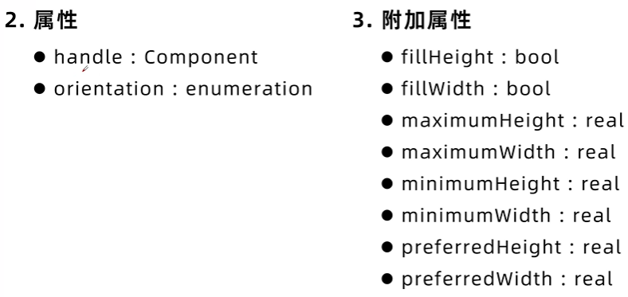

```js
    SplitView {
        id: splitview
        anchors.fill: parent

        Rectangle {
            id: rect1
            implicitWidth: 200
            SplitView.maximumWidth: 400
            color: "blue"
            Label {
                text: "View 1"
                anchors.centerIn: parent
            }
        }

        Rectangle {
            id: rect2
            implicitWidth: 200
            SplitView.maximumWidth: 400
            color: "green"
            Label {
                text: "View 2"
                anchors.centerIn: parent
            }
        }

        Rectangle {
            id: rect3
            implicitWidth: 200
            SplitView.maximumWidth: 400
            color: "yellow"
            Label {
                text: "View 3"
                anchors.centerIn: parent
            }
        }
    }
```

```js
import QtQuick
import QtQuick.Controls
import QtQuick.Layouts
import QtCore

Window {
    width: 640
    height: 480
    visible: true
    title: qsTr("Hello World")


    Component.onCompleted: splitview.restoreState(settings.splitview)
    Component.onDestruction: settings.splitview = splitview.saveState()

    Settings {
        id: settings
        property var splitview
    }

    SplitView {
        id: splitview
        anchors.fill: parent

        Rectangle {
            id: rect1
            SplitView.preferredWidth: 200
            SplitView.maximumWidth: 400
            color: "blue"
            Label {
                text: "View 1"
                anchors.centerIn: parent
            }
        }

        Rectangle {
            id: rect2
            SplitView.preferredWidth: 200
            SplitView.maximumWidth: 400
            color: "green"
            Label {
                text: "View 2"
                anchors.centerIn: parent
            }
        }

        Rectangle {
            id: rect3
            SplitView.preferredWidth: 200
            SplitView.maximumWidth: 400
            color: "yellow"
            Label {
                text: "View 3"
                anchors.centerIn: parent
            }
        }
    }
}

```

### 栈视图 StackView

将多个页面放在一个栈中，可以实现页面先进后出

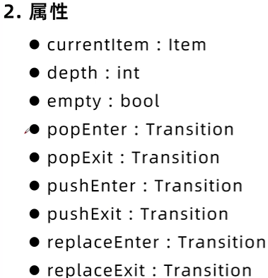

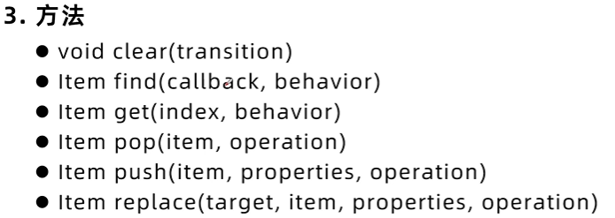

### 选项卡 TabBar

提供一个基于选项卡的导航模型，一般和SwipeView或者stackLayout等提供currentIndex属性的类型同时使用

**属性**

currentIndex： int

```js
header: ToolBar {
	RowLayout {
		ToolButton {
			text: "Home"

			onClicked: swipeView.setCurrentIndex(0)
			enabled: swipeView.currentIndex !== 0
		}
		ToolButton {
			text: "<"
			// 自动 -1
			onClicked: swipeView.decrementCurrentIndex(0)
			enabled: swipeView.currentIndex > 0
		}
		ToolButton {
			text: ">"
			// 自动 +1
			onClicked: swipeView.incrementCurrentIndex(0)
			enabled: swipeView.currentIndex < swipeView.count - 1
		}
	}
}

SwipeView {
	id: swipeView
	implicitWidth: parent.width
	height: 200
	background: Rectangle {
		color: "lightblue"
	}
	currentIndex: tabBar.currentIndex

	Repeater {
		model: 5
		Loader {
			active: SwipeView.isCurrentItem ||
					SwipeView.isNextItem ||
					SwipeView.isPreviousItem
			sourceComponent: Text {
						text: qsTr("页面") + (index + 1)
					}
		}
	}

}

TabBar {
	id: tabBar
	width: parent.width
	currentIndex: swipeView.currentIndex
	anchors.top: swipeView.bottom
	anchors.topMargin: 5

	Repeater {
		model: ["1", "2", "3", "4", "5"]

		TabButton {
		   text: modelData
		   width: Math.max(100, tabBar.width / 5)

		}
	}
}
```

### 项目代理 ItemDelegate

用来表示一个标准的视图项，继承自AbstractButton，可以用作各种视图中的代理，是代理类控件的基类型

**属性**

highlighted：bool

**信号处理器**

onClicked: {}

```js
ListView {
	width: 320
	height: 240
	focus: true
	model: Qt.fontFamilies()
	anchors.centerIn: parent

	delegate: ItemDelegate {
		text: modelData
		highlighted: ListView.isCurrentItem

		onClicked: {
			console.log("click: " + modelData)
		}
	}

	ScrollIndicator.vertical: ScrollIndicator{}
}
```

### 按钮类代理 ButtonDelegate
- CheckDelegate 提供一个类似checkBox的项目委托，可以进行选中或取消选中，用于列表中的一组选项中选择一个或多个选项
- RadioDelegate 提供一个类似于RadioButton的项目委托，可以进行选中或取消选中，用于从一组选项中选择一个选项
- SwitchDelegate 提供一个类似于Switch的项目委托，可以进行选中或取消选中，用于从一组选项中选择一个或多个选项


**信号处理器**

onCheckedChanged: {}

```js
    ListView {
        width: 140
        height: 240
        model: ["1", "2", "3"]

        delegate: CheckDelegate {
            text: modelData

            onCheckedChanged: console.log("check" + checked)
        }
    }
```

### 滑动代理 SwipeDelegate

继承自ItemDelegate，提供一个视图项，实现向左或向右滑动以显示更多选项或信息，一般在ListView等视图中用作委托

**属性**

swipe.enabled: bool
swipe.behind: Component  滑动样式
swipe.left: Component 左滑样式
swipe.right: Component
swipe.transition: Transition  滑动动画样式

```js
ListView {
	id: listView
	anchors.fill: parent
	model: ListModel {
		ListElement { sender: "Bob Bobbleton"; title: "How are you going?" }
		ListElement { sender: "Rug Emporium"; title: "SALE! All rugs MUST go!" }
		ListElement { sender: "Electric Co."; title: "Electricity bill 15/07/2016 overdue" }
		ListElement { sender: "Tips"; title: "Five ways this tip will save your life" }
	}
	delegate: SwipeDelegate {
		id: swipeDelegate
		text: sender + " - " + title
		width: listView.width

		required property string sender
		required property string title
		required property int index

		ListView.onRemove: SequentialAnimation {
			PropertyAction {
				target: swipeDelegate
				property: "ListView.delayRemove"
				value: true
			}
			NumberAnimation {
				target: swipeDelegate
				property: "height"
				to: 0
				easing.type: Easing.InOutQuad
			}
			PropertyAction {
				target: swipeDelegate
				property: "ListView.delayRemove"
				value: false
			}
		}

		swipe.right: Label {
			id: deleteLabel
			text: qsTr("Delete")
			color: "white"
			verticalAlignment: Label.AlignVCenter
			padding: 12
			height: parent.height
			anchors.right: parent.right

			SwipeDelegate.onClicked: listView.model.remove(index)

			background: Rectangle {
				color: deleteLabel.SwipeDelegate.pressed ? Qt.darker("tomato", 1.1) : "tomato"
			}
		}
	}
}
```

### 菜单Menu

继承自Popup

**属性**

menuitem: MenuItem

icon.source: url

title: string

**信号**

onClicked: {}

**分割线**

MenuSeparator {}

**Action{}**

onTriggered:{}

```js
MouseArea {
	anchors.fill: parent
	acceptedButtons: Qt.LeftButton | Qt.RightButton

	onClicked: {
		if(mouse.button === Qt.RightButton)
		{
			popMenu.popup() // 弹出 当前位置 open是原点位置
		}
	}
}

Menu {
	id: popMenu
	MenuItem {
		text: "Cut"
		icon.source: ""
		onClicked: console.log("Cut")
	}
	MenuItem { text: "Copy" }
	MenuSeparator {}
	Menu {
		title: "二级菜单"
		MenuItem { text: "Copy" }
	}
}
```

### 抽屉控件 Drawer

类似抽屉的侧面板控件，可以放在窗口的上下左右任意一个边缘

**属性**

drawMargin: real

edge: enumeration  上下左右

position: real

```js
Label {
	id: label
	text: "QT"
	font.pixelSize: 32
	anchors.fill: parent
	verticalAlignment: Text.AlignVCenter
	horizontalAlignment: Text.AlignHCenter

	transform: Translate {
		x: draw.position * label.width * 0.33
	}
}

Drawer {
	id: draw
	width: window.width * 0.33
	height: window.height
	dragMargin: 50
	edge: Qt.LeftEdge
}
```


### 弹出控件 Popup

Popup 是弹出窗口类用户界面控件的基本类型，不提供自己的布局

通常情况下使用附加属性 Overlay 将弹出窗口显示在界面中心，而不考虑打开窗口的位置

Overlay是覆盖整个窗口的一个普通项目，为弹出窗口提供一个层，确保弹出窗口显示在其他内容之上，当弹出窗口为模态（modal属性为true）或将dim属性设置为true，弹出窗口可见时背景会变暗


**属性**

width: real

height: real

background: item

modal: bool   模态

closePolicy: enumeration  退出策略

**信号**

void closed()

void opened()

```js
Button {
	id: deleteBtn
	width: 100
	height: 50
	font.pixelSize: 32
	anchors.left: parent.left
	anchors.bottom: parent.bottom
	anchors.leftMargin: 50
	anchors.bottomMargin: 50
	text: "删除"

	onClicked: {
		popup.open()
	}
}

Popup {
	id: popup
	width: parent.width / 2
	height: parent.height / 2
	modal: true

	anchors.centerIn: parent

	// 模态周围的颜色
	Overlay.modal: Rectangle {
		id: overlay
		color: "#80111111"
	}
}
```


### 日期控件 Date

MonthGrid：将天气显示为一个表格

DayOfWeekRow：将星期显示为一行

WeekNumberColumn：在一列中显示给定年、月的周数

都继承于Control

**属性**
- delegate：Component
- locale：Locale
- month：int
- year：int

### 分隔控件 Separator

分隔控件用来分隔选项

MenuSeparator {}

ToolSeparator {}


### 设置控件样式 QuickStyle

编译时选择样式


**运行时选择样式**

工程文件.pro添加模块
QT += quick quickcontrols2

main.cpp
`#include <QQuickStyle>`

设置样式
```js
QQuickStyle::setStyle("Windows")
engine.load(url)
```

### 自定义控件 QuickToast

是继承于Popup自定义简易的消息提示框，永远不会获得焦点，无法被点击


**属性**

property color backgroundColor: "#B4191821"

property color textColor: "#FFFFFF"

property int fontPixelSize: 16

property int delay: 2000

自定义一个popup，模拟安卓的toast

## 对话框

### 消息对话框 MessageDialog

MessageDialog继承自Dialog，它为系统对话框提供了QML API，buttons属性用来设置按钮

**属性**

title: string

buttons: flags

text: string

informativeText: string

**信号**

onButtonClicked

```js
Button {
	width: 100
	height: 50
	text: "打开"

	onClicked: {
		messageDialog.open()
	}
}

MessageDialog {
	id: messageDialog
	title: "对话框"
	text: "内容"
	informativeText: "确认信息"
	buttons: MessageDialog.Ok | MessageDialog.Cancel

	onButtonClicked: function (button, role) {
		console.log(button)
		console.log(role)
	}
}
```

### 文件对话框 FileDialog

FileDialog 继承自 Dialog，为系统文件对话框提供了QML API，用于获取选择的文件或多个文件，可以自定义acceptLabel和rejectLabel按钮显示文本

**属性**

`nameFilters: list<string>`  文件过滤器

selectedFile: url  选择文件路径

fileMode: enumeration  选择1个或者多个文件

acceptLabel: string  选择文件按钮文字

rejectLabel: string 取消按钮文件

**信号**

onAccepted: {}

```js
FileDialog {
	id: fileDialog
	acceptLabel: "1"
	rejectLabel: "2"
	fileMode: FileDialog.OpenFiles
	nameFilters: ["图片 (*.jpg)", "HTML files (*.html *.htm)"]
	onAccepted: {
		console.log(selectedFile)
		image.source = selectedFile
	}
}

Button {
	id: btn
	width: 100
	height: 50
	text: "打开"

	onClicked: {
		fileDialog.open()
	}
}

Image {
	id: image
	source: "file"
	width: parent.width * 0.9
	height: parent.height * 0.9
	fillMode: Image.PreserveAspectFit
}
```

### 目录对话框 FolderDialog

可自定义acceptLabel 和 rejectLabel

**属性**

acceptLabel: string

rejectLabel: string

currentFolder: url

**信号**

onAccepted: {}

```js
Button {
	id: btn
	width: 100
	height: 50
	text: "打开"

	onClicked: {
		folderDialog.open()
	}
}

FolderDialog {
	id: folderDialog
	acceptLabel: "选择"
	rejectLabel: "取消"

	onAccepted: {
		console.log(currentFolder)
	}
}
```

### 字体对话框 FontDialog

获取选择的字体

**属性**

currentFont: font

**信号**

onAccepted: {}

```js
Button {
	id: btn
	width: 100
	height: 50
	text: "打开"

	onClicked: {
		fontDialog.open()
	}
}

FontDialog {
	id: fontDialog

	onAccepted: {
		console.log(currentFont)
	}
}
```

### 颜色对话框 ColorDialog

```js
Button {
	id: btn
	width: 100
	height: 50
	text: "打开"

	onClicked: {
		colorDialog.open()
	}
}

ColorDialog {
	id: colorDialog

	onAccepted: {
		console.log(selectedColor)
	}
}
```

## 图片

### 颜色color

**函数**

color darker(color baseColor, real factor)  变暗，影响因子
color lighter(color baseColor, real factor)  变亮

### 渐变 Gradient

使用一组GradientStop子项目指定颜色，每个GradientStop子项目都在渐变中指定一个位置和一个颜色，通过orientation设置渐变方向

渐变对硬件性能要求较高

**属性**

orientation：enumeration

**GradientStop 属性**

color：color

position：real

```js
Rectangle {
	anchors.fill: parent

	gradient: Gradient {
		orientation: Gradient.Vertical
		GradientStop {
			position: 0.0
			color: "#FF0000"
		}
		GradientStop {
			position: 1.0
			color: "#FF00FF"
		}
	}
}
```

### 图片 Image

通过source属性指定可以是绝对路径或相对路径

**属性**

width : real
height：real
source: url
sourceSize: size   设置加载图片时每次加载多少
fillMode: enumeration  填充模式
asynchronous: bool  异步，防止界面卡住
status: enumeration   当前图片加载状态
mirrir: bool  镜像图片
smooth: bool  平滑过度
sourceClipRect: rect  裁剪

**信号**

onStatusChanged: {}

```js
Image {
	id: jpgImage
	source: "file"
	fillMode: Image.PreserveAspectFit
}
```


### 动态图片 AnimatedImage

该类型扩展了Image类型，用来播放序列帧动画图片，比如gif或webp

**属性**

width : real
height：real
source: url
sourceSize: size   设置加载图片时每次加载多少
fillMode: enumeration  填充模式
asynchronous: bool  异步，防止界面卡住
status: enumeration   当前图片加载状态
mirrir: bool  镜像图片
smooth: bool  平滑过度
sourceClipRect: rect  裁剪

currentFrame：int
frameCount：int
paused：bool
playing：bool
speed：real

**信号**

onStatusChanged: {}
onCurrentFrameChanged: {}

```js
AnimatedImage {
	id: gifImage
	source: "file"
	fillMode: Image.PreserveAspectFit

	onCurrentFrameChanged: {
		console.log("当前多少帧 " + currentFrame)
	}
}
```

### 图片属性变换

Image继承Item，可以属性变换，主要包括 缩放、角度旋转、比例、3D坐标旋转等

**变换属性**

rotation：real 旋转
scale：real  缩放  缩放
`transform：list<Transform>`


```js
Image {
	id: image
	
	property real mXScale: 1 // 不能直接改XScale
	property real mAngle: 1
	transform {
		Scale {  缩放
			origin.x: 25 // 原点
			origin.y: 25
			xScale: image.mXScale  // 缩放因子
		}
		
		Rotation {  旋转
			origin.x: 20
			origin.y: 20
			axis {x: 0; y: 1; z: 0}  轴线
			angle: image.mAngle
		}
	}
}
```


### 状态 State

所有基于Item的对象都有一个state属性，用于描述项目的当前状态，可以通过向项目的states属性添加新的State对象指定附加状态，组建的每一个状态都有一个唯一的名称，默认值为空字符串

要改变一个项目的当前状态，可以将state属性设置为要改变的状态的名称

对于不是Item派生的对象，可以通过StateGroup类型来使用状态
不同的状态间进行切换时可以使用过渡Transitions来实现动画效果


**属性**

name: string  自定义状态名字
when: bool

**信号**

PropertyChanges {}

```js
Rectangle {
	id: rectangle
	width: 100
	height: 100

	states: [
		State {
			name: "red_color"
			PropertyChanges {
				target: rectangle
				color: "red"
			}
		},
		State {
			name: "blue_color"
			PropertyChanges {
				target: rectangle
				color: "blue"
			}
		}
	]
}

Button {
	id: btn
	width: 200
	height: 50
	x: 10
	y: 150

	onClicked: {
		rectangle.state = "red_color"
	}
}
```


## 动画

```js
classDiagram
    class Animation {
        (基类)
    }
    class PropertyAnimation {
        (属性动画基类：万金油)
    }
    
    Animation <|-- PropertyAnimation
    
    PropertyAnimation <|-- ColorAnimation : 颜色
    PropertyAnimation <|-- NumberAnimation : 数字
    PropertyAnimation <|-- RotationAnimation : 旋转(带方向)
    PropertyAnimation <|-- Vector3dAnimation : 3D向量
    
    NumberAnimation <|-- SpringAnimation : 物理弹簧
    NumberAnimation <|-- SmoothedAnimation : 平滑追踪
```


### 属性动画 PropertyAnimation

属性对话PropertyAnimation继承自Animation，是针对属性值应用的动画对象，可以随时间的推移逐渐改变属性值，原理是在设置的两个属性值之间进行插值，形成平滑的变化效果

属性动画提供了时间控制，并且可以使用缓和曲线 easing 进行不同的插值

**Animation属性**

alwaysRunToEnd：bool  保持动画运行到结束
loops：int  循环次数
paused：bool  暂停
running：bool  运行

**Animation信号**

finished()
started()
stopped()

**Animation函数**

complete()   完成
pause()  暂停
restart()  
resume()  暂停
start()
stop()

**PropertyAnimation属性**

target：QtObject
`targets: list<QtObject>`
properties: string
property: string
duration: int  持续时间
from: variant
to: variant
easing  动画曲线

**NumberAnimation属性**

继承自PropertyAnimation
from: real
to: real


```js
Image {
	id: image
	width: 256
	height: 256
	source: "qt_logo_256x256.png"
	anchors.centerIn: parent
	fillMode: Image.PreserveAspectFit
	opacity: 0.1

	MouseArea {
		anchors.fill: parent
		onClicked: {
			animation.start()
			numberAnimation.start()
		}
	}

	PropertyAnimation {
		id: animation
		target: image
		properties: "opacity"
		to: 1.0
		duration: 1000
	}

	NumberAnimation {
		id: numberAnimation
		target: image
		properties: "rotation"
		from: 0
		to: 360
		loops: Animation.Infinite
		duration: 1000
		easing.type: Easing.InOutElastic;
	}
}
```

### 预定义的目标和属性动画

使用`<Animation> on <Property>` 语法可以实现预定义的目标和属性动画，不需要指定target和property属性

这种语法适用于组合动画中，从而保证一组动画都应用在相同属性

```js
    Rectangle {
        id: rect1
        anchors.fill: parent
        color: "blue"

        SequentialAnimation on color {
            ColorAnimation {
                from: "blue"
                to: "violet"
                duration: 2000
            }
        }
    }
```

### 过渡动画 Transition

对称或其他简单过渡，可以将to属性设置为通配符`*`

```js
    Rectangle {
        id: rect1
        anchors.fill: parent

        MouseArea {
            anchors.fill: parent
            onPressed: rect1.state = "PRESSED"
            onReleased: rect1.state = "RELEASE"
        }

        states: [
            State {
                name: "PRESSED"
                PropertyChanges {
                    target: rect1
                    color: "dark"
                }
            },
            State {
                name: "RELEASE"
                PropertyChanges {
                    target: rect1
                    color: "green"
                }
            }
        ]

        transitions: [
            Transition {
                from: "PRESSED"
                to: "RELEASE"

                ColorAnimation {

                    duration: 500
                }
            },
            Transition {
                from: "RELEASE"
                to: "PRESSED"

                ColorAnimation {

                    duration: 500
                }
            }
        ]
    }
```


### 默认行为动画 Behavior

使用`<Behavior> on <Property>`语法可以实现默认行为动画

Behavior可以指定具体的属性，如果在Behavior类型中使用了动画，当这个属性的值改变时都会应用动画

```js
    MouseArea {
        anchors.fill: parent

        onClicked: {
            circle.color = Qt.rgba(Math.random(256),
                                   Math.random(256),
                                   Math.random(256),
                                   1)

            circle.x += 50
            circle.y += 50
        }
    }

    Rectangle {
        id: circle
        width: 100
        height: 100
        radius: height / 2
        color: "lightgreen"
        border.color: "black"

        Behavior on x {
            NumberAnimation {
                id: behavior
                // property: "color"
                duration: 1000
                easing.type: Easing.InOutElastic;
                easing.amplitude: 2.0;
                easing.period: 0.5
            }
        }
        Behavior on y {
            animation: behavior
        }

        Behavior on color {
            ColorAnimation {
                target: circle
                duration: 1000
            }
        }
    }
```


### 并行动画和序列动画 ParallelAndSequentialAnimation

并行动画使用一组动画在同一时间同时执行
序列动画使一组动画一次执行
都继承于Animation

```js
Window {
    id: window
    width: 640
    height: 480
    visible: true
    title: qsTr("Hello World")

    Rectangle {
        id: rect1
        x: 0
        y: 0
        width: 100
        height: 100
        color: "red"
    }

    Rectangle {
        id: rect2
        x: 100
        y: 100
        width: 50
        height: 50
        color: "green"
    }

    Button {
        id: btn1
        width: 100
        height: 50
        anchors.left: parent.left
        anchors.leftMargin: 100
        anchors.bottom: parent.bottom
        text: "并行动画"
    }

    ParallelAnimation {
        id: parallelAnimation
        running: btn1.pressed

        NumberAnimation {
            target: rect1
            property: "x"
            from: 0
            to: window.width - rect1.width
            duration: 200
            easing.type: Easing.InOutQuad
        }
        NumberAnimation {
            target: rect1
            property: "y"
            from: 0
            to: window.height - rect1.height
            duration: 200
            easing.type: Easing.InOutQuad
        }
    }

    Button {
        id: btn2
        width: 100
        height: 50
        anchors.right: parent.right
        anchors.rightMargin: 100
        anchors.bottom: parent.bottom
        text: "序列动画"
    }

    SequentialAnimation {
        id: sequentialAnimation
        running: btn2.pressed

        NumberAnimation {
            target: rect2
            property: "x"
            from: 100
            to: window.width - rect1.width
            duration: 200
            easing.type: Easing.InOutQuad
        }
        NumberAnimation {
            target: rect2
            property: "y"
            from: 100
            to: window.height - rect1.height
            duration: 200
            easing.type: Easing.InOutQuad
        }
    }
}
```


### 动画师动画 Animator

继承于Animation，在UI线程阻塞的情况下仍然能通过图形系统的渲染线程来工作，比传统的基于对象和属性的Animation元素能带来更好的用户视觉体验，

不能直接使用Animator，但可以使用他的子类

**动画师子类型**

XAnimator
YAnimator
ScaleAnimator
OpactityAnimator
RotationAnimator
UnifromAnimator  

```js
    Rectangle {
        id: rect1
        x: 0
        y: 0
        width: 100
        height: 100
        color: "red"

        XAnimator on x {
            from: 0
            to: 300
            duration: 500
            loops: Animation.Infinite
        }
    }
```


### 精灵动画 SpriteAnimations

一般用于游戏动画，
精灵动画可以使用Sprite类型，使用source为动画指定图片，使用frameWidth和frameHight属性指定每帧大小，图片可以分为多个连续的行或者矩形帧，当一行的帧使用完则会自动使用下一行的帧，使用frameX和frameY指定开始帧位置

goalSprite属性可以指定目标Sprite类型，指定该属性后会无视过渡权重，而以最短路径达到目标动画

to属性可以设置要过渡到的精灵的名称和权重

SpriteSequence类型使用精灵引擎绘制定义在它里面的Sprite


### 动态精灵动画 AnimatedSprite

不需要在动画之间进行过渡的场景，一次只能显示一个精灵动画，没有包含精灵引擎来出来幕后的时间线和过渡，该类型提供了更多的手工控制，包括设置播放循环次数，提供播放、暂停、开始、结束等方法来控制动画的执行


### 弹动效果Flickable

基于触摸的用户界面，可以将其子项目添加在一个可以拖拽和弹动的界面，当用户已经停止触摸后，它还会继续滚动并做出反弹的动作，通过视图的滚动来显示更多内容

子类包括 ListView GridView 和 tableView等视图类型

FlickAble内的项目不能使用anhors锚定，项目的大小由contentWidth和contentHeight决定，可以使用x,y坐标指定项目位置

**属性**

contentHeight: real
contentWidth: real
clip: bool   裁剪
flickDeceleration: real    滑动释放后减速的阈值  弹动灵敏度  摩擦力
flickableDirection: enumeration   滑动的方向
horizontalVelocity: real     水平速度
verticalVelocity: real   垂直速度
maximumFlickVelocity: real   弹动最大速度
rebound: Transition  回弹动画

**信号**

flickEnded() 弹动结束  抖动，太慢不会产生 
flickStarted()  弹动开始
movementEnded()  滚动结束   用的多
movementStarted()   滚动开始  用的多

```js
Window {
    id: window
    width: 600
    height: 900
    visible: true
    title: qsTr("Hello World")

    property int contentHeight: 2000
    property int contentWidth: window.width * 0.9

    Label {
        text: "标题"
        width: parent.width
        height: 60
        font.pixelSize: 50
        anchors.horizontalCenter: parent.horizontalCenter
        horizontalAlignment: Label.AlignHCenter
        y: 0
        color: "black"
        background: Rectangle {
            implicitWidth: parent.width
            implicitHeight: parent.height
            color: "lightblue"
        }
    }

    Flickable {
        id: flickable
        width: window.width
        height: window.height
        y: 60
        clip: true  // 裁剪 超出隐藏
        contentWidth: window.width
        contentHeight: window.contentHeight
        flickDeceleration: 0.01

        rebound: Transition {
            NumberAnimation {
                properties: "x, y"
                duration: 1000
                easing.type: Easing.OutBounce
            }
        }

        Item {
            id: item
            width: window.contentWidth
            height: window.contentHeight
            x: (window.width - width) / 2
            y: 20

            Rectangle {
                id: rect1
                width: parent.width
                height: 360
                radius: 20
                color: "lightgreen"

                Label {
                    text: "1"
                    font.pixelSize: 32
                    anchors.centerIn: parent
                }
            }

            Rectangle {
                id: rect2
                width: parent.width
                height: 360
                anchors.top: rect1.bottom
                anchors.topMargin: 20
                radius: 20
                color: "lightyellow"

                Label {
                    text: "2"
                    font.pixelSize: 32
                    anchors.centerIn: parent
                }
            }

            Rectangle {
                id: rect3
                width: parent.width
                height: 360
                anchors.top: rect2.bottom
                anchors.topMargin: 20
                radius: 20
                color: "red"

                Label {
                    text: "3"
                    font.pixelSize: 32
                    anchors.centerIn: parent
                }
            }

            Rectangle {
                id: rect4
                width: parent.width
                height: 1000
                anchors.top: rect3.bottom
                anchors.topMargin: 20
                radius: 20
                color: "blue"

                Label {
                    text: "4"
                    font.pixelSize: 32
                    anchors.centerIn: parent
                }
            }
        }
    }

}
```

### 翻转效果 Flipable

使用Rotation State和Transition等类型来产生翻转效果

**属性**

back：item
front：item
side：enumeration

```js
Window {
    id: window
    width: 600
    height: 900
    visible: true
    title: qsTr("Hello World")

    Flipable {
        id: flipable
        width: 240
        height: 240
        anchors.centerIn: parent

        property bool flipped: false

        front: Image {
            id: i1
            source: "qt_logo_256x256.png"
            anchors.centerIn: parent
        }

        back: Image {
            id: i2
            source: "qt_logo_256x256.png"
            anchors.centerIn: parent
        }

        transform: Rotation {
            id: r1
            origin.x: flipable.width / 2
            origin.y: flipable.height / 2
            axis.x: 0
            axis.y: 1
            axis.z: 0
        }

        states: State {
            name: "back"
            when: flipable.flipped
            PropertyChanges {
                target: r1
                angle: 180
            }
        }

        transitions: Transition {

            NumberAnimation {
                target: r1
                property: "angle"
                duration: 500
                easing.type: Easing.InOutQuad
            }
        }

        MouseArea {
            anchors.fill: parent
            onClicked: {
                flipable.flipped = !flipable.flipped
            }
        }
    }

}

```

## 图形效果

### 颜色效果 Color

QtQuick提供
- BrightnessContrast 亮度对比度
- ColorOverlay 颜色叠加
- 着色 Colorize
- Desaturate 着色
- GammaAdjust 伽马调整
- HueSaturation 色相饱和度
- LevelAdjust 色阶调整

需引入`import Qt5Compat.GraphicalEffects`

```js
Window {
    id: window
    width: 800
    height: 540
    visible: true
    title: qsTr("Hello World")

    Image {
        id: image
        source: "qt_logo_256x256.png"
        sourceSize: Qt.size(parent.width, parent.height)
        smooth: true
    }

    // 亮度对比度
    BrightnessContrast {
        anchors.fill: image  // 效果填充
        source: image
        brightness: brightnessSlider.value // 对应滑动条
        contrast: contrastSlider.value
        visible: brightnessContrastRadio.checked
    }

    // 颜色叠加 ColorOverlay
    ColorOverlay {
        anchors.fill: image
        source: image
        // color: "#8000ff00"  // ARGB
        color: Qt.rgba(1,
                       colorSlider.value,
                       colorSlider.value,
                       colorSlider.value)
        visible: colorRadio.checked
    }

    // 着色 Colorize
    Colorize {
        anchors.fill: image
        source: image
        hue: 0.0 // 色调
        lightness: lightnessSlider.value  // 亮度值
        saturation: saturationSlider.value // 饱和
        visible: colorizeRadio.checked
    }

    // 去饱和度 Desaturate
    Desaturate {
        anchors.fill: image
        source: image
        desaturation: desaturationSlider.value // 去饱和
        visible: desaturationRadio.checked
    }

    // 伽玛调整 GammaAdjust
    GammaAdjust {
        anchors.fill: image
        source: image
        gamma: gammaSlider.value // 伽马
        visible: gammaRadio.checked
    }

    // 色相饱和度 HueSaturation
    HueSaturation {
        anchors.fill: image
        source: image
        hue: hueSlider.value  // 色调
        lightness: -0.1 // 亮度值
        saturation: 0.5 // 饱和
        visible: hueRadio.checked
    }

    // 色阶调整 LevelAdjust
    LevelAdjust {
        anchors.fill: image
        source: image
        minimumOutput: "#00ffffff"
        maximumOutput: "#ff000000"
        gamma: Qt.vector3d(1.0,  1.0, levelGammaSlider.value)
        visible: maximumOutputRadio.checked
    }


    ButtonGroup {
        id: buttonGroup
        exclusive: true
    }

    Frame {
        width: 350
        height: 100
        x: 400
        y: 10

        RadioButton {
            id: brightnessContrastRadio
            text: "亮度对比度 BrightnessContrast"
            font.bold: true
            checked: true
            ButtonGroup.group: buttonGroup
        }

        Row {
            width: parent.width
            x: 10; y: 30
            spacing: 20

            Label { text: "brightness:  " }

            Slider {
                id: brightnessSlider
                width: 200; height: 20
                from: -1; to: 1
                stepSize: 0.1
            }
        }

        Row {
            width: parent.width
            x: 10; y: 60
            spacing: 30

            Label { text: "contrast:    " }

            Slider {
                id: contrastSlider
                width: 200; height: 20
                from: -1; to: 1
                stepSize: 0.1
            }
        }
    }

    Frame {
        width: 350
        height: 60
        x: 400
        y: 110

        RadioButton {
            id: colorRadio
            text: "颜色叠加 ColorOverlay"
            font.bold: true
            ButtonGroup.group: buttonGroup
        }

        Row {
            width: parent.width
            x: 10; y: 30
            spacing: 20

            Label { text: "color:       " }

            Slider {
                id: colorSlider
                width: 200; height: 20
                from: 0; to: 1
                stepSize: 0.1
            }
        }
    }

    Frame {
        width: 350
        height: 100
        x: 400
        y: 170

        RadioButton {
            id: colorizeRadio
            text: "着色 Colorize"
            font.bold: true
            ButtonGroup.group: buttonGroup
        }

        Row {
            width: parent.width
            x: 10; y: 30
            spacing: 20

            Label { text: "saturation:  " }

            Slider {
                id: saturationSlider
                width: 200; height: 20
                from: 0; to: 1
                stepSize: 0.1
                value: 0.5
            }
        }

        Row {
            width: parent.width
            x: 10; y: 60
            spacing: 20
            Label { text: "lightness:   " }
            Slider {
                id: lightnessSlider
                width: 200; height: 20
                from: -1; to: 1
                stepSize: 0.1
                value: 0.2
            }
        }
    }

    Frame {
        width: 350
        height: 60
        x: 400
        y: 270

        RadioButton {
            id: desaturationRadio
            text: "饱和度 Desaturate"
            font.bold: true
            ButtonGroup.group: buttonGroup
        }

        Row {
            width: parent.width
            x: 10; y: 30
            spacing: 20
            Label { text: "desaturation:" }
            Slider {
                id: desaturationSlider
                width: 200; height: 20
                from: 0; to: 1
                stepSize: 0.1
            }
        }
    }

    Frame {
        width: 350
        height: 60
        x: 400
        y: 330

        RadioButton {
            id: gammaRadio
            text: "伽玛调整 GammaAdjust"
            font.bold: true
            ButtonGroup.group: buttonGroup
        }

        Row {
            width: parent.width
            x: 10; y: 30
            spacing: 20
            Label { text: "gamma:       " }
            Slider {
                id: gammaSlider
                width: 200; height: 20
                from: 0; to: 5
                stepSize: 0.1
            }
        }
    }

    Frame {
        width: 350
        height: 60
        x: 400
        y: 390

        RadioButton {
            id: hueRadio
            text: "色相饱和度 HueSaturation"
            font.bold: true
            ButtonGroup.group: buttonGroup
        }

        Row {
            width: parent.width
            x: 10; y: 30
            spacing: 20
            Label { text: "hue:         " }
            Slider {
                id: hueSlider
                width: 200; height: 20
                from: -1; to: 1
                stepSize: 0.1
            }
        }
    }

    Frame {
        width: 350
        height: 60
        x: 400
        y: 450

        RadioButton {
            id: maximumOutputRadio
            text: "色阶调整 LevelAdjust"
            font.bold: true
            ButtonGroup.group: buttonGroup
        }

        Row {
            width: parent.width
            x: 10; y: 30
            spacing: 20

            Label { text: "gamma:       " }

            Slider {
                id: levelGammaSlider
                width: 200; height: 20
                from: 0; to: 10
                stepSize: 0.1
            }
        }
    }

}
```


### 渐变效果 Gradient

包含ConicalGradient锥形渐变，LinearGradient线性渐变和RadialGradient辐射渐变3种


**ConicalGradient 锥形渐变**

angle:real 渐变的起始角度 `0` 度通常指向右侧（3点钟方向）
gradient: Gradient 定义渐变的颜色和位置。它包含一个 `GradientStop` 列表，指定在不同角度（相对于中心点）的颜色
horizontalOffset:real 渐变中心点相对于填充区域**左上角**的水平偏移量
source: variant  渐变的中心点 通常是一个 `QPointF`
verticalOffset: real 渐变中心点相对于填充区域**左上角**的垂直偏移量

**线性渐变LinearGradient**

end: variant  渐变的终止点
gradient: Gradient
source: variant  定义渐变坐标系统的项（Item
start: variant  渐变的起始点

**RadiaGradient辐射渐变**

angle: real
gradient: Gradient
source: variant
horizontalOffset: real
horizontalRadius: real 渐变在**水平方向**的半径
verticalOffset: real 
verticalRadius: real    渐变在**垂直方向**的半径

```js
Window {
    id: window
    width: 800
    height: 540
    visible: true
    title: qsTr("Hello World")

    Image {
        id: butterfly
        source: "butterfly.png"
        sourceSize: Qt.size(parent.width, parent.height)
        smooth: true
    }

    // 锥形渐变 半径画圆
    ConicalGradient {
        anchors.fill: parent
        source: butterfly
        visible: conicalGradientRadio.checked
        gradient: Gradient {
            GradientStop {
                position: 0.000
                color: Qt.rgba(1, 0, 0, 1)
            }
            GradientStop {
                position: 0.167
                color: Qt.rgba(1, 1, 0, 1)
            }
            GradientStop {
                position: 0.333
                color: Qt.rgba(0, 1, 0, 1)
            }
            GradientStop {
                position: 0.500
                color: Qt.rgba(0, 1, 1, 1)
            }
            GradientStop {
                position: 0.667
                color: Qt.rgba(0, 0, 1, 1)
            }
            GradientStop {
                position: 0.833
                color: Qt.rgba(1, 0, 1, 1)
            }
            GradientStop {
                position: 1.000
                color: Qt.rgba(1, 0, 0, 1)
            }
        }
    }

    // 线性渐变 平移
    LinearGradient {
        anchors.fill: parent
        source: butterfly
        start: Qt.point(0, 50)
        end: Qt.point(400, 300)
        visible: linearGradientRadio.checked
        gradient: Gradient {
            GradientStop {
                position: 0.0
                color: "turquoise"
            }

            GradientStop {
                position: 0.8
                color: "violet"
            }

            GradientStop {
                position: 1.0
                color: "blue"
            }
        }
    }

    // 辐射渐变，扩散，从内向外
    RadialGradient {
        anchors.fill: parent
        source: butterfly
        visible: radialGradientRadio.checked
        gradient: Gradient {
            GradientStop {
                position: 0.000
                color: Qt.rgba(1, 0, 0, 1)
            }
            GradientStop {
                position: 0.167
                color: Qt.rgba(1, 1, 0, 1)
            }
            GradientStop {
                position: 0.333
                color: Qt.rgba(0, 1, 0, 1)
            }
            GradientStop {
                position: 0.500
                color: Qt.rgba(0, 1, 1, 1)
            }
            GradientStop {
                position: 0.667
                color: Qt.rgba(0, 0, 1, 1)
            }
            GradientStop {
                position: 0.833
                color: Qt.rgba(1, 0, 1, 1)
            }
            GradientStop {
                position: 1.000
                color: Qt.rgba(1, 0, 0, 1)
            }
        }
    }


    RadioButton {
        id: conicalGradientRadio
        text: "ConicalGradient 锥形渐变"
        width: 200
        font.bold: true
        anchors.top: parent.top
        anchors.topMargin: 20
        anchors.right: parent.right
        checked: true
    }

    RadioButton {
        id: linearGradientRadio
        text: "LinearGradient 线性渐变"
        width: 200
        font.bold: true
        anchors.top: conicalGradientRadio.bottom
        anchors.topMargin: 20
        anchors.right: parent.right
    }

    RadioButton {
        id: radialGradientRadio
        text: "RadialGradient 辐射渐变"
        width: 200
        font.bold: true
        anchors.top: linearGradientRadio.bottom
        anchors.topMargin: 20
        anchors.right: parent.right
    }

}
```

### 发光效果 Glow

会产生一个高质量的发光图像，渲染速度会收到限制，需要较高渲染速度，而不需要高质量发光图像，需要设置fast为true

**属性**

cached：bool  缓存
color：alias 发光边缘颜色
radius：alias 发光半径
samples：alias 采样率
source：alias 作用在那张图片
spread：alias  传播扩散 发散效果
transparentBorder：alias 透明边框

```js
    Rectangle {
        anchors.fill: parent
        color: "black"
    }

    Image {
        id: butterfly
        source: "butterfly.png"
        sourceSize: Qt.size(parent.width, parent.height)
        anchors.centerIn: parent
        smooth: true
        visible: false
    }

    Glow {
        anchors.fill: butterfly
        source: butterfly
        color: "gold"
        spread: 1.0
        radius: 8
    }
```

### 混合效果 Blend

混合效果Blend使用混合模式合并两个源项目，通过使用mode属性指定不同的混合模式

**属性**

cached: bool
foregroundSource: variant
mode: string
source: variant

```js
    Image {
        id: bug
        source: "bug.png"
        anchors.centerIn: parent
        sourceSize: Qt.size(parent.width,parent.height)
        smooth: true
        visible: false
    }

    Image {
        id: butterfly
        source: "butterfly.png"
        anchors.centerIn: parent
        sourceSize: Qt.size(parent.width,parent.height)
        smooth: true
        visible: false
    }

    Blend {
        anchors.fill: bug
        source: bug
        foregroundSource: butterfly
        mode: "color"
    }
```

### 变形效果 Displace

提供一种可以移动像素的位移效果，根据给定的位移贴图来移动source项目，displacementSource属性定义了用作位移贴图的项目，会被渲染到中间像素缓冲区，真实的位移量依赖于displacement属性，定义了位移的比例，比例越大，像素的位移量就越大

**属性**

cached： bool
displacement：real      变形量/强度
displacementSource：variant  置换源/置换图   通常是一张黑白或彩色的图片
source：variant   被变形的对象

```js
    Image {
        id: bug
        source: "bug.png"
        anchors.centerIn: parent
        sourceSize: Qt.size(parent.width,parent.height)
        smooth: true
        visible: false
    }

    Image {
        id: butterfly
        source: "butterfly.png"
        anchors.centerIn: parent
        sourceSize: Qt.size(parent.width,parent.height)
        smooth: true
        visible: false
    }

    Displace {
        anchors.fill: bug
        source: bug
        displacementSource: butterfly
        displacement: 0.2
    }
```


### 阴影效果 Shadow

包含投影 DropShadow 和内阴影InnerShadow 两种类型 

投影在source项目中生成一个彩色的具有模糊效果的阴影图像并显示在source项目后边，使得source项目有一种悬浮效果

内阴影在source项目生成一个彩色的具有模糊效果的阴影

```js
import Qt5Compat.GraphicalEffects

Window {
    id: window
    width: 800
    height: 540
    visible: true
    title: qsTr("Hello World")

    Image {
        id: butterfly
        source: "butterfly.png"
        anchors.centerIn: parent
        sourceSize: Qt.size(parent.width, parent.height)
        smooth: true
        visible: false
    }

    DropShadow {
        anchors.fill: butterfly
        source: butterfly
        radius: 32
        samples: radius * 2 + 1
        color: "#80000000"
        spread: 0.2
        horizontalOffset: 10
        verticalOffset: 20
        visible: dropShadowRadio.checked
    }

    InnerShadow {
        anchors.fill: butterfly
        source: butterfly
        radius: 8
        samples: radius * 2 + 1
        color: "#E000FF00"
        visible: innerShadowRadio.checked
    }


    RadioButton {
        id: dropShadowRadio
        text: "DropShadow 投影"
        width: 200
        font.bold: true
        anchors.top: parent.top
        anchors.topMargin: 20
        anchors.right: parent.right
        checked: true
    }

    RadioButton {
        id: innerShadowRadio
        text: "InnerShadow 内阴影"
        width: 200
        font.bold: true
        anchors.top: dropShadowRadio.bottom
        anchors.topMargin: 20
        anchors.right: parent.right
    }
}
```

**DropShadow属性**

cached：alias
color：alias  颜色
horizontalOffset：real  水平便宜量
radius：int   阴影半径
samples：alias  采样率
source：alias  作用在什么图片上
spread：alias  发散效果 虚实
verticalOffset：real 垂直偏移

**InnerShadow属性**

cached：bool
color：color
fast：bool
horizontalOffset：real
radius：real
samples：int
source：variant
spread：real
verticalOffset：real

```js
import Qt5Compat.GraphicalEffects

Window {
    id: window
    width: 800
    height: 540
    visible: true
    title: qsTr("Hello World")

    Image {
        id: butterfly
        source: "butterfly.png"
        anchors.centerIn: parent
        sourceSize: Qt.size(parent.width, parent.height)
        smooth: true
        visible: false
    }

    DropShadow {
        anchors.fill: butterfly
        source: butterfly
        radius: 32
        samples: radius * 2 + 1
        color: "#80000000"
        spread: 0.2
        horizontalOffset: 10
        verticalOffset: 20
        visible: dropShadowRadio.checked
    }

    InnerShadow {
        anchors.fill: butterfly
        source: butterfly
        radius: 8
        samples: radius * 2 + 1
        color: "#E000FF00"
        visible: innerShadowRadio.checked
    }

    RadioButton {
        id: dropShadowRadio
        text: "DropShadow 投影"
        width: 200
        font.bold: true
        anchors.top: parent.top
        anchors.topMargin: 20
        anchors.right: parent.right
        checked: true
    }

    RadioButton {
        id: innerShadowRadio
        text: "InnerShadow 内阴影"
        width: 200
        font.bold: true
        anchors.top: dropShadowRadio.bottom
        anchors.topMargin: 20
        anchors.right: parent.right
    }
}
```

### 模糊效果 Blur

快速模糊FastBlur    低质量模糊，渲染速度较快
radius: real
source: variant
高斯模糊GaussianBlur    高质量模糊，渲染速度慢
radius：real
source: variant
samples: int
迭代模糊RecursiveBlur  更加模糊的效果，渲染速度极慢
radius：real
source：variant
loops：int  迭代多少次
progress：real   当前进度
遮罩模糊MakedBlur   控制每个像素的模糊程度，高质量模糊，渲染速度较慢
alpha通道定义实际的模糊半径
radius:alias
maskSource: alias
samples: alias
source: alias

通过调整radius属性改变模糊程度

```js
import Qt5Compat.GraphicalEffects

Window {
    id: window
    width: 800
    height: 540
    visible: true
    title: qsTr("Hello World")

    Image {
        id: bug
        source: "bug.png"
        y: 10
        anchors.horizontalCenter: parent.horizontalCenter
        sourceSize: Qt.size(parent.width, parent.height)
        smooth: true
        visible: false
    }

    FastBlur {
        anchors.fill: bug
        source: bug
        radius: blurSlider.value
        visible: fastRadio.checked
    }

    GaussianBlur {
        anchors.fill: bug
        source: bug
        radius: blurSlider.value
        samples: radius * 2 + 1
        visible: gaussianRadio.checked
    }

    RecursiveBlur {
        anchors.fill: bug
        source: bug
        radius: blurSlider.value
        loops: 20
        visible: recursiveRadio.checked
    }

    MaskedBlur {
        anchors.fill: bug
        source: bug
        radius: blurSlider.value
        samples: radius * 2 + 1
        maskSource: maskLinearGradient
        visible: maskedRadio.checked
    }

    LinearGradient {
        id: maskLinearGradient
        anchors.fill: bug
        gradient: Gradient {
            GradientStop { position: 0.2; color: "#ffffffff" }
            GradientStop { position: 0.5; color: "#00ffffff" }
        }
        start: Qt.point(0, 0)
        end: Qt.point(300, 0)
        visible: false
    }


    Row {
        width: parent.width
        x: 10
        y: 400
        spacing: 20

        Label { text: "blur:  " }

        Slider {
            id: blurSlider
            width: 200
            height: 20
            from: 0
            to: 16
            stepSize: 1
            value: 1
        }
    }

    RadioButton {
        id: fastRadio
        text: "FastBlur 快速模糊"
        width: 200
        font.bold: true
        checked: true
        x: 400
        y: 350
    }

    RadioButton {
        id: gaussianRadio
        text: "GaussianBlur 高斯模糊"
        width: 200
        font.bold: true
        x: 400
        y: 380
    }

    RadioButton {
        id: recursiveRadio
        text: "RecursiveBlur 迭代模糊"
        width: 200
        font.bold: true
        x: 400
        y: 410
    }

    RadioButton {
        id: maskedRadio
        text: "MaskedBlur 遮罩模糊"
        width: 200
        font.bold: true
        x: 400
        y: 440
    }

}
```


### 动感模糊效果 Blur

方向模糊：DirectionalBlur
朝着模糊的方向移动的感知印象效果
angle：real
length：real

径向模糊：RadiaBlur
朝着模糊的方向旋转的感知印象效果
angle：real
horizontalOffset：real
verticalOffset：real
samples：int

缩放模糊：ZoomBlur
朝着Z轴上的中心点方向移动或相机似乎在迅速缩小的感知印象效果
length：real
horizontalOffset：real
verticalOffset：real
samples：int

通过调整angle和length属性来改变模糊效果

```js
import Qt5Compat.GraphicalEffects

Window {
    id: window
    width: 800
    height: 540
    visible: true
    title: qsTr("Hello World")

    Image {
        id: bug
        source: "bug.png"
        anchors.horizontalCenter: parent.horizontalCenter
        sourceSize: Qt.size(parent.width, parent.height)
        smooth: ture
        visible: false
    }

    DirectionalBlur {
        anchors.fill: bug
        source: bug
        angle: blurSlider.value  // 角度
        length: 32 // 长度
        samples: 24
        visible: directionalRadio.checked
    }

    RadialBlur {
        anchors.fill: bug
        source: bug
        angle: blurSlider.value
        samples: 24
        visible: radialRadio.checked
    }

    ZoomBlur {
        anchors.fill: bug
        source: bug
        length: blurSlider.value
        samples: 24
        visible: zoomRadio.checked
    }

    Row {
        width: parent.width
        x: 10
        y: 400
        spacing: 20

        Label { text: "blur:  " }

        Slider {
            id: blurSlider
            width: 200
            height: 20
            from: 0
            to: 360
            stepSize: 1
            value: 1
        }
    }

    RadioButton {
        id: directionalRadio
        text: "DirectionalBlur 方向模糊"
        width: 200
        font.bold: true
        checked: true
        x: 400
        y: 350
    }

    RadioButton {
        id: radialRadio
        text: "RadialBlur 径向模糊"
        width: 200
        font.bold: true
        x: 400
        y: 380
    }

    RadioButton {
        id: zoomRadio
        text: "ZoomBlur 缩放模糊"
        width: 200
        font.bold: true
        x: 400
        y: 410
    }

}
```


### 遮罩效果Mash

不透明遮罩：OpacityMash
通过mashSource指定遮罩项目渲染到一个中间像素缓冲区，结果的alpha值决定source项目像素的可见性

mashSource：variant
source：variant

阈值遮罩：ThreshholdMash
通过threshold阈值控制遮罩效果，遮罩像素alpha值小于阈值时完全遮罩source项目中对应的像素，大于时则和source项目对应的像素进行alpha混合后显示出来

maskSource:variant
source:variant
threshold:realt
spread:real

```js
import Qt5Compat.GraphicalEffects

Window {
    id: window
    width: 800
    height: 540
    visible: true
    title: qsTr("Hello World")

    Image {
        id: bug
        y: 10
        anchors.horizontalCenter: parent.horizontalCenter
        source: "bug.png"
        sourceSize: Qt.size(parent.width, parent.height)
        smooth: true
        visible: false
    }

    Image {
        id: mask
        y: 10
        anchors.horizontalCenter: parent.horizontalCenter
        source: opacityRadio.checked ? "butterfly.png" : "mask.png"
        sourceSize: Qt.size(parent.width, parent.height)
        smooth: true
        visible: false
    }

    OpacityMask {  // 盖在下一张上
        anchors.fill: bug
        source: bug
        maskSource: mask
        visible: opacityRadio.checked
    }

    ThresholdMask {
        anchors.fill: bug
        source: bug
        maskSource: mask
        threshold: thresholdSlider.value
        spread: 0.7 // 扩散
        visible: thresholdRadio.checked
    }

    Row {
        width: parent.width
        x: 10
        y: 400
        spacing: 20

        Label { text: "threshold:  " }

        Slider {
            id: thresholdSlider
            width: 200
            height: 20
            from: 0
            to: 1
            stepSize: 0.1
        }
    }

    RadioButton {
        id: opacityRadio
        text: "OpacityMask 不透明遮罩"
        width: 200
        font.bold: true
        checked: true
        x: 400
        y: 350
    }

    RadioButton {
        id: thresholdRadio
        text: "ThresholdMask 阈值遮罩"
        width: 200
        font.bold: true
        x: 400
        y: 380
    } y: 410


}
```


## 粒子效果

### 粒子系统 ParticleSystem
粒子系统ParticleSystem可以模拟一些自然现象，比如雪花、烟火、流星、爆炸、水流、气体、尘埃、雾气或发光轨迹等视觉效果

ParticleSystem用于控制共享时间线，一个场景可以有多个粒子系统，每一个都有自己独立的时间线

需要导入
`import QtQuick.Particles`


**主要类型**

ParticleSystem  粒子系统，管理发射器共享时间线
empty：bool
`particleStates：list<Sprite>`
paused: bool
running: bool


Emitter  粒子发射器，向系统中发射逻辑粒子
pause()
reset()
restart()
resume()
start()
stop()

ParticlePainter  粒子画笔，使用粒子画笔绘制粒子
Direction  粒子方向，已发出粒子使用的空间向量
ParticleGroup  粒子组，每个粒子都是一个粒子组的成员
Affector  粒子控制器，控制已发射的粒子

```js
import QtQuick.Particles

Window {
    id: window
    width: 800
    height: 540
    visible: true
    title: qsTr("Hello World")

    Rectangle {
        id: root
        anchors.fill: parent
        color: "black"
    }

    ParticleSystem { // 粒子系统
        id: particles
        running: false // 默认不运行
    }


    Emitter { // 粒子发射器
        id: emitter
        system: particles  // 指定粒子系统
        x: 10 // 发射位置
        width: 600 // 发射宽度
        emitRate: 100 // 发射速度

        velocity: PointDirection { // 方向
            y: 500
            yVariation: 100
        }
    }

    // 子弹
    ItemParticle { // item画笔  也有Image画笔
        system: particles  // 指定系统
        delegate: Rectangle { // 绘制矩形
            id: rect
            width: 5
            height: 5
            radius: height / 2
            color: "gold"
        }
    }


    Row {
        width: 430
        anchors.bottom: parent.bottom
        anchors.horizontalCenter: parent.horizontalCenter
        height: 50
        spacing: 10

        Button {
            text: "开始"
            width: 100
            height: 50
            onClicked: particles.start()
        }

        Button {
            text: "暂停"
            width: 100
            height: 50
            onClicked: particles.pause()
        }

        Button {
            text: "恢复"
            width: 100
            height: 50
            onClicked: {
                particles.resume()
            }
        }

        Button {
            text: "停止"
            width: 100
            height: 50
            onClicked: particles.stop()
        }
    }
}
```

### 发射器 Emitter

用于发射粒子，从发射器的位置发射，包含轨迹和寿命，没有外观

使用指定的初始属性发射粒子，粒子的寿命在任何时刻都可以使用影响器Affector修改指定的属性

**属性**

acceleration：StochasticDirection  发射粒子的初始化速度
emitRate：real  每秒发射粒子的数目
enable：bool  设置为false时停止发射
endSize：real  寿命末期粒子大小
group：string  将要发射的逻辑粒子组
lifeSpan：int  发射的粒子的寿命
lifeSpanVariantion：int  粒子寿命差异值
maximumEmitted：int  同一时间可存活粒子最大数目
shape：shape   从改形状覆盖的区域进行随机发射
size：real  在粒子寿命开始时的大小
sizeVariantion: real  粒子size或endSize的差异值
startTime：int   在加载发射器之前的时间点发射粒子
system：ParticleSystem   发射器将要发射到的粒子系统
velocity：StochasticDirection  发射粒子的起始速度
velocityFromMovement：qreal  提供基于该移动的额外起始速度

```js
import QtQuick.Particles

Window {
    id: window
    width: 800
    height: 540
    visible: true
    title: qsTr("Hello World")

    Rectangle {
        id: root
        anchors.fill: parent
        color: "black"
    }

    ParticleSystem { // 粒子系统
        id: particles
        running: false
    }

    ItemParticle { // 子弹
        system: particles
        delegate: Rectangle {
            id: rect
            width: 5
            height: 5
            color: "gold"
            radius: height / 2
        }
    }

    Emitter { // 发射器
        id: emitter
        system: particles
        x: 10  // 发射位置
        width: 600 // 发射宽度
        emitRate: 100  // 发射速率
        lifeSpan: 2000  // 寿命
        lifeSpanVariation: 1000 // 寿命差异值

        property int yVelocity: 500
        velocity: PointDirection { // 粒子速度 允许设置XY方向上的速度
            y: emitter.yVelocity
            yVariation: 1000 // 差异值
        }
    }

    Row {
        width: 540
        anchors.bottom: parent.bottom
        anchors.horizontalCenter: parent.horizontalCenter
        height: 50
        spacing: 10

        Button {
            text: "开始"
            width: 100
            height: 50
            onClicked: particles.start()
        }

        Button {
            text: "暂停"
            width: 100
            height: 50
            onClicked: particles.pause()
        }

        Button {
            text: "-"
            width: 100
            height: 50
            onClicked: emitter.emitRate -= 50 // 加粒子速率
        }

        Button {
            text: "+"
            width: 100
            height: 50
            onClicked: emitter.emitRate += 50
        }

        Button {
            text: "加速"
            width: 100
            height: 50
            onClicked: emitter.yVelocity += 100  // 加速度范围
        }
    }
}
```

### 渲染器 ParticlePainter

是个基本类型，本身不渲染任何东西，需要使用他的子类进行粒子可视化渲染，子类包含 ImageParticle ItemParticle和CustomParticle。

**ImageParticle**

使用图像渲染逻辑粒子，图像能够上色，旋转，变形，或者添加精灵动画

source：url
color：color
colorVariation：real   定义了粒子颜色 偏离基准颜色 (`color`) 的最大随机程度
rotation：real  初始旋转角度
rotationVariation：real  差异值
rotationVelocity：real  初始旋转速度
rotationVelocityVariation：real   差异值
`sprites：list<Spritre>`  精灵动画

**ItemParticle**

使用Item来渲染逻辑粒子，给delegate一个item，每个粒子使用Item渲染，

delegate：Component   每个粒子的委托
fade：bool   粒子在生命周期结束时淡入淡出

freeze(item item)  冻结粒子
unfreeze(item item)  解冻粒子

**CustomParticle**

基于着色器的粒子CustomParticle使用OpenGL着色器语言GLSL定义，

fragmentShader：片段着色器
vertexShader：顶点着色器

```js
    Rectangle {
        id: root
        anchors.fill: parent
        color: "black"
    }

    ParticleSystem {
        id: particleSystem
    }

    Emitter {
        id: emitter
        system: particleSystem
        anchors.centerIn: parent
        width: parent.width
        height: parent.height
        emitRate: 20
        lifeSpan: 2000
        lifeSpanVariation: 500
        size: 16
        endSize: 32

        property int xVelocity: 0 // x基本速度
        property int yVelocity: 0 // y基本速度
        velocity: PointDirection {
            x: emitter.xVelocity
            xVariation: 10 // x差异值
            y: emitter.yVelocity
            yVariation: 10 // y差异值
        }
    }

    ImageParticle {
        id: iamgeParticle
        system: particleSystem // 粒子系统
        source: "star.png" // 默认
        color: "#FFD700"
        colorVariation: 0.8 // 颜色差异值
    }

    Row {
        width: parent.width
        anchors.bottom: parent.bottom
        anchors.horizontalCenter: parent.horizontalCenter
        height: 50
        spacing: 8

        Button {
            text: "切换"
            width: 100
            height: 50
            property int source: 0
            onClicked: {
                if(source < 3)
                {
                    source++
                }
                else
                {
                    source = 0
                }

                switch(source)
                {
                    case 0: {
                        iamgeParticle.source = "star.png"
                    } break
                    case 1: {
                        iamgeParticle.source = "fivestar.png"
                        iamgeParticle.color = "#FFD700"
                        iamgeParticle.colorVariation = 0.7
                    } break
                    case 2: {
                        iamgeParticle.source = "snow.png"
                        iamgeParticle.color = "snow"
                        iamgeParticle.colorVariation = 0.1
                    } break
                }
            }
        }

        Button {
            text: "旋转"
            width: 100
            height: 50
            onClicked: {
                iamgeParticle.rotation = 45 // 旋转初始角度
                iamgeParticle.rotationVariation = 15 // 偏差
                iamgeParticle.rotationVelocity = 100 // 
                iamgeParticle.rotationVelocityVariation = 50
            }
        }

        Button {
            text: "发射速率-"
            width: 100
            height: 50
            onClicked: emitter.emitRate -= 50
        }

        Button {
            text: "发射速率+"
            width: 100
            height: 50
            onClicked: emitter.emitRate += 50
        }

        Button {
            text: "x加速"
            width: 100
            height: 50
            onClicked: emitter.xVelocity += 50
        }

        Button {
            text: "y加速"
            width: 100
            height: 50
            onClicked: emitter.yVelocity += 50
        }
    }
```

### 跟踪发射器 TrailEmitter

特点是起始位置基于其它粒子，会跟随一个粒子移动，使用follow属性指定要跟随的逻辑粒子的类型

**属性**

follow：string  跟随
emitWidth：real   发射宽度
emitHeight：real  发射高度
emitShape：Shape   发射形状
emitRatePerparticle：real     发射粒子速度

```js
import QtQuick.Particles

Window {
    id: window
    width: 800
    height: 540
    visible: true
    title: qsTr("Hello World")

    Rectangle {
        id: root
        anchors.fill: parent
        color: "black"
    }

    ParticleSystem {
        id: particleSystem
        anchors.fill: parent

        Image {
            id: matchImage
            source: "match.png"
            sourceSize: Qt.size(300, 300)
            anchors.top: emitter.bottom
            anchors.topMargin: -85
            anchors.horizontalCenter: parent.horizontalCenter
            anchors.horizontalCenterOffset: -50
        }

        ImageParticle {
            source: "glowdot.png"
            color: "#11111111"
            groups: ["smoke"]
        }

        ImageParticle {
            source: "glowdot.png"
            color: "#11FF400F"
            colorVariation: 0.1 // 颜色偏移
            groups: ["flame"]
        }

        TrailEmitter {
            group: "smoke"
            follow: "flame"
            emitRatePerParticle: 1
            lifeSpan: 2400
            lifeSpanVariation: 500
            size: 16
            endSize: 8
            sizeVariation: 8

            acceleration: PointDirection {
                y: -40
            }

            velocity: AngleDirection {
                angle: 270
                angleVariation: 20
                magnitude: 40
                magnitudeVariation: 5
            }
        }

        Emitter {
            id: emitter
            anchors.centerIn: parent
            group: "flame"
            size: 20
            endSize: 10
            sizeVariation: 10
            emitRate: 120
            lifeSpan: 1200

            acceleration: PointDirection {
                y: -40
            }

            velocity: AngleDirection {
                angle: 270
                angleVariation: 22
                magnitude: 20
                magnitudeVariation: 5
            }
        }
    }
}
```

### 粒子组 ParticleGroup

因为无法访问单个粒子，所以要使用粒子组来控制同组中的粒子

粒子组ParticleGroup对逻辑粒子进行分组，允许在粒子组上设置定时过渡，直接设置为粒子组的发射器、影响器和渲染器会自动应用到该粒子中，而TrailEmitter会自动跟随在组后面发射

**属性**
duration：int
durationVariation：ParticleSystem
name：string
system：ParticleSystem
to：ParticleSystem

```js
import QtQuick.Particles

Window {
    width: 640
    height: 480
    visible: true
    title: qsTr("Hello World")

    Rectangle {
        id: root
        anchors.fill: parent
        color: "black"
    }

    ParticleSystem {
        id: particleSystem  // 粒子系统
        anchors.fill: parent

        ImageParticle {
            source: "particle.png"
            color: "#00FF400F"
            colorVariation: 0.1
            groups: ["flame", "lit", "lighting"]
        }

        // 原始
        ParticleGroup {
            name: "unlit" // 粒子组名称
            duration: 1000
            to: {  // 设置权重
                "lighting": 3, // 点亮的有三个 30%
                "unlit": 7 // 没点亮的有7个
            }

            ImageParticle {
                source: "particle.png"
                color: "#2060160F"
                colorVariation: 0.1
            }

            Emitter { // 发射器
                height: parent.height / 2
                emitRate: 10
                lifeSpan: 3000 // 持续时间
                size: 24 // 大小
                sizeVariation: 4 // 大小偏差值

                velocity: PointDirection {// 速度
                    x: 100
                    xVariation: 50 // x偏移
                    yVariation: 50 // y偏移
                }

                acceleration: PointDirection {// 加速度
                    y: 100
                }
            }
        }

        // 点亮
        ParticleGroup {
            name: "lighting"
            duration: 500
            to: {
                "lit": 1 // 点亮的100%燃烧
            }
        }

        // 燃烧
        ParticleGroup {
            name: "lit"
            duration: 3000 // 持续时间
            TrailEmitter { // 追踪发射器
                group: "flame"
                emitRatePerParticle: 50 // 速率
                lifeSpan: 300 // 寿命
                emitWidth: 10 // 宽高
                emitHeight: 10
                size: 24
                sizeVariation: 10
                endSize: 4
            }
        }
    }
}
```

### 随机参数 Direction

包含了PointDirection、AngleDirection、TargetDirection和CumulativeDirection几个子类，用于方向控制

方向矢量通过改变x,y或者角度来指定，


PointDirection
x:real
y:real
xVariation:real
yVariation:real

AngleDirection
angle:real
angleVariation:real
magnitude:real  每秒多少个像素，越大发的越快
magnitudeVariation:real

TargetDirection  使用目标点坐标定义方向
magnitude：real  每秒多少个像素，越大发的越快
magnitudeVariation：real
proportionalMagnitude:bool
targetItem:Item  发射的目标
targetVariation:real  
targetX:real  坐标
targetY:real

```js
import QtQuick.Particles

Window {
    width: 640
    height: 480
    visible: true
    title: qsTr("Hello World")

    Rectangle {
        anchors.fill: parent
        color: "black"
    }

    Rectangle {
        id: targetPoint
        width: 50
        height: 50
        radius: height / 2
        color: "red"
        opacity: 0.5
        MouseArea {
            anchors.fill: parent
            drag.target: targetPoint
            drag.axis: Drag.XAndYAxis
            drag.minimumX: 0
            drag.maximumX: root.width - targetPoint.width
            drag.minimumY: 0
            drag.maximumY: root.height - targetPoint.width
        }
    }

    ParticleSystem {
        id: particleSystem
    }

    ImageParticle {
        system: particleSystem
        source: "star.png"
        color: "#FFD700"
        colorVariation: 0.6
        rotation: 15
        rotationVariation: 5
        rotationVelocity: 45
        rotationVelocityVariation: 15
        entryEffect: ImageParticle.Scale
    }

    Emitter {
        id: emitter
        system: particleSystem
        anchors.left: parent.left
        anchors.verticalCenter: parent.verticalCenter
        width: 1
        height: 1
        emitRate: 50
        lifeSpan: 6400
        lifeSpanVariation: 1000
        size: 20

        acceleration: AngleDirection {
            angle: angleDirection2Radio.checked ? (90 + valueSlider.value * 5) : 0
            magnitude: angleDirection2Radio.checked ? 25 : 0
        }

        velocity: getVelocity()

        function getVelocity()
        {
            if(pointDirectionRadio.checked)
            {
                return pointDirection
            }
            else if(angleDirectionRadio.checked)
            {
                return angleDirection
            }
            else if(angleDirection2Radio.checked)
            {
                return angleDirection2
            }
            else if(targetDirectionRadio.checked)
            {
                return targetDirection
            }
        }

        PointDirection {
            id: pointDirection
            x: 100 * valueSlider.value
            xVariation: 5
            y: 0
            yVariation: 100 / 5
        }

        AngleDirection {
            id: angleDirection
            angle: (45 - valueSlider.value * 10)
            angleVariation : 15
            magnitude: 100
            magnitudeVariation : 50
        }

        AngleDirection {
            id: angleDirection2
            angle: -45
            magnitude: 100
        }

        TargetDirection {
            id: targetDirection
            targetItem: targetPoint
            targetVariation: 100 / 5
            magnitude: 100 + valueSlider.value * 100
        }
    }

    Row {
        width: parent.width
        x: 10
        y: 400
        spacing: 20

        Label {
            text: "value:  "
            color: "white"
            font.pixelSize: 16
            font.bold: true
        }

        Slider {
            id: valueSlider
            width: 200
            height: 20
            from: 0
            to: 10
            stepSize: 1
            value: 1
        }
    }

    RadioButton {
        id: pointDirectionRadio
        text: "PointDirection"
        width: 200
        font.bold: true
        checked: true
        x: 400
        y: 350
        font.pixelSize: 12

        contentItem: Text {
            text: parent.text
            font: parent.font
            opacity: enabled ? 1.0 : 0.3
            color: "white"
            verticalAlignment: Text.AlignVCenter
            leftPadding: parent.indicator.width + 5
        }
    }

    RadioButton {
        id: angleDirectionRadio
        text: "AngleDirection"
        width: 200
        font.bold: true
        x: 400
        y: 380

        contentItem: Text {
            text: parent.text
            font: parent.font
            opacity: enabled ? 1.0 : 0.3
            color: "white"
            verticalAlignment: Text.AlignVCenter
            leftPadding: parent.indicator.width + 5
        }
    }

    RadioButton {
        id: angleDirection2Radio
        text: "AngleDirection2"
        width: 200
        font.bold: true
        x: 400
        y: 410

        contentItem: Text {
            text: parent.text
            font: parent.font
            opacity: enabled ? 1.0 : 0.3
            color: "white"
            verticalAlignment: Text.AlignVCenter
            leftPadding: parent.indicator.width + 5
        }
    }

    RadioButton {
        id: targetDirectionRadio
        text: "TargetDirection"
        width: 200
        font.bold: true
        x: 400
        y: 440

        contentItem: Text {
            text: parent.text
            font: parent.font
            opacity: enabled ? 1.0 : 0.3
            color: "white"
            verticalAlignment: Text.AlignVCenter
            leftPadding: parent.indicator.width + 5
        }
    }
}

```


### 影响器 Affector


```js
import QtQuick.Particles

Window {
    width: 640
    height: 480
    visible: true
    title: qsTr("Hello World")

    Rectangle {
        anchors.fill: parent
        color: "black"
    }

    ParticleSystem {
        id: particleSystem
    }

    Emitter {
        system: particleSystem
        anchors.left: parent.left
        anchors.verticalCenter: parent.verticalCenter
        width: 10
        height: 10
        emitRate: valueSlider.value
        lifeSpan: 5000
        lifeSpanVariation: 500
        size: 16
        velocity: TargetDirection {
            targetItem: targetPoint
            targetVariation: 100 / 5
            magnitude: frictionRadio.checked ? 120 : 100
        }
    }

    ImageParticle {
        system: particleSystem
        source: "star.png"
        color: "#FFD700"
        colorVariation: 0.6
        rotation: 15
        rotationVariation: 5
        rotationVelocity: 45
        rotationVelocityVariation: 15
        entryEffect: ImageParticle.Scale
    }

    Age {
        system: particleSystem
        anchors.centerIn: parent
        width: affectorRect.width
        height: affectorRect.height
        advancePosition: true
        lifeLeft: 2500
        once: true
        enabled: ageRadio.checked
    }

    Attractor {
        system: particleSystem
        anchors.centerIn: parent
        width: affectorRect.width
        height: affectorRect.height
        pointX: 0
        pointY: 0
        strength: 100
        enabled: attractorRadio.checked
    }

    Friction {
        system: particleSystem
        anchors.centerIn: parent
        width: affectorRect.width
        height: affectorRect.height
        factor: 0.8
        threshold: 25
        enabled: frictionRadio.checked
    }

    Gravity {
        system: particleSystem
        anchors.centerIn: parent
        width: affectorRect.width
        height: affectorRect.height
        angle: 90
        magnitude: 100
        enabled: gravityRadio.checked
    }

    Turbulence {
        system: particleSystem
        anchors.centerIn: parent
        width: affectorRect.width
        height: affectorRect.height
        strength: 500
        enabled: turbulenceRadio.checked
    }

    Wander {
        system: particleSystem
        anchors.centerIn: parent
        width: affectorRect.width
        height: affectorRect.height
        affectedParameter: Wander.Position
        pace: 1000
        xVariance: 500
        yVariance: 2000
        enabled: wanderRadio.checked
    }


    Rectangle {
        id: targetPoint
        anchors.right: parent.right
        anchors.verticalCenter: parent.verticalCenter
        width: 10
        height: 10
        radius: 10
        color: "red"
    }

    Rectangle {
        id: affectorRect
        anchors.centerIn: parent
        width: 160
        height: 70
        color: "transparent"
        border.color: "red"
        border.width: 1
    }

    Row {
        width: parent.width
        x: 10
        y: 400
        spacing: 20

        Label {
            text: "value:  "
            color: "white"
            font.pixelSize: 16
            font.bold: true
        }

        Slider {
            id: valueSlider
            width: 200
            height: 20
            from: 1
            to: 100
            stepSize: 1
            value: 10
        }
    }

    RadioButton {
        id: ageRadio
        text: "Age"
        width: 200
        font.bold: true
        checked: true
        x: 500
        y: 300
        font.pixelSize: 12

        contentItem: Text {
            text: parent.text
            font: parent.font
            opacity: enabled ? 1.0 : 0.3
            color: "white"
            verticalAlignment: Text.AlignVCenter
            leftPadding: parent.indicator.width + 5
        }
    }

    RadioButton {
        id: attractorRadio
        text: "Attractor"
        width: 200
        font.bold: true
        x: 500
        y: 330

        contentItem: Text {
            text: parent.text
            font: parent.font
            opacity: enabled ? 1.0 : 0.3
            color: "white"
            verticalAlignment: Text.AlignVCenter
            leftPadding: parent.indicator.width + 5
        }
    }

    RadioButton {
        id: frictionRadio
        text: "Friction"
        width: 200
        font.bold: true
        x: 500
        y: 360

        contentItem: Text {
            text: parent.text
            font: parent.font
            opacity: enabled ? 1.0 : 0.3
            color: "white"
            verticalAlignment: Text.AlignVCenter
            leftPadding: parent.indicator.width + 5
        }
    }

    RadioButton {
        id: gravityRadio
        text: "Gravity"
        width: 200
        font.bold: true
        x: 500
        y: 390

        contentItem: Text {
            text: parent.text
            font: parent.font
            opacity: enabled ? 1.0 : 0.3
            color: "white"
            verticalAlignment: Text.AlignVCenter
            leftPadding: parent.indicator.width + 5
        }
    }

    RadioButton {
        id: turbulenceRadio
        text: "Turbulence"
        width: 200
        font.bold: true
        x: 500
        y: 420

        contentItem: Text {
            text: parent.text
            font: parent.font
            opacity: enabled ? 1.0 : 0.3
            color: "white"
            verticalAlignment: Text.AlignVCenter
            leftPadding: parent.indicator.width + 5
        }
    }

    RadioButton {
        id: wanderRadio
        text: "Wander"
        width: 200
        font.bold: true
        x: 500
        y: 450

        contentItem: Text {
            text: parent.text
            font: parent.font
            opacity: enabled ? 1.0 : 0.3
            color: "white"
            verticalAlignment: Text.AlignVCenter
            leftPadding: parent.indicator.width + 5
        }
    }

}

```

## 3D

### 基础

不会和任何图形API一起使用，而是使用Qt RHI渲染硬件接口进行抽象


使用Qt Quick 3D
加入
`QT += quick3d`

find_package(Qt6 REQUIRED COMPONENTS Quick Quick3D)
target_link_libraries(appQcharts PRIVATE Qt6::Quick Qt6::Quick3D)

QML 导入
import QtQuick3d


**组成**
3d视图 View3D
模型Model
相机Camera
灯光Light

```js
import QtQuick
import QtQuick3D

Window {
    width: 640
    height: 480
    visible: true
    title: qsTr("Hello World")

    View3D {
        id: view3d
        anchors.fill: parent

        environment: SceneEnvironment {
            clearColor: "limegreen"
            backgroundMode: SceneEnvironment.Color
        }

        Model {
            position: Qt.vector3d(0, -200, 0)
            source: "#Cylinder"
            scale: Qt.vector3d(3, 0.5, 1)
            materials: [
                DefaultMaterial {
                    diffuseColor: "blue"
                }

            ]

        }

        PerspectiveCamera {
            // 透视相机
            position: Qt.vector3d(0,200,300)
            eulerRotation.x: -30
        }

        DirectionalLight {
            eulerRotation.x: -30
            eulerRotation.y: -70
        }

        Model {
            position: Qt.vector3d(0, 150, 0)
            source: "#Sphere"
            materials: [
                DefaultMaterial {
                    diffuseColor: "red"
                }

            ]

            SequentialAnimation on y {
                loops: Animation.Infinite
                NumberAnimation {
                    duration: 2000
                    from: 100
                    to: -100
                    easing.type: Easing.InQuad
                }
                NumberAnimation {
                    duration: 2000
                    from: -100
                    to: 100
                    easing.type: Easing.OutQuad
                }
            }
        }

    }
}
```

### 3D场景坐标

初始状态窗口中的中心点坐标为原点（0,0,0）X轴从左向右，Y轴从下向上，Z轴从里向外

3个轴相互垂直，交点即为原点，默认单位为厘米，可以分别绕每一个轴进行旋转，逆时针方向为正值

Model、Camera、Light都是继承Node基类型，这些在3d场景中都有position属性，一般使用Qt.vector3d(x,y,z)函数来指定3D场景坐标

欧拉角


**Helpers辅助类型**

3d场景中使用AxisHelper类型显示辅助的坐标轴和网格，X轴为红色，Y轴为绿色，Z轴为蓝色

WasdController类型允许使用WASD方向键和鼠标来控制Node节点，比如移动相机的位置和角度

需要导入 `import QtQuick3D.Helpers`

```js
Window {
    width: 640
    height: 480
    visible: true
    title: qsTr("Hello World")

    View3D {
        anchors.fill: parent
        camera: perspectiveCamera // 指定相机

        PerspectiveCamera {
            id: perspectiveCamera
            position: Qt.vector3d(300, 300, 300)
            eulerRotation.x: -45
            eulerRotation.y: 45
        }
        DirectionalLight {
            position: Qt.vector3d(-500, 500, -100)
            color: Qt.rgba(1,1,1,1)
        }
        DirectionalLight {
            position: Qt.vector3d(500, -500, 100)
            color: Qt.rgba(1,1,1,1)
            eulerRotation.x: -45  // 跟着相机旋转
            eulerRotation.y: 45
        }
        Model {
            source: "#Sphere"
            position: Qt.vector3d(0,0,0)
            materials: [
                DefaultMaterial {
                    diffuseColor: "gold"
                }
            ]
        }

        AxisHelper{}
    }

    WasdController {
        controlledObject: perspectiveCamera // 通过方向和鼠标控制相机
    }
}
```


### 场景环境 SceneEnvironment

配置场景的渲染方式，包括清除场景背景，抗锯齿，光照，雾效等功能

**属性**

antialiasingMode：enumeration  抗锯齿


antialiasingQuality：enumeration 抗锯齿质量

backgroundMode：enumeration  背景模式

clearColor：color  设置固定颜色
fog：QtQuick3D::Fog  设置雾效

```js
import QtQuick3D
import QtQuick3D.Helpers

Window {
    width: 640
    height: 480
    visible: true
    title: qsTr("Hello World")

    View3D {
        anchors.fill: parent
        camera: perspectiveCamera // 指定相机
        environment: SceneEnvironment { // 场景环境
            antialiasingMode: SceneEnvironment.MSAA // 抗锯齿
            antialiasingQuality: SceneEnvironment.High // 抗锯齿质量
            backgroundMode: SceneEnvironment.Color
            clearColor: "red" // 以指定颜色填充
        }

        PerspectiveCamera {
            id: perspectiveCamera
            position: Qt.vector3d(300, 300, 300)
            eulerRotation.x: -45
            eulerRotation.y: 45
        }
        DirectionalLight {
            position: Qt.vector3d(500, -500, 100)
            color: Qt.rgba(1,1,1,1)
            eulerRotation.x: -45
            eulerRotation.y: 45
        }

        Model {
            source: "#Sphere"
            position: Qt.vector3d(0,0,0)
            materials: [
                DefaultMaterial {
                    diffuseColor: "gold"
                }
            ]
        }

        AxisHelper{}
    }

    WasdController {
        controlledObject: perspectiveCamera // 通过方向和鼠标控制相机
    }
}

```

### 图像照明IBL与天空盒

基于图像的照明IBL用于照亮场景或单个材质，它是一种使用图像照亮场景的照明技术，可以在场景中创建逼真的照明和反射，可以将任何图像文件用于IBL，建议用HDR

使用IBL需要将图像作为纹理贴图添加到SceneEnvironment的lightProbe属性，再将backgroundMode属性设置为SceneEnvironment.SkyBox就实现天空盒效果，此场景中的所有模型都会由lightProbe照亮

如果只想在对应材质而不是整个场景上使用IBL，可以将图像指定到模型特定材质的lightProbe属性

**属性**

backgroundMode：enumeration    背景模式
lightProbe：QtQuick3D::Texture    探针 纹理贴图 
probeExposure：float   探针强度

```js
import QtQuick
import QtQuick.Controls
import QtQuick3D
import QtQuick3D.Helpers

Window {
    width: 640
    height: 480
    visible: true
    title: qsTr("Hello World")

    View3D {
        anchors.fill: parent
        focus: true

        environment: SceneEnvironment {
            id: env
            backgroundMode: SceneEnvironment.SkyBox // 背景模式 天空盒
            lightProbe: texture  // 探针 贴图材质
            probeExposure: probeExposureSlider.value // 探针亮度
        }

        Keys.onDeletePressed: {
            if(env.backgroundMode == SceneEnvironment.SkyBox)
            {
                env.backgroundMode = SceneEnvironment.Color
                env.clearColor = "lightgray"
                env.lightProbe = null
            }
            else
            {
                env.backgroundMode = SceneEnvironment.SkyBox
                env.lightProbe = texture
            }
        }

        Texture {
            id: texture
            source: "RiverSide.hdr"
        }

        Model {  // 模型
            source: "#Sphere"
            scale: Qt.vector3d(3, 3, 3)
            materials: [  // 材质
                PrincipledMaterial {
                    metalness: 0.9  // 金属度
                    lightProbe: texture  // 光探针 反射源
                }
            ]
        }

        PerspectiveCamera {  // 相机
            id: camera
            z: 500
        }

        WasdController {  // wasd 控制
            controlledObject: camera
        }
    }

    Row {
        width: parent.width
        anchors.left: parent.left
        anchors.leftMargin: 10
        anchors.bottom: parent.bottom
        spacing: 20

        Label {
            text: "亮度: "
            color: "white"
        }

        Slider {
            id: probeExposureSlider
            width: 200
            height: 20
            from: 0
            to: 10
            stepSize: 0.1
            value: 1
        }
    }
}

```


### quick 3d场景效果

QtQuick 3D Effects模块包含一个3D场景效果库，包含多种效果，如变形、模糊、渐变、浮雕等，使用起来很简单，直接指定到SceneEnvironment对象的effects属性即可，并且可以同时使用多个效果

使用Qt场景效果需要导入
import QtQuick3D.Effects

QT6.5之后被弃用

```js
import QtQuick
import QtQuick3D
import QtQuick3D.Helpers
import QtQuick3D.Effects

Window {
    width: 640
    height: 480
    visible: true
    title: qsTr("Hello World")

    View3D {
        anchors.fill: parent
        focus: true

        environment: SceneEnvironment {
            id: env
            backgroundMode: SceneEnvironment.SkyBox
            lightProbe: texture

            effects: [
                Blur { // 模糊
                    amount: 0.002
                },

                DistortionSphere { // 扭曲
                    distortionHeight: 0.5
                    radius: 0.3
                }
            ]
        }

        Texture {
            id: texture
            source: "lake.jpg"
        }

        Model {
            id: model
            source: "#Sphere"
            scale: Qt.vector3d(3, 3, 3)
            materials: [
                PrincipledMaterial {
                    metalness: 0.9
                    lightProbe: texture
                }
            ]
        }

        Node {
            PerspectiveCamera {
                id: camera
                z: 500
            }
        }

        WasdController {
            controlledObject: camera
        }
    }
}

```


### 相机Camera
透视相机PerspectiveCamera提供一个棱锥形的视锥体，离相机越远的对象看起来越小，最常用的，通过fieldOfView设置相机的事业，以度为单位，默认是 60，默认垂直视野

**属性**

clipFar：real  远场
clipNear：real   近场
fieldOfView：real  相机视野
fieldOfViewOrientation：enumeration    视野方向
eulerRotation：vector3d   相机角度

**其他相机**


CustomCamera 自定义相机，自定义投影矩阵的相机，用于计算投影矩阵
OrthographicCamera  正交相机  适用于CAD计算机辅助设计场景

```js
import QtQuick
import QtQuick3D
import QtQuick3D.Helpers
import QtQuick.Controls

Window {
    width: 640
    height: 480
    visible: true
    title: qsTr("Hello World")

    View3D {
        anchors.fill: parent
        camera: perspectiveCamera
        importScene: sceneNode
        environment: SceneEnvironment {
            backgroundMode: SceneEnvironment.Color
            clearColor: "lightblue"
            antialiasingMode: SceneEnvironment.MSAA // 抗锯齿
        }
    }

    Node {
        id: sceneNode


        PerspectiveCamera {
            id: perspectiveCamera
            position: Qt.vector3d(0, 100, 300)
            eulerRotation.x: xSlider.value
            eulerRotation.y: ySlider.value
            eulerRotation.z: zSlider.value
            fieldOfView: fieldOfViewSlider.value

        }

        DirectionalLight {
            brightness: 1 // 亮度
            eulerRotation.x: -30
            eulerRotation.y: -60
        }

        Model {
            source: "#Cube"
            position: Qt.vector3d(0,-65,-220)
            scale: Qt.vector3d(5,0.3,5)
            eulerRotation.y: 45
            materials: [
                DefaultMaterial {
                    diffuseColor: "lightgray"
                }

            ]
        }

        Model {
            source: "#Sphere"
            z: -400
            materials: [
                PrincipledMaterial {
                    baseColor: "red"
                    roughness: 0.3  // 粗糙度
                }
            ]
        }

        Model {
            source: "#Sphere"
            z: 90
            materials: [
                PrincipledMaterial {
                    baseColor: "limegreen"
                    roughness: 0.3
                }
            ]
        }
    }

    WasdController {
        controlledObject: perspectiveCamera
    }

    Row {
        width: parent.width
        x: 10
        y: 320
        spacing: 20

        Label { text: "ERX: " }

        Slider {
            id: xSlider
            width: 200
            height: 20
            from: -180
            to: 180
            stepSize: 1
            value: -18
        }
    }

    Row {
        width: parent.width
        x: 10
        y: 350
        spacing: 20

        Label { text: "ERY: " }

        Slider {
            id: ySlider
            width: 200
            height: 20
            from: -180
            to: 180
            stepSize: 1
            value: 0
        }
    }

    Row {
        width: parent.width
        x: 10
        y: 380
        spacing: 20

        Label { text: "ERZ: " }

        Slider {
            id: zSlider
            width: 200
            height: 20
            from: -180
            to: 180
            stepSize: 1
            value: 0
        }
    }

    Row {
        width: parent.width
        x: 10
        y: 410
        spacing: 20

        Label { text: "fieldOfView: " }

        Slider {
            id: fieldOfViewSlider
            width: 200
            height: 20
            from: 0
            to: 180
            stepSize: 1
            value: 60
        }
    }
}

```

### 光源Light

用于照亮3D场景和模型，是所有光源的积累，

平行光源DirectionalLight
点光源PointLight
聚光灯光源SpotLight

**Light属性**


**平行光源**

和太阳发出的光类似，发出的光线是平行的，并且被平行光照射到的整个区域收到的光照强度都是一样的。光的默认方向是从Z正方形照射到XY平面上，所以调整平行光源方向时仅X和Y轴有效

**属性**

brightness
eulerRotation.x
eulerRotation.y


**点光源**

和灯泡类似，移动点光源将改变光源发出的位置

**属性**
brightness
position

**激光灯光源**

类似手电筒

brightness
position
coneAngle 圆锥角
innerConeAngle  内锥角

```js
import QtQuick
import QtQuick.Controls
import QtQuick3D
import QtQuick3D.Helpers

Window {
    width: 640
    height: 480
    visible: true
    title: qsTr("Hello World")

    Node {
        id: sceneNode

        Model {
            source: "#Cube"
            position: Qt.vector3d(0, 0, -300)
            scale: Qt.vector3d(5, 0.5, 5)
            eulerRotation.y: 45
            materials: [
                DefaultMaterial {
                    diffuseColor: "darkgray"
                }
            ]
        }

        Model {
            source: "#Cylinder"
            position: Qt.vector3d(-180, 150, -240)
            scale: Qt.vector3d(1.5, 3, 1.5)
            materials: [
                PrincipledMaterial {
                    baseColor: "red"
                    roughness: 0.1  // 金属度
                }
            ]
        }

        Model {
            source: "#Cylinder"
            position: Qt.vector3d(180, 150, -240)
            scale: Qt.vector3d(1.5, 3, 1.5)
            materials: [
                PrincipledMaterial {
                    baseColor: "gold"
                    roughness: 0.1
                }
            ]
        }


        DirectionalLight {
            visible: directionalLightCheckBox.checked
            brightness: brightnessSlider.value
            eulerRotation: Qt.vector3d(xSlider.value, ySlider.value, zSlider.value)
        }

        PointLight {
            visible: pointLightCheckBox.checked
            brightness: brightnessSlider.value
            position: Qt.vector3d(xSlider.value, ySlider.value, zSlider.value)
        }

        SpotLight {
            visible: spotLightCheckBox.checked
            brightness: brightnessSlider.value
            position: Qt.vector3d(xSlider.value, ySlider.value, zSlider.value)
            coneAngle: coneAngleSlider.value
            innerConeAngle: innerConeAngleSlider.value
        }

        PerspectiveCamera {
            id: perspectiveCamera
            position: Qt.vector3d(0, 100, 300)
            fieldOfView: 60
        }
    }

    View3D {
        camera: perspectiveCamera
        importScene: sceneNode
        anchors.fill: parent
        environment: SceneEnvironment {
            clearColor: "slategrey"
            backgroundMode: SceneEnvironment.Color
            antialiasingMode: SceneEnvironment.MSAA
        }
        AxisHelper{}
    }


    CheckBox {
        id: directionalLightCheckBox
        x: 500
        y: 360
        text: "DirectionalLight"
    }

    CheckBox {
        id: pointLightCheckBox
        x: 500
        y: 390
        text: "PointLight"
    }

    CheckBox {
        id: spotLightCheckBox
        x: 500
        y: 420
        text: "SpotLight"
    }


    Row {
        width: parent.width
        x: 10
        y: 390
        spacing: 10

        Label { text: "ERX: " }

        Slider {
            id: xSlider
            width: 200
            height: 20
            from: spotLightCheckBox.checked ? -180 : -90
            to: spotLightCheckBox.checked ? 180 : 90
            stepSize: 1
            value: -30
        }
    }

    Row {
        width: parent.width
        x: 10
        y: 420
        spacing: 10

        Label { text: "ERY: " }

        Slider {
            id: ySlider
            width: 200
            height: 20
            from: 0
            to: 360
            stepSize: 1
            value: 300
        }
    }

    Row {
        width: parent.width
        x: 10
        y: 450
        spacing: 10

        Label { text: "ERZ: " }

        Slider {
            id: zSlider
            width: 200
            height: 20
            from: -180
            to: 180
            stepSize: 1
            value: 0
        }
    }

    Row {
        width: parent.width
        x: 330
        y: 450
        spacing: 10

        Label { text: "brightness: " }

        Slider {
            id: brightnessSlider
            width: 200
            height: 20
            from: 1
            to: 10
            stepSize: 0.01
            value: 1
        }
    }

    Row {
        width: parent.width
        x: 330
        y: 0
        spacing: 10

        Label { text: "coneAngle: " }

        Slider {
            id: coneAngleSlider
            width: 200
            height: 20
            from: 0
            to: 180
            stepSize: 1
            value: 40
        }
    }

    Row {
        width: parent.width
        x: 330
        y: 30
        spacing: 10

        Label { text: "innerConeAngle: " }

        Slider {
            id: innerConeAngleSlider
            width: 200
            height: 20
            from: 0
            to: 180
            stepSize: 1
            value: 30
        }
    }

}

```


### 节点Node

节点Node识别QtQuick 3D中的基本组件，本身不可见，类似item，形成复杂的3D场景

**主要功能**
- 组合其他3D对象
- 变换Node和其子对象，具有位移、旋转和缩放等属性
- 定义Node的边界和形状
- 定义Node的可见性和透明度，具有visible和opacity属性，用于控制Node及其子对象的可见性和透明度
- 定义Node中的选中状态和事件处理，具有enabled、selected和hovered状态属性

**属性**

eulerRotation：verctor3d
opacity：real
position：real
rotation：quaternion（四元数旋转）
scale：verctor3d
visible：bool
x：real
y：real
z：real

```js
import QtQuick
import QtQuick.Controls
import QtQuick3D
import QtQuick3D.Helpers

Window {
    width: 640
    height: 480
    visible: true
    title: qsTr("Hello World")

    Node {
        id: sceneNode

        DirectionalLight {
            brightness: 1
        }

        PerspectiveCamera {
            id: perspectiveCamera
            position: Qt.vector3d(0,0,400)
            fieldOfView: 60
        }

        Model {
            source: "#Sphere"
            position: Qt.vector3d(0,300,-600)
            scale: Qt.vector3d(1,1,1)
            eulerRotation.y: 45
            materials: [
                DefaultMaterial {
                    diffuseColor: "darkgray"
                }

            ]
            AxisHelper{}
        }
    }

    View3D {
        anchors.fill: parent
        importScene: sceneNode // 导入参数
        environment: SceneEnvironment {
            backgroundMode: SceneEnvironment.Color
            clearColor: "lightgray"
            antialiasingMode: SceneEnvironment.MSAA
        }
        AxisHelper{}

        WasdController {
            controlledObject: perspectiveCamera
        }
    }

}

```


### 材质Material

是描述物体外观和光学特性的属性集合，它包括物体的颜色，反射属性，透明度，折射率等，材质定义了物体如何与光线进行交互，决定了物体在渲染时的外观效果

CustomMaterial
DefaultMaterial
使用镜面反射、光泽度类型的工作流的材质，主要特性通过以下属性进行控制
镜面反射：对象表面的镜面反射量和颜色
光泽度：取决于表面的光滑程度或不规则程度
漫反射颜色：材质的基本颜色

diffuseColor：color  漫反射颜色
specularTint：color    镜面色
specularAmount：real  镜面反射量
specularRoughness：real  镜面粗糙度

PrincipledMaterial  金属粗糙度材质
是一种基于PBR物理渲染的金属粗糙度类型工作流的材质，主要特性是通过以下属性控制
金属度：材质可以分为金属和非金属两类，值越大越接近金属材质
粗糙度：取决于表面的光滑程度或不规则程度
基色：材质的基本颜色，包含了漫反射和镜面反射数据

baseColor：color
metalness：real  金属感
roughness：real 粗糙度

SpecularGlossyMaterial 镜面光泽材质
是一种PBR镜面反射，光泽度类型工作流的材质
镜面反射：对象表面的镜面反射量和颜色，主要颜色来自此属性
光泽度：取决于表面的光滑程度或不规则程度
返照率：材质的漫反射颜色

albedoColor：color 返照率颜色
specularColor：color 镜面颜色
glossiness：real  光泽度

```js
import QtQuick
import QtQuick.Controls
import QtQuick3D
import QtQuick3D.Helpers

Window {
    width: 640
    height: 480
    visible: true
    title: qsTr("Hello World")

    View3D {
        anchors.fill: parent
        camera: perspecitveCamera
        environment: SceneEnvironment {
            backgroundMode: SceneEnvironment.SkyBox
            antialiasingMode: SceneEnvironment.MSAA
            antialiasingQuality: SceneEnvironment.VeryHigh
            lightProbe: Texture {
                source: "lake.jpg"
            }
            probeExposure: 2 // 探针强度
        }

        DirectionalLight {
            brightness: 1
        }

        PerspectiveCamera {
            id: perspecitveCamera
            position: Qt.vector3d(0, 100, 300)
            fieldOfView: 60
        }

        Model {
            source: "#Sphere"
            position: Qt.vector3d(-260, 120, -240)
            scale: Qt.vector3d(2, 2, 2)
            materials: [
                DefaultMaterial {
                    diffuseColor: "#333333"
                    specularTint: "red"
                    specularAmount: saSlider.value
                    specularRoughness: srSlider.value
                }
            ]
        }

        Model {
            source: "#Sphere"
            position: Qt.vector3d(0, 120, -240)
            scale: Qt.vector3d(2, 2, 2)
            materials: [
                PrincipledMaterial {
                    baseColor: "gold"
                    metalness: maSlider.value
                    roughness: mrSlider.value
                }
            ]
        }

        Model {
            source: "#Sphere"
            position: Qt.vector3d(260, 120, -240)
            scale: Qt.vector3d(2, 2, 2)
            materials: [
                SpecularGlossyMaterial {
                    albedoColor: "#222222"
                    specularColor: "silver"
                    glossiness: glossySlider.value
                }
            ]
        }
    }

    WasdController {
        controlledObject: perspecitveCamera
    }

    // DefaultMaterial
    Row {
        width: parent.width
        anchors.left: parent.left
        anchors.leftMargin: 10
        y: 390
        spacing: 10

        Label { text: "反射度: "; color: "white" }

        Slider {
            id: saSlider
            width: 100
            height: 20
            from: 0
            to: 1
            stepSize: 0.1
            value: 0.5
        }
    }

    Row {
        width: parent.width
        anchors.left: parent.left
        anchors.leftMargin: 10
        y: 420
        spacing: 10

        Label { text: "粗糙度: "; color: "white" }

        Slider {
            id: srSlider
            width: 100
            height: 20
            from: 0
            to: 1
            stepSize: 0.1
            value: 0.5
        }
    }

    // PrincipledMaterial
    Row {
        width: parent.width
        anchors.left: parent.left
        anchors.leftMargin: 240
        y: 390
        spacing: 10

        Label { text: "金属度: "; color: "white" }

        Slider {
            id: maSlider
            width: 100
            height: 20
            from: 0
            to: 1
            stepSize: 0.1
            value: 0.5
        }
    }

    Row {
        width: parent.width
        anchors.left: parent.left
        anchors.leftMargin: 240
        y: 420
        spacing: 10

        Label { text: "粗糙度: "; color: "white" }

        Slider {
            id: mrSlider
            width: 100
            height: 20
            from: 0
            to: 1
            stepSize: 0.1
            value: 0.5
        }
    }


    // SpecularGlossyMaterial
    Row {
        width: parent.width
        anchors.left: parent.left
        anchors.leftMargin: 470
        y: 390
        spacing: 10

        Label { text: "光泽度: "; color: "white" }

        Slider {
            id: glossySlider
            width: 100
            height: 20
            from: 0
            to: 1
            stepSize: 0.1
            value: 0.5
        }
    }

}

```

### 纹理 Texture
是一种图像，用于模拟物理表面的细节和纹理，包含颜色信息、细节图案、纹理细节等

**属性**

source：url   图片来源
sourceItem：Item  贴在什么模型上边
mappingMode：enumeration  贴图模式

**DefaultMaterial 贴图属性**

bumpMap：Texture  凹凸贴图
diffuseMap：Texture  漫反射贴图
normalMap：Texture 法线贴图
opacityMap：Texture  不透明贴图
specularMap：Texture  高光贴图
roughnessMap：Texture  粗糙贴图


```js
import QtQuick
import QtQuick.Controls
import QtQuick3D
import QtQuick3D.Helpers


Window {
    width: 1366
    height: 768
    visible: true
    title: qsTr("Hello World")

    View3D {
        anchors.fill: parent
        camera: perspectiveCamera
        environment: SceneEnvironment {
            backgroundMode: SceneEnvironment.SkyBox
            antialiasingMode: SceneEnvironment.MSAA
            antialiasingQuality: SceneEnvironment.VeryHigh
            // lightProbe: Texture {
            //     // source: "DoschAsiaRoads.hdr"
            // }
            probeExposure: 2
        }

        DirectionalLight {
            brightness: 2
        }

        PerspectiveCamera {
            id: perspectiveCamera
            position: Qt.vector3d(0, 100, 300)
            fieldOfView: 60
        }

        Model {
            id: treeModel
            source: "#Cylinder"
            position: Qt.vector3d(-350, 120, -240)
            scale: Qt.vector3d(2, 3, 2)
            eulerRotation.y: treeERXSlider.value
            materials: [
                DefaultMaterial {
                    diffuseMap: Texture {
                        source: "pine_bark_diff.jpg"
                        mappingMode: Texture.UV
                        flipV: false
                    }
                    specularAmount: saSlider.value
                    specularRoughness: srSlider.value
                }
            ]
        }

        Model {
            id: materialModel
            source: "#Cube"
            position: Qt.vector3d(0, 120, -240)
            scale: Qt.vector3d(2, 2, 2)
            eulerRotation: Qt.vector3d(0, erxSlider.value, 45)
            materials: [
                PrincipledMaterial {
                    baseColorMap: Texture {
                        source: "steel.jpg"
                        mappingMode: Texture.UV
                        flipV: false
                    }
                    metalness: maSlider.value
                    roughness: mrSlider.value
                }
            ]
        }


        Model {
            id: leatherModel
            source: "#Cube"
            position: Qt.vector3d(320, 120, -240)
            scale: Qt.vector3d(2, 2, 2)
            eulerRotation.y: erySlider.value
            materials: [
                PrincipledMaterial {
                    baseColorMap: Texture {
                        source: "Leather_hole.png"
                        mappingMode: Texture.UV
                        flipV: false
                    }

                    normalMap: Texture {
                        source: "Leather_hole_Normal.png"
                        mappingMode: Texture.UV
                        flipV: false
                    }

                    metalness: maSlider2.value
                    roughness: mrSlider2.value
                }
            ]
        }

    }

    WasdController {
        controlledObject: perspectiveCamera
    }

    // DefaultMaterial
    Row {
        width: parent.width
        anchors.left: parent.left
        anchors.leftMargin: 100
        y: 600
        spacing: 10

        Label { text: "反射度: "; color: "white" }

        Slider {
            id: saSlider
            width: 100
            height: 20
            from: 0
            to: 1
            stepSize: 0.1
            value: 0.5
        }
    }

    Row {
        width: parent.width
        anchors.left: parent.left
        anchors.leftMargin: 100
        y: 650
        spacing: 10

        Label { text: "粗糙度: "; color: "white" }

        Slider {
            id: srSlider
            width: 100
            height: 20
            from: 0
            to: 1
            stepSize: 0.1
            value: 0.5
        }
    }

    Row {
        width: parent.width
        anchors.left: parent.left
        anchors.leftMargin: 100
        y: 700
        spacing: 10

        Label { text: "旋转: "; color: "white" }

        Slider {
            id: treeERXSlider
            width: 100
            height: 20
            from: 0
            to: 360
            stepSize: 1
            value: 0
        }
    }


    // PrincipledMaterial
    Row {
        width: parent.width
        anchors.left: parent.left
        anchors.leftMargin: 600
        y: 600
        spacing: 10

        Label { text: "金属度: "; color: "white" }

        Slider {
            id: maSlider
            width: 100
            height: 20
            from: 0
            to: 1
            stepSize: 0.1
            value: 0.5
        }
    }

    Row {
        width: parent.width
        anchors.left: parent.left
        anchors.leftMargin: 600
        y: 650
        spacing: 10

        Label { text: "粗糙度: "; color: "white" }

        Slider {
            id: mrSlider
            width: 100
            height: 20
            from: 0
            to: 1
            stepSize: 0.1
            value: 0.5
        }
    }

    Row {
        width: parent.width
        anchors.left: parent.left
        anchors.leftMargin: 600
        y: 700
        spacing: 10

        Label { text: "旋转: "; color: "white" }

        Slider {
            id: erxSlider
            width: 100
            height: 20
            from: 0
            to: 360
            stepSize: 1
            value: 0
        }
    }


    // SpecularGlossyMaterial
    Row {
        width: parent.width
        anchors.left: parent.left
        anchors.leftMargin: 1050
        y: 600
        spacing: 10

        Label { text: "金属度: "; color: "white" }

        Slider {
            id: maSlider2
            width: 100
            height: 20
            from: 0
            to: 1
            stepSize: 0.1
            value: 0.5
        }
    }

    Row {
        width: parent.width
        anchors.left: parent.left
        anchors.leftMargin: 1050
        y: 650
        spacing: 10

        Label { text: "粗糙度: "; color: "white" }

        Slider {
            id: mrSlider2
            width: 100
            height: 20
            from: 0
            to: 1
            stepSize: 0.1
            value: 0.5
        }
    }

    Row {
        width: parent.width
        anchors.left: parent.left
        anchors.leftMargin: 1050
        y: 700
        spacing: 10

        Label { text: "旋转: "; color: "white" }

        Slider {
            id: erySlider
            width: 100
            height: 20
            from: 0
            to: 360
            stepSize: 1
            value: 0
        }
    }
}

```

### 2d内容应用到3d场景

- 使用Texture将2D内容整合到3D场景
- 使用Node节点将2D内容整合到3D场景
2D内容不会有光照阴影，从Qt6开始，键盘鼠标和触摸都不会传递给2D内容，是非交互式的

```js
import QtQuick
import QtQuick.Controls
import QtQuick3D
import QtQuick3D.Helpers

Window {
    width: 640
    height: 480
    visible: true
    title: qsTr("Hello World")

    View3D {
        anchors.fill: parent
        environment: SceneEnvironment {
            backgroundMode: SceneEnvironment.Color
            clearColor: "lightgray"
            antialiasingMode: SceneEnvironment.MSAA
            antialiasingQuality: SceneEnvironment.VeryHigh
        }

        DirectionalLight {
            brightness: 2
        }

        PerspectiveCamera {
            id: camera
            position: Qt.vector3d(0, 100, 300)
            fieldOfView: 60
        }

        Model {
            id: treeModel
            source: "#Cylinder"
            position: Qt.vector3d(-200, 120, -240)
            scale: Qt.vector3d(2, 3, 2)
            eulerRotation: Qt.vector3d(erxSlider.value, erySlider.value, 0)
            materials: [
                DefaultMaterial {
                    diffuseMap: Texture {
                        source: "pine_bark_diff.jpg"
                        mappingMode: Texture.UV
                        flipV: false
                    }
                    specularAmount: 1
                    specularRoughness: 1
                }
            ]

            Node {
                y: 30
                z: 60
                // eulerRotation.y: erySlider.value
                Rectangle {
                    color: "#8000FF00"
                    width: 50
                    height: 60
                    Label {
                        text: "树木"
                        anchors.centerIn: parent
                        horizontalAlignment: Text.AlignHCenter
                        verticalAlignment: Text.AlignVCenter
                        font.pixelSize: 16
                        color: "white"
                    }
                }
            }
        }

        Model {
            id: matelModel
            source: "#Cube"
            position: Qt.vector3d(100, 120, -240)
            scale: Qt.vector3d(2, 2, 2)
            eulerRotation: Qt.vector3d(erxSlider.value, erySlider.value, 45)
            materials: [
                PrincipledMaterial {
                    baseColorMap: Texture {
                        source: "steel.jpg"
                        mappingMode: Texture.UV
                        flipV: false
                    }
                    metalness: 0.5
                    roughness: 0.5
                }
            ]

            Node {
                x: -30
                y: 20
                z: 55
                Rectangle {
                    color: "#805555FF"
                    width: 50
                    height: 60
                    Label {
                        text: "金属"
                        anchors.centerIn: parent
                        horizontalAlignment: Text.AlignHCenter
                        verticalAlignment: Text.AlignVCenter
                        font.pixelSize: 16
                        color: "white"
                    }

                    MouseArea {
                        anchors.fill: parent
                        onPressed: console.log("3D金属 按下")
                        onReleased: console.log("3D金属 释放")
                    }
                }
            }
        }
    }

    Rectangle {
        color: "#805555FF"
        width: 50
        height: 60
        x: 500
        y: 370
        Label {
            text: "金属"
            anchors.centerIn: parent
            horizontalAlignment: Text.AlignHCenter
            verticalAlignment: Text.AlignVCenter
            font.pixelSize: 16
            color: "white"
        }

        MouseArea {
            anchors.fill: parent
            onPressed: console.log("2D金属 按下")
            onReleased: console.log("2D金属 释放")
        }
    }

    WasdController {
        controlledObject: camera
    }

    Row {
        width: parent.width
        x: 10
        y: 450
        spacing: 10

        Label { text: "旋转X: "; color: "white" }

        Slider {
            id: erxSlider
            width: 100
            height: 20
            from: 0
            to: 360
            stepSize: 1
            value: 0
        }
    }

    Row {
        width: parent.width
        x: 400
        y: 450
        spacing: 10

        Label { text: "旋转Y: "; color: "white" }

        Slider {
            id: erySlider
            width: 100
            height: 20
            from: 0
            to: 360
            stepSize: 1
            value: 0
        }
    }

}

```


### 实例化渲染

qt6.1引入了实例化渲染的支持，这是GPU的一项功能，极大的提高性能，可以一次绘制来渲染大量项目

导入 import QtQuick3D.Helpers

**属性**

color：InstanceRange
colorModel：enumeration
customData：InstanceRange
instanceCount：int   要复制多少个模型
position：InstanceRange    位置
randomSeed：int  随机种子
rotation：InstanceRange
scale：InstanceRange

```js
import QtQuick
import QtQuick3D
import QtQuick3D.Helpers

Window {
    width: 640
    height: 480
    visible: true
    title: qsTr("Hello World")

    View3D {
        anchors.fill: parent
        environment: SceneEnvironment {
            backgroundMode: SceneEnvironment.SkyBox
            lightProbe: Texture {
                source: "DoschAsiaRoads.hdr"
            }
            probeExposure: 3
        }

        PerspectiveCamera {
            id: camera
            position: Qt.vector3d(0, 300, 500)
            eulerRotation.x: -25
        }

        RandomInstancing {
            id: randomInstancing
            instanceCount: 10000

            position: InstanceRange {
                from: Qt.vector3d(-5000, -2000, -9000)
                to: Qt.vector3d(5000, 200, 500)
            }

            rotation: InstanceRange {
                from: Qt.vector3d(-180, 0, -45)
                to: Qt.vector3d(180, 0, 45)
            }

            color: InstanceRange {
                from: Qt.rgba(0.1, 0.1, 0.1, 1)
                to: Qt.rgba(1, 1, 1, 1)
            }

        }

        Model {
            instancing: randomInstancing
            source: "#Cube"
            materials: PrincipledMaterial {
                metalness: 1
                roughness: 0.1
                baseColor: "#FFFFFF"
            }

            NumberAnimation on eulerRotation.y {
                from: 0
                to: 360
                duration: 3000
                loops: Animation.Infinite
            }
        }

        WasdController {
            controlledObject: camera
        }

    }
}

```


### 3D粒子系统 ParticleSystem3D

与ParticleSystem参数基本相似


```js
import QtQuick
import QtQuick.Controls
import QtQuick3D
import QtQuick3D.Particles3D
import QtQuick3D.Helpers

Window {
    width: 1024
    height: 768
    visible: true
    title: qsTr("Hello World")

    View3D {
        anchors.fill: parent
        environment: SceneEnvironment {
            backgroundMode: SceneEnvironment.SkyBox
            antialiasingMode: SceneEnvironment.MSAA
            antialiasingQuality: SceneEnvironment.VeryHigh
            lightProbe: Texture {
                source: "NordnesPark.hdr"
            }
            probeExposure: 0.5
        }

        PerspectiveCamera {
            id: camera
            position: Qt.vector3d(0, 100, 300)
        }

        ParticleSystem3D {
            id: particleSystem3D

            SpriteParticle3D {
                id: snowParticle
                sprite: Texture {
                    source: "snowflake.png"
                }
                maxAmount: 15000
                color: "#FFFFFF"
                colorVariation: Qt.vector4d(0.05, 0.05, 0.05, 0.5)
                fadeInDuration: 1000
                fadeOutDuration: 1000
            }

            ParticleEmitter3D {
                id: emitter
                particle: snowParticle
                position: Qt.vector3d(0, 300, -300)
                depthBias: -100
                scale: Qt.vector3d(15, 0, 15)
                shape: ParticleShape3D {
                    type: ParticleShape3D.Sphere
                }
                particleRotationVariation: Qt.vector3d(180, 180, 180)
                particleRotationVelocityVariation: Qt.vector3d(50, 50, 50);
                particleScale: sizeSlider.value
                particleScaleVariation: 0.5;
                velocity: VectorDirection3D {
                    direction: Qt.vector3d(0, -200 * rotationSlider.value, 0)
                    directionVariation: Qt.vector3d(0, -200 * 0.5 * rotationSlider.value, 0)
                }
                emitRate: emitRateSlider.value
                lifeSpan: 10000
                lifeSpanVariation: 2000
            }
        }
    }

    WasdController {
        controlledObject: camera
    }

    Button {
        width: 100
        height: 50
        anchors.left: parent.left
        anchors.leftMargin: 50
        y: 600
        text: particleSystem3D.running ? "停止" : "开始"

        onClicked: {
            particleSystem3D.running = !particleSystem3D.running
        }
    }

    Row {
        width: parent.width
        anchors.left: parent.left
        anchors.leftMargin: 50
        y: 700
        spacing: 10

        Label { text: "雪花数量: "; color: "white" }

        Slider {
            id: emitRateSlider
            width: 200
            height: 20
            from: 100
            to: 5000
            stepSize: 100
            value: 500
        }
    }

    Row {
        width: parent.width
        anchors.left: parent.left
        anchors.leftMargin: 400
        y: 700
        spacing: 10

        Label { text: "雪花大小: "; color: "white" }

        Slider {
            id: sizeSlider
            width: 200
            height: 20
            from: 1
            to: 5
            stepSize: 0.05
            value: 1
        }
    }

    Row {
        width: parent.width
        anchors.left: parent.left
        anchors.leftMargin: 750
        y: 700
        spacing: 10

        Label { text: "旋转: "; color: "white" }

        Slider {
            id: rotationSlider
            width: 200
            height: 20
            from: 1
            to: 20
            stepSize: 0.1
            value: 2
        }
    }

}

```

### 3D物理模拟Physics


## 模型与视图

### 简介

包含Model、View和Delegate

模型包含数据及其结构，有多种QML类型可以创建模型
视图显示数据的容器，通过列表和表格方式显示
委托控制数据在视图中进行显示，并封装了模型中的每个数据

```js
    ListModel {
        id: model
        ListElement {type: "Dog"; age: 8}
        ListElement {type: "Cat"; age: 8}
        ListElement {type: "Tiger"; age: 8}
        ListElement {type: "Monkey"; age: 8}

    }

    ListView {
        id: view
        anchors.fill: parent
        model: model
        delegate: delegate

    }

    Component {
        id: delegate
        Label {
            text: type + "," + age
            font.pixelSize: 32
        }

    }
```


### 整数模型Model

使用整数作为模型时，模型中不包含任何数据角色，整数模型中的项目数量不能超过100000000

```js
    ListView {
        anchors.fill: parent
        model: 50
        delegate: intDelegate
    }

    Component {
        id: intDelegate
        Text {
            text: "item" + index
        }
    }
```


### 列表模型 ListModel

是一个简单的具有层次的容器，可以使用ListElement属性来指定可用的角色

使用ListElement添加条目


### 对象模型 ObjectModel

在视图中显示可视项目，不需要指定委托，已经包含了可视化的委托，使用model的附加属性index获取数据项的索引位置

```js
    ObjectModel {
        id: model
        Button {
            width: 200
            height: 50
            text: "1"
        }
    }

    ListView {
        anchors.fill: parent
        model: model
    }
```

### 表格模型 TableMode

导入 import Qt.labs.qmlmodels

实现一个简单的模型，可以将JavaScript/JSON对象存储为能与TableView一起使用的表格模型的数据

```js
    TableView {
        anchors.fill: parent
        columnSpacing: 1
        rowSpacing: 1
        boundsBehavior: Flickable.StopAtBounds

        model: TableModel {
            // 表头
            TableModelColumn {display: "number"}
            TableModelColumn {display: "color"}

            // 每一行的数据
            rows: [
                {
                    number: 1,
                    color: "red"
                },
                {
                    number: 2,
                    color: "green"
                }
            ]
        }

        delegate: TextInput {
            // TableModel 会自动提供 display 变量
            text: model.display
            padding: 12
            selectByMouse: true
            onAccepted: model.display = text
        }
    }
```


### XML列表模型 XMLListModel

用于创建只读XML数据模型，作为视图的数据源，也可以为Repeater等能够和模型数据进行交互的类型提供数据

XmlListModel的数据是异步加载的，当程序启动或数据未加载的，界面会显示一段时间的空白，使用XmlListModel::status属性判断模型加载状态

需要导入 import QtQml.XmlListModel


### 包装 Package

多个view使用同一个deleagte的时候

在Package中任何项目都会通过Package.name附加属性分配一个名称

```js
Window {
    width: 640
    height: 480
    visible: true
    title: qsTr("Hello World")

    ListModel {
        id: listModel
        ListElement {name1: "1"; name2: "2"}
        ListElement {name1: "3"; name2: "4"}
        ListElement {name1: "5"; name2: "6"}
    }

    DelegateModel {
        id: deleModel
        model: listModel
        delegate: Package {
            Label {
                text: name1
                Package.name: "list"
            }
            Label {
                text: name2
                Package.name: "grid"
            }
        }
    }

    ListView {
        width: parent / 4
        height: parent.height
        x: 0
        y: 0
        model: deleModel.parts.list
    }

    GridView {
        width: parent / 2
        height: parent.height
        x: 200
        y: 0
        model: deleModel.parts.grid
    }
}
```


### WorkerScript

可以在后台运行新线程并执行一些耗时的操作，避免GUI主线程阻塞造成界面卡顿

新线程和父线程之间用sendMessage和onMessage处理器来传递信息

使用source属性指定实现了onMessage处理器代码的javaScript文件的路径

**属性**

ready：bool
source：url

**信号**

message(jsobject msg)

**函数**

sendMessage(jsobject message)

### 列表视图 ListView

继承自Flickable

以水平或垂直形式显示列表

**常用属性**

- count：int
- currentIndex：int
- currentItem：Item
- delegate：Component
- highlight：Component 高亮
- highlightItem：Item  高亮元素
- layoutDirection：enumeration  布局方向
- model：model  数据
- move：Transition   滑动移动动画
- orientation：enumeration    布局
- preferredHighlightBegin：real  显示开始结束位置
- preferredHighlightEnd：real
- snapMode：enumeration   换行模式
- spacing：real   间距
- verticalLayoutDirection：enumeration   垂直布局方向
- isCurrentItem：bool  是否是当前元素

**函数**

decrementCurrentIndex()  
forceLayout()
incrementCurrentindex()
int indexAt(real x, real y)   点击返回当前的元素下标
item itemAt(real x, real y)
item itemAtIndex(int index)
positionViewAtBeginning()
positionViewAtEnd()
positionViewAtIndex(int index, positionMode mode)  设置某一个选中

```js
Window {
    width: 500
    height: 680
    visible: true
    title: qsTr("Hello World")

    ListModel {
        id: contactModel
        ListElement {name: "周星星"; number: "138 9527 9527"; image: "images/Chow.png"}
        ListElement {name: "张三"; number: "138 1234 5678"; image: ""}
        ListElement {name: "李四"; number: "150 9999 9999"; image: ""}
        ListElement {name: "王五"; number: "178 2323 1111"; image: ""}
        ListElement {name: "李老板"; number: "152 6666 6666"; image: ""}
        ListElement {name: "老王"; number: "189 4567 8910"; image: "images/LaoWang.png"}
        ListElement {name: "腾讯客服"; number: "0755 1234 657"; image: "images/QQ.png"}
        ListElement {name: "交警"; number: "122"; image: ""}
        ListElement {name: "中国移动"; number: "10086"; image: ""}
        ListElement {name: "小明"; number: "136 8888 8666"; image: ""}
        ListElement {name: "华天安"; number: "139 9999 9999"; image: ""}
        ListElement {name: "小卖部"; number: "020 5693 1236"; image: ""}
        ListElement {name: "Qt Group"; number: "020 9527 9102"; image: "images/qt_logo.png"}
        ListElement {name: "陈小艳"; number: "010 6666 1523"; image: ""}
        ListElement {name: "李中达"; number: "136 7777 5555"; image: ""}
        ListElement {name: "大荣"; number: "0755 6666 2222"; image: ""}
        ListElement {name: "王子文"; number: "155 5555 5555"; image: ""}
        ListElement {name: "李二柱"; number: "136 9999 0000"; image: ""}
    }

    ListView {
        id: listView
        width: parent.width
        height: 620
        model: contactModel
        spacing: 3
        snapMode: ListView.SnapOneItem // 换行模式 一个一个滚动
        currentIndex: 4

        function firstVisibleItemIndex() {
            var firstVisibleY = contentY;
            var index = Math.floor(firstVisibleY / 50);
            // 如果index是负数或者超过了模型大小，需要进行调整
            index = Math.max(0, Math.min(index, model.count - 1));
            return index;
        }

        MouseArea {
            anchors.fill: parent
            onClicked: {
                var delegateHeight = 50
                var spacing = 3
                var offsetY = mouse.y +
                              listView.firstVisibleItemIndex() * delegateHeight +
                              listView.firstVisibleItemIndex() * spacing
                listView.currentIndex = listView.indexAt(mouse.x, offsetY)
                console.log("visibleFistIndex: " + listView.firstVisibleItemIndex())
            }
        }

        delegate: Item {
            id: itemDelegate
            width: parent.width
            height: 50

            Rectangle {
                id: contactRect
                anchors.fill: parent
                color: itemDelegate.ListView.isCurrentItem ? "#A0FFA0" : "#F0F0F0"
                radius: 16

                Row {
                    width: parent.width
                    height: parent.height

                    Image {
                        id: contactImage
                        width: 40
                        height: 40
                        anchors.verticalCenter: parent.verticalCenter
                        source: (image == "") ? "./images/contact.png" : image
                        fillMode: Image.PreserveAspectFit
                    }

                    Label {
                        id: nameLabel
                        anchors.left: contactImage.right
                        anchors.leftMargin: 10
                        anchors.verticalCenter: parent.verticalCenter
                        width: 200
                        height: 40
                        font.pixelSize: 32
                        verticalAlignment: Text.AlignVCenter
                        color: "black"
                        text: name
                    }

                    Label {
                        id: numberLabel
                        anchors.left: nameLabel.right
                        anchors.verticalCenter: parent.verticalCenter
                        width: 400
                        height: 40
                        verticalAlignment: Text.AlignVCenter
                        font.pixelSize: 32
                        color: "black"
                        text: number
                    }
                }
            }
        }
    }

    Button {
        id: decAllContact
        width: parent.width / 2
        height: 40
        anchors.left: parent.left
        anchors.bottom: parent.bottom
        text: "▼"
        font.pixelSize: 32
        font.bold: true

        onClicked: {
            var index = listView.currentIndex
            index++
            if(index >= listView.count)
            {
                listView.currentIndex = listView.count - 1
                listView.positionViewAtIndex(listView.count - 1, ListView.Visible)
            }
            else
            {
                listView.currentIndex = index
                listView.positionViewAtIndex(index, ListView.Visible)
            }
        }
    }

    Button {
        id: incContact
        width: parent.width / 2
        height: 40
        anchors.right: parent.right
        anchors.bottom: parent.bottom
        text: "▲"
        font.pixelSize: 32
        font.bold: true

        onClicked: {
            var index = listView.currentIndex
            index--
            if(index <= 0)
            {
                listView.currentIndex = 0
                listView.positionViewAtIndex(0, ListView.Visible)
            }
            else
            {
                listView.currentIndex = index
                listView.positionViewAtIndex(index, ListView.Visible)
            }
        }
    }
}
```


### 栅格视图 GridView

继承自Flickable以方格形式显示数据列表，需要在一个二维表格视图中使用委托

GridView不建立在委托的大小及其之间的间距之上，GridView使用cellWidth和cellHeight属性控制单元格的大小，每一个委托所渲染的数据项都会出现在这样的一个单元格的左上角


```js
Window {
    width: 640
    height: 480
    visible: true
    title: qsTr("Hello World")

    ListModel {
        id: listModel
        ListElement {name: "Mike"; portrait: "Mike.png"}
        ListElement {name: "Brown"; portrait: "portrait.png"}
        ListElement {name: "Jim"; portrait: "portrait.png"}
        ListElement {name: "Chow"; portrait: "Chow.png"}
        ListElement {name: "John"; portrait: "portrait.png"}
        ListElement {name: "Tom"; portrait: "portrait.png"}
    }

    Component {
        id: gridDelegate
        Item {
            width: gridView.cellWidth
            height: gridView.cellHeight

            Column {
                anchors.centerIn: parent

                Image {
                    source: portrait
                    width: gridView.cellWidth / 2
                    height: gridView.cellHeight / 2
                    anchors.horizontalCenter: parent.horizontalCenter
                    fillMode: Image.PreserveAspectFit
                }

                Label {
                    text: name
                    anchors.horizontalCenter: parent.horizontalCenter
                }
            }
        }
    }

    GridView {
        id: gridView
        anchors.fill: parent
        cellWidth: width / 2  // 单元格大小
        cellHeight: height / 2
        model: listModel
        delegate: gridDelegate
        focus: true
        highlight: Rectangle {
            color: "lightgreen"
            radius: gridView.cellHeight / 8
        }
    }
}
```

### 表格视图 TableView

导入 import Qt.labs.qmlmodels

可以有任意数量的行和列，视窗内通常能看到表格的一部分，轻弹后新列进入视窗，旧行从视窗中移除，移除的行列重新用于构建移入视窗的行列，因此支持任何大小的模型而不影响性能


```js
import Qt.labs.qmlmodels

Window {
    width: 640
    height: 480
    visible: true
    title: qsTr("Hello World")

    TableView {
        id: tableView
        anchors.fill: parent
        columnSpacing: 1
        rowSpacing: 1
        clip: true
        selectionModel: ItemSelectionModel {}
        delegate: tableDelegate

        model: TableModel {
            TableModelColumn {display: "name"}
            TableModelColumn {display: "color"}

            rows: [
                {"name": "cat", "color": "black"},
                {"name": "dog", "color": "brown"},
                {"name": "bird", "color": "white"},
                {"name": "fish", "color": "blue"},
                {"name": "cattle", "color": "dark"},
                {"name": "tiger", "color": "yellow"}
            ]
        }

        Component {
            id: tableDelegate

            Rectangle {
                implicitWidth: 100
                implicitHeight: 50
                border.width: 2

                required property bool current
                color: current ? "skyblue" : "white"

                TableView.onPooled: rotationAnimation.pause()
                TableView.onReused: rotationAnimation.resume()

                Label {
                    id: label
                    text: display
                    anchors.centerIn: parent
                    font.pixelSize: 16
                }

                RotationAnimation {
                    id: rotationAnimation
                    target: label
                    from: 0
                    to: 360
                    duration: (Math.random() * 5000) + 2000
                    loops: Animation.Infinite
                    // running: true
                }
            }
        }

        property var columnWidths: [200, 100]
        columnWidthProvider: function(column) {
            return columnWidths[column]
        }

        Timer {
            running: true
            interval: 2000

            onTriggered: {
                tableView.columnWidths[1] = 200
                tableView.forceLayout()
            }
        }
    }
```


### 路径视图 PathView

能够将所有的委托实例在特定的路径上布局，基于这个路径，视图还能够进行缩放或其他参数调整

使用PathView时需要定义一个委托和一个路径Path，提供一系列属性用于控制视图


```js
import Qt.labs.qmlmodels

Window {
    width: 640
    height: 480
    visible: true
    title: qsTr("Hello World")

    ListModel {
        id: appModel
        ListElement { name: "Music"; icon: "images/AudioPlayer_48.png" }
        ListElement { name: "Movies"; icon: "images/VideoPlayer_48.png" }
        ListElement { name: "Camera"; icon: "images/Camera_48.png" }
        ListElement { name: "Pencil"; icon: "images/Pencil_48.png" }
        ListElement { name: "Calendar"; icon: "images/DateBook_48.png" }
        ListElement { name: "Message"; icon: "images/EMail_48.png" }
        ListElement { name: "Search"; icon: "images/Search_48.png" }
        ListElement { name: "TodoList"; icon: "images/TodoList_48.png" }
        ListElement { name: "Contacts"; icon: "images/AddressBook_48.png" }
    }

    Component {
        id: appDelegate

        Item {
            width: 100
            height: 100
            scale: PathView.iconScale

            Image {
                id: myIcon
                source: icon
                y: 20
                smooth: true
                anchors.horizontalCenter: parent.horizontalCenter
            }

            Label {
                text: name
                smooth: true
                anchors.top: myIcon.bottom
                anchors.horizontalCenter: parent.horizontalCenter
            }

            MouseArea {
                anchors.fill: parent
                onClicked: pathView.currentIndex = index
            }
        }
    }

    Component {
        id: appHighlight

        Rectangle {
            width: 120
            height: 120
            radius: height / 2
            color: "lightskyblue"
        }
    }


    PathView {
        id: pathView
        anchors.fill: parent
        highlight: appHighlight
        preferredHighlightBegin: 0.5
        preferredHighlightEnd: 0.5
        focus: true
        model: appModel
        delegate: appDelegate
        path: Path {
            startX: 10
            startY: 50

            PathAttribute { name: "iconScale"; value: 0.3 }

            PathQuad { x: 300; y: 200; controlX: 50; controlY: 200 }

            PathAttribute { name: "iconScale"; value: 1.5 }
            PathQuad { x: 590; y: 50; controlX: 550; controlY: 200 }

            PathAttribute { name: "iconScale"; value: 0.3 }
        }

        onMovementEnded: {
            console.log("currentIndex: " + currentIndex)
        }
    }
}
```


### 视图过渡 Transition


```js
Window {
    width: 640
    height: 480
    visible: true

    ListView {
        width: parent.width / 2
        height: parent.height
        anchors.horizontalCenter: parent.horizontalCenter
        focus: true
        model: ListModel {}

        delegate: Rectangle {
            width: 300
            height: 50
            border.width: 1
            color: "lightskyblue"
            Label {
                anchors.centerIn: parent
                text: name
            }
        }

        add: Transition {
            NumberAnimation {
                properties: "opacity"
                from: 0
                to: 1
                duration: 400
            }
            NumberAnimation {
                properties: "scale"
                from: 0
                to: 1
                duration: 400
            }
        }

        displaced: Transition {
            NumberAnimation {
                properties: "x,y"
                duration: 400
                easing.type: Easing.OutBounce
            }
        }

        Keys.onSpacePressed: {
            model.insert(0, {"name": "Item" + model.count})
        }
    }
}
```


## 图表

### 新建图表工程


QT += charts

find_package(Qt6 REQUIRED COMPONENTS Quick Charts)
target_link_libraries(appQcharts
    PRIVATE Qt6::Quick Qt6::Charts
)

使用Charts模块需要更改应用类型

QApplication app(argc, argv)

import QtCharts

**LineSeries属性**

capStyle：Qt::PenCapStyle
count：int
style：Qt::PenStyle
width：real

```js
import QtCharts

Window {
    width: 640
    height: 480
    visible: true
    title: qsTr("Hello World")

    ChartView {
        title: "Line"
        anchors.fill: parent
        antialiasing: true // 抗锯齿

        LineSeries {  // 线性图
            name: "LineSeries"

            XYPoint {x: 0; y: 0}
            XYPoint {x: 20; y: 30}
            XYPoint {x: 50; y: 65}
            XYPoint {x: 100; y: 100}
        }
    }
}
```

### 数值和对数坐标轴 ValueAndLogValueAxis

坐标轴用来显示刻度线、网格线和阴影，Qt Charts坐标轴类型全部继承自AbstractAxis类型

同一个图表可以使用多个不同的坐标轴，可以设置在图表的上下左右


**坐标轴常用属性**

color：color  颜色
gridLineColor：color
gridVisible：bool    栅格是否可见
labelsAngle：int 
labelsColor：color    坐标轴刻度颜色
labelsFont：font
labelsVisible：bool
lineVisible：bool   线是否可见
orientation：Qt.Orientation
titleText：string  标题
titleVisible：bool  标题是否可见
visible：bool

```js
Window {
    width: 640
    height: 480
    visible: true
    title: qsTr("Hello World")

    ChartView {
        title: "Line"
        anchors.fill: parent
        antialiasing: true // 抗锯齿

        ValuesAxis { // 数值坐标轴
            id: xAxis
            min: 0  // 范围
            max: 1000
            labelFormat: "%.1f" // 小数点后一位
            minorTickCount: 1 // 小刻度计数器
            tickCount: 5 // 多少格
            color: "lightgreen"
            labelsColor: "red"
            titleText: "X 轴"
            gridLineColor: "green"
        }

        LogValueAxis { // 对数坐标轴
            id: yAxis
            min: 2  // 范围
            max: 1024
            labelFormat: "%.1f" // 小数点后一位
            base: 2 // 以2为底 2 的对数
            color: "gold"
            labelsColor: "blue"
            titleText: "Y 轴"
            gridLineColor: "yellow"
        }

        // LineSeries
        LineSeries {
            name: "线性表" // 图例
            axisX: xAxis
            axisY: yAxis

            XYPoint {x: 0; y: 2}
            XYPoint {x: 100; y: 120}
            XYPoint {x: 300; y: 250}
            XYPoint {x: 600; y: 999}
        }
    }
}
```


### 分类坐标轴 CategoryAxis

使用分类标签区分基础数据，类别范围的宽度可以自定义，

**属性**

endValue：int
lable：string

```js
Window {
    width: 640
    height: 480
    visible: true
    title: qsTr("Hello World")

    ChartView {
        title: "Line"
        anchors.fill: parent
        antialiasing: true // 抗锯齿

        ValuesAxis { // 数值坐标轴
            id: xAxis
            min: 0  // 范围
            max: 1000
            labelFormat: "%.1f" // 小数点后一位
            minorTickCount: 1 // 小刻度计数器
            tickCount: 5 // 大刻度 多少格
            color: "lightgreen"
            labelsColor: "red"
            titleText: "X 轴"
            gridLineColor: "green"
        }

        CategoryAxis {
            id: yAxis
            min: 0
            max: 1000
            // 标签显示在 刻度的中间
            labelsPosition: CategoryAxis.AxisLabelsPositionOnValue

            // 分类
            CategoryRange {
                label: "Low"
                endValue: 200
            }

            CategoryRange {
                label: "Mid"
                endValue: 400
            }

            CategoryRange {
                label: "High"
                endValue: 600
            }
        }

        // LineSeries
        LineSeries {
            name: "线性表" // 图例
            axisX: xAxis
            axisY: yAxis

            XYPoint {x: 0; y: 2}
            XYPoint {x: 100; y: 120}
            XYPoint {x: 300; y: 250}
            XYPoint {x: 600; y: 999}
        }
    }
}

```


### 柱形图分类坐标轴BarCategoryAxis

**属性**

categories：QStringList
count：int
max：string
min：string

```js
Window {
    width: 640
    height: 480
    visible: true
    title: qsTr("Hello World")

    ChartView {
        title: "Line"
        anchors.fill: parent
        antialiasing: true // 抗锯齿

        BarSeries {
            id: barSeries
            axisX: BarCategoryAxis {
                categories: ["2001", "2002", "2003", "2004"]

            }
            BarSet { label: "Tom"; values: [100,200,300,400]}
            BarSet { label: "Jety"; values: [100,200,400,400]}
            BarSet { label: "LM"; values: [200,200,320,400]}
        }
    }
}
```


### 日期时间坐标轴 DateTimeAxis

**属性**

format：string
max：datetime
min：datetime
tickCount：int


```js
Window {
    width: 640
    height: 480
    visible: true
    title: qsTr("Hello World")

    ChartView {
        title: "DateTimeAxis"
        anchors.fill: parent
        antialiasing: true

        DateTimeAxis {
            id: xAxis
            format: "MM-dd"  // 格式化
            tickCount: 5
            min: new Date(2024, 0, 15) // 0 对应 1
            max: new Date(2024, 3, 1)
        }

        LineSeries {
            name: "LineSeries"
            axisX: xAxis

            XYPoint {x: getMsec(new Date(2024, 0, 21)); y: 12}
            XYPoint {x: getMsec(new Date(2024, 1, 15)); y: 18}
            XYPoint {x: getMsec(new Date(2024, 1, 21)); y: 35}
            XYPoint {x: getMsec(new Date(2024, 2, 30)); y: 50}
        }
    }

    function getMsec(date)
    {
        var msec = date.getTime()
        return msec
    }
}

```

### 图例 Legend

**属性**

alignment：alignment   对齐方式
backgroundVisible：bool
borderColor：color
color：color
font：Font
labelColor：color
markerShape：enumeration  标记形状


```js
Window {
    width: 640
    height: 480
    visible: true
    title: qsTr("Hello World")

    ChartView {
        title: "BarSeries"
        anchors.fill: parent
        antialiasing: true // 抗锯齿
        legend {
            alignment : Qt.AlignBottom // 底部对齐
            backgroundVisible : false // 背景可见
            color : "lightgray"
            borderColor : "gray"
            font.bold: true
            font.pixelSize: 16
            labelColor : "black"
        }


        BarSeries {
            id: mySeries
            axisX: BarCategoryAxis { categories: ["2007", "2008", "2009"] }
            BarSet { label: "Bob"; values: [2, 2, 3] }
            BarSet { label: "Susan"; values: [5, 1, 2] }
            BarSet { label: "James"; values: [3, 5, 8] }
        }
    }
}

```


### 图表视图效果

导入 import Qt5Compat.GraphicalEffects

```js
import Qt5Compat.GraphicalEffects

Window {
    width: 640
    height: 480
    visible: true
    title: qsTr("Hello World")

    ChartView {
        id: chartView
        title: "BarSeries"
        anchors.fill: parent
        antialiasing: true

        backgroundColor: "transparent" // 背景透明
        animationOptions: ChartView.AllAnimations // 设置图表都支持
        animationDuration: 3000 // 动画时间
        animationEasingCurve: Easing.OutQuad // 动画效果

        BarSeries {
            id: mySeries
            axisX: BarCategoryAxis { categories: ["2007", "2008", "2009"] }
            BarSet { label: "Bob"; values: [2, 2, 3] }
            BarSet { label: "Susan"; values: [5, 1, 2] }
            BarSet { label: "James"; values: [3, 5, 8] }
        }
    }

    Glow { // 发光
        id: glow
        anchors.fill: parent
        radius: 15
        samples: 36
        // color: "lightgreen"
        source: chartView
    }

}
```


### 动态创建图表


```js
import QtQuick
import QtCharts
import QtQml.Models

Window {
    width: 640
    height: 480
    visible: true
    title: qsTr("2024年产量")

    property int currentIndex: -1

    ListModel {
        id: listModel
        ListElement {month: 1; production: 10000}
        ListElement {month: 2; production: 15000}
        ListElement {month: 3; production: 20000}
        ListElement {month: 4; production: 18000}
        ListElement {month: 5; production: 16000}
        ListElement {month: 6; production: 21000}
        ListElement {month: 7; production: 19000}
        ListElement {month: 8; production: 25000}
        ListElement {month: 9; production: 31000}
        ListElement {month: 10; production: 29000}
        ListElement {month: 11; production: 26000}
        ListElement {month: 12; production: 31000}
    }

    ChartView {
        id: chartView
        anchors.fill: parent
        antialiasing: true // 抗锯齿
        theme: ChartView.ChartThemeQt // 主题
    }

    Timer {
        id: timer
        interval: 500 // 间隔
        repeat: true
        triggeredOnStart: true
        running: true

        onTriggered: {
            currentIndex++
            if(currentIndex < listModel.count)
            {
                var lineSeries = chartView.series("2024") // 这条线的名称
                if(!lineSeries)
                {
                    lineSeries = chartView.createSeries(ChartView.SeriesTypeSpline, "2024")
                    chartView.axisY().min = 10000;
                    chartView.axisY().max = 35000;
                    chartView.axisY().tickCount = 12;
                    chartView.axisY().titleText = "Production"
                    chartView.axisX().visible = true
                    lineSeries.color = "green"
                    lineSeries.pointsVisible = true
                    lineSeries.pointLabelsVisible = true
                    lineSeries.pointLabelsFormat = "@xPoint月份 产量:@yPoint"
                    chartView.animationOptions = ChartView.SeriesAnimations
                }

                // 从ListModel中拿数据
                lineSeries.append(listModel.get(currentIndex).month,
                                  listModel.get(currentIndex).production)

                // 滑动窗口
                // 一旦数据超过了 6 个月，X 轴就开始向右滑动
                if(listModel.get(currentIndex).month > 6)
                {
                    chartView.axisX().max = Number(listModel.get(currentIndex).month) + 1;
                    chartView.axisX().min = chartView.axisX().max - 6
                }
                else
                {
                    chartView.axisX().max = 11
                    chartView.axisX().min = 0
                }

                // 确保刻度对齐，防止数据移位
                chartView.axisX().tickCount = chartView.axisX().max - chartView.axisX().min + 1
            }
            else
            {
                timer.stop()
                // chartView.axisX().min = 0
                // 强行拉回数据，展示全貌
            }
        }
    }
}
```

### XYSeries


```js
import QtQuick
import QtQuick.Controls
import QtCharts

Window {
    width: 640
    height: 480
    visible: true
    title: qsTr("Hello World")

    ChartView {
        title: "Line"
        // anchors.fill: parent
        width: parent.width
        height: parent.height * 0.9
        x: 0
        y: 0
        antialiasing: true

        ValuesAxis {
            id: xAxis
            min: 0
            max: 1000
            labelFormat: "%.1f"
            minorTickCount: 1
            tickCount: 5
        }

        ValuesAxis {
            id: yAxis
            min: 0
            max: 1000
            labelFormat: "%.1f"
            minorTickCount: 1
            tickCount: 5
        }

        LineSeries {
            id: lineSeries
            name: "LineSeries"
            axisX: xAxis
            axisY: yAxis
            XYPoint {x: 0; y: 0}
            XYPoint {x: 100; y: 200}
            XYPoint {x: 300; y: 400}
            XYPoint {x: 500; y: 800}
            XYPoint {x: 1000; y: 1000}
            visible: true
        }

        SplineSeries {
            id: splineSeries
            name: "SplineSeries"
            axisX: xAxis
            axisY: yAxis
            XYPoint {x: 0; y: 0}
            XYPoint {x: 100; y: 200}
            XYPoint {x: 300; y: 400}
            XYPoint {x: 500; y: 800}
            XYPoint {x: 1000; y: 1000}
            visible: false
        }

        ScatterSeries {
            id: scatterSeries
            name: "ScatterSeries"
            axisX: xAxis
            axisY: yAxis
            XYPoint {x: 0; y: 0}
            XYPoint {x: 100; y: 200}
            XYPoint {x: 300; y: 400}
            XYPoint {x: 500; y: 800}
            XYPoint {x: 1000; y: 1000}
            visible: false
        }
    }

    Button {
        width: parent.width / 3
        height: 50
        anchors.left: parent.left
        anchors.bottom: parent.bottom
        font.pixelSize: 24
        text: "LineSeries"
        onClicked: {
            lineSeries.visible = true
            splineSeries.visible = false
            scatterSeries.visible = false
        }
    }

    Button {
        width: parent.width / 3
        height: 50
        anchors.horizontalCenter: parent.horizontalCenter
        anchors.bottom: parent.bottom
        font.pixelSize: 24
        text: "SplineSeries"
        onClicked: {
            lineSeries.visible = false
            splineSeries.visible = true
            scatterSeries.visible = false
        }
    }

    Button {
        width: parent.width / 3
        height: 50
        anchors.right: parent.right
        anchors.bottom: parent.bottom
        font.pixelSize: 24
        text: "ScatterSeries"
        onClicked: {
            lineSeries.visible = false
            splineSeries.visible = false
            scatterSeries.visible = true
        }
    }

}

```

**属性**

axisX：AbstractAxis 指向该系列所关联的坐标轴
axisY：AbstractAxis
color：color  连线或点的颜色
pointLabelsColor：font   标签文字的颜色
pointLabelsVisible：bool    是否显示数值标签
pointsVisible：bool 是否显示数据点
selectedColor：color   标签文字的颜色

**信号**

clicked(point point) 单击某个数据点时触发 point 会返回该点在坐标系中的实际数值 (x, y)
doubleClicked(point point)
pressed(point point) 鼠标按下或释放时触发
released(point point)

**函数**

append(real x, real y)  追加数据
QPointF at(int index)  查询数据  返回指定索引位置的坐标（`QPointF`）。比如 `at(0)` 获取第一个点
insert(int index, real x, real y)  插队
remove(int index)  移除指定位置的点

### 柱形图BarSeries


**属性**

borderColor：color  柱子**边框**的颜色和宽度
borderWidth：real
brushFilename：string  可以不用纯色填充柱子，而是用一张图片（纹理）来填充柱子
color：color  填充颜色
count：int   返回这个 `BarSet` 中包含多少个数据数值
label：string  该数据集的**名称**
labelColor：color  数值标签的颜色和字体
labelFont：font
values：QVariantList   数据列表

```js
Window {
    width: 640
    height: 480
    visible: true
    title: qsTr("Hello World")

    ChartView {
        title: "BarSeries"
        anchors.fill: parent
        antialiasing: true

        BarSeries {
            id: barSeries
            axisX: BarCategoryAxis {
                categories: ["2022", "2023", "2024"]
            }

            BarSet { label: "Bob"; values: [2, 2, 3] }
            BarSet { label: "Susan"; values: [5, 1, 2] }
            BarSet { label: "James"; values: [3, 5, 8] }
        }
    }
}
```

### 面积图 AreaSeries


**属性**

axisX：AbstractAxis
axisY：AbstractAxis
color：color
lowerSeries：LineSeries  下边界
upperSeries：LineSeries  上边界

```js
import QtQuick
import QtCharts

Window {
    width: 640
    height: 480
    visible: true
    title: qsTr("Hello World")

    ChartView {
        title: "ChartView"
        anchors.fill: parent
        antialiasing: true

        ValuesAxis {
            id: valueAxis
            min: 2000
            max: 2011
            tickCount: 12
            labelFormat: "%.0f"
        }

        AreaSeries {
            name: "Russian"
            axisX: valueAxis
            color: "limegreen"
            upperSeries: LineSeries {
                XYPoint { x: 2000; y: 1 }
                XYPoint { x: 2001; y: 1 }
                XYPoint { x: 2002; y: 1 }
                XYPoint { x: 2003; y: 1 }
                XYPoint { x: 2004; y: 1 }
                XYPoint { x: 2005; y: 0 }
                XYPoint { x: 2006; y: 1 }
                XYPoint { x: 2007; y: 1 }
                XYPoint { x: 2008; y: 4 }
                XYPoint { x: 2009; y: 3 }
                XYPoint { x: 2010; y: 2 }
                XYPoint { x: 2011; y: 1 }
            }
        }
    }
}

```

### 饼状图 PieSeries


```js
import QtQuick
import QtCharts

Window {
    width: 640
    height: 480
    visible: true
    title: qsTr("Hello World")

    ChartView {
        id: chart
        title: "Top-5 car brand shares in EU"
        anchors.fill: parent
        legend.alignment: Qt.AlignBottom
        antialiasing: true

        property variant othersSlice: 0

        PieSeries {
            id: pieSeries
            PieSlice { label: "Volkswagen"; value: 13.5; color: "darkgreen"}
            PieSlice { label: "Toyota"; value: 10.9; color: "limegreen" }
            PieSlice { label: "Ford"; value: 8.6; color: "lightgreen" }
            PieSlice { label: "Skoda"; value: 8.2; color: "red" }
            PieSlice { label: "Volvo"; value: 6.8; color: "yellow"  }
        }

        Component.onCompleted: {
            othersSlice = pieSeries.append("Others", 52.0)
            pieSeries.find("Volkswagen").exploded = true
        }
    }
}

```


### 极坐标图


```js
import QtQuick
import QtQuick.Controls
import QtCharts

Window {
    width: 640
    height: 480
    visible: true
    title: qsTr("Hello World")

    PolarChartView {
        title: "Two Series, Common Axes"
        anchors.fill: parent
        legend.visible: false
        antialiasing: true

        ValuesAxis {
            id: axisAngular
            min: 0
            max: 20
            tickCount: 9
        }

        ValuesAxis {
            id: axisRadial
            min: -0.5
            max: 1.5
        }

        SplineSeries {
            id: series1
            axisAngular: axisAngular
            axisRadial: axisRadial
            pointsVisible: true
        }

        ScatterSeries {
            id: series2
            axisAngular: axisAngular
            axisRadial: axisRadial
            markerSize: 10
        }

        // Add data dynamically to the series
        Component.onCompleted: {
            for (var i = 0; i <= 20; i++) {
                series1.append(i, Math.random());
                series2.append(i, Math.random());
            }
        }
    }
}

```


### 箱形图


```js
import QtQuick
import QtCharts

Window {
    width: 640
    height: 480
    visible: true
    title: qsTr("Hello World")

    ChartView {
        title: "Box Plot Series"
        anchors.fill: parent
        antialiasing: true
        legend.alignment: Qt.AlignBottom

        BoxPlotSeries {
            id: plotSeries
            name: "Income"
            BoxSet { label: "Jan"; values: [3, 4, 5.1, 6.2, 8.5] }
            BoxSet { label: "Feb"; values: [5, 6, 7.5, 8.6, 11.8] }
            BoxSet { label: "Mar"; values: [3.2, 5, 5.7, 8, 9.2] }
            BoxSet { label: "Apr"; values: [3.8, 5, 6.4, 7, 8] }
            BoxSet { label: "May"; values: [4, 5, 5.2, 6, 7] }
        }
    }
}

```


### K线图 CandlestickSeries


```js
import QtQuick
import QtQuick.Controls
import QtCharts

Window {
    width: 640
    height: 480
    visible: true
    title: qsTr("Hello World")

    ChartView {
        title: "Candlestick Series"
        anchors.fill: parent
        antialiasing: true

        CandlestickSeries {
            name: "Acme Ltd."
            increasingColor: "green"
            decreasingColor: "red"

            CandlestickSet { timestamp: 1435708800000; open: 690; high: 694; low: 599; close: 660 }
            CandlestickSet { timestamp: 1435795200000; open: 669; high: 669; low: 669; close: 669 }
            CandlestickSet { timestamp: 1436140800000; open: 485; high: 623; low: 485; close: 600 }
            CandlestickSet { timestamp: 1436227200000; open: 589; high: 615; low: 377; close: 569 }
            CandlestickSet { timestamp: 1436313600000; open: 464; high: 464; low: 254; close: 254 }
        }
    }
}

```

## 3D 图表

使用3D可视化模块需要在.pro工程文件中加入 
QT += datavisualization

find_package(Qt6 REQUIRED COMPONENTS DataVisualization)
target_link_libraries(MyApp PRIVATE Qt6::DataVisualization)


使用3D可视化需要在main函数中加入
qputenv("QSG_RHI_BACKEND", "opengl");

使用3D可视化需要在.qml文件导入
import QtDataVisualization


### Bars3d


```js
import QtQuick
import QtQuick.Controls
import QtDataVisualization

Window {
    width: 640
    height: 480
    visible: true
    title: qsTr("Hello World")

    Bars3D {
        width: parent.width
        height: parent.height

        scene {
            // 旋转角度
            activeCamera.xRotation: xSlider.value
            activeCamera.yRotation: ySlider.value
        }

        Bar3DSeries {
            // 设置鼠标悬停或选中柱体时显示的标签格式
            // @colLabel: 列名, @rowLabel: 行名, @valueLabel: 数值
            itemLabelFormat: "@colLabel, @rowLabel: @valueLabel"

            ItemModelBarDataProxy {
                itemModel: dataModel // 指定数据来源
                // 映射规则：将 Model 里的字段映射到 3D 图表的三个维度
                rowRole: "year"      // 行：对应 Z 轴（深度）
                columnRole: "city"   // 列：对应 X 轴（宽度）
                valueRole: "expenses"// 值：对应 Y 轴（高度）
            }
        }
    }

    ListModel {
        // 三个轴
        id: dataModel
        ListElement{ year: "2012"; city: "Oulu";     expenses: "4200"; }
        ListElement{ year: "2012"; city: "Rauma";    expenses: "2100"; }
        ListElement{ year: "2012"; city: "Helsinki"; expenses: "7040"; }
        ListElement{ year: "2012"; city: "Tampere";  expenses: "4330"; }
        ListElement{ year: "2013"; city: "Oulu";     expenses: "3960"; }
        ListElement{ year: "2013"; city: "Rauma";    expenses: "1990"; }
        ListElement{ year: "2013"; city: "Helsinki"; expenses: "7230"; }
        ListElement{ year: "2013"; city: "Tampere";  expenses: "4650"; }
    }

    Row {
        width: parent.width
        anchors.bottom: parent.bottom
        anchors.bottomMargin: 60
        anchors.left: parent.left
        anchors.leftMargin: 10
        spacing: 10

        Label { text: "xr: ";font.pixelSize: 16 }

        Slider {
            id: xSlider
            width: 200
            height: 30
            from: -180
            to: 180
            stepSize: 1
            value: -25
        }

        Label { text: xSlider.value; font.pixelSize: 16 }
    }

    Row {
        width: parent.width
        anchors.bottom: parent.bottom
        anchors.bottomMargin: 30
        anchors.left: parent.left
        anchors.leftMargin: 10
        spacing: 10

        Label { text: "xy: ";font.pixelSize: 16 }

        Slider {
            id: ySlider
            width: 200
            height: 30
            from: -180
            to: 180
            stepSize: 1
            value: 40
        }

        Label { text: ySlider.value; font.pixelSize: 16 }
    }
}

```

### 3D坐标轴与数据带来

QtDataVisualization支持
- 数值坐标轴ValueAxis3D
- 分类坐标轴CategoryAxis3D
都继承于AbstractAxis3D类型

如果没有明确指定坐标轴，会创建一个没有标签的临时默认坐标轴
如果在一个方向上指定了坐标轴，那么改 该方向上的默认坐标轴会被销毁


```js
import QtQuick
import QtDataVisualization

Window {
    width: 640
    height: 480
    visible: true
    title: qsTr("Hello World")

    Bars3D {
        width: parent.width
        height: parent.height

        // 绑定下面定义的坐标轴 ID
        rowAxis: rAxis // x轴
        columnAxis: cAxis  // z轴
        valueAxis: vAxis // y轴

        Bar3DSeries {
            // 选中后显示的文字
            itemLabelFormat: "@colLabel, @rowLabel: @valueLabel"

            ItemModelBarDataProxy {
                // 指定数据来源
                itemModel: dataModel

                rowRole: "year"
                columnRole: "month"
                valueRole: "income"
            }
        }
    }

    ValueAxis3D {
        id: vAxis
        title: "Y-Axis"
        titleVisible: true
        min: 0
        max: 30
        subSegmentCount: 2 // 大刻度之间的细分刻度线数量
        labelFormat: "%.1f" // 标签格式：显示一位小数
    }

    CategoryAxis3D {
        id: rAxis
        title: "Z-Axis"
        titleVisible: true
        labelAutoRotation: 30 // 标签自动旋转 30 度，防止文字太长重叠
    }

    CategoryAxis3D {
        id: cAxis
        title: "X-Axis"
        titleVisible: true
        // 手动指定标签。注意：如果数据中的 month 没在 labels 里，可能无法正确显示
        labels: ["January", "February"]
        labelAutoRotation: 30
    }

    ListModel {
        id: dataModel
        ListElement{ year: "2023"; month: "07";  income: "16"  }
        ListElement{ year: "2023"; month: "08";  income: "28"  }
        ListElement{ year: "2024"; month: "07";  income: "22"  }
        ListElement{ year: "2024"; month: "08";  income: "25"  }
    }
}

```

### 主题Theme3D


```txt
ambientLightStrength : real **环境光强度**。决定了没有被直射光照射到的区域亮度。值越大，阴影部分越亮。
backgroundColor : color  背景颜色
backgroundEnabled : bool  背景是否启用
baseColors : list<ThemeColor>  基础颜色列表  当图表中有多个数据系列时，系统会依次从这个列表中取色给柱体着色
baseGradients : list<ColorGradient>  基础渐变色列表
colorStyle : Theme3D.ColorStyle  着色风格
font : font
gridEnabled : bool  网格是否启用
gridLineColor : color  网格线颜
highlightLightStrength : real   高亮光强度
labelBackgroundColor : color  标签背景颜色
labelBackgroundEnabled : bool  标签背景是否启用
labelBorderEnabled : bool  标签边框是否启用
labelTextColor : color  标签文字颜色
lightColor : color  直射光颜色
lightStrength : real  直射光强度
multiHighlightColor : color   多选高亮颜色
multiHighlightGradient : ColorGradient  多选高亮渐变
singleHighlightColor : color  单选高亮颜色
singleHighlightGradient : ColorGradient  单选高亮渐变
type : Theme3D.Theme  主题预设类型
windowColor : color  窗口颜色
```

```js
import QtQuick
import QtDataVisualization

Window {
    width: 640
    height: 480
    visible: true
    title: qsTr("Hello World")

    Bars3D {
        width: parent.width
        height: parent.height
        theme: myTheme

        scene {
            activeCamera.xRotation: 40
            activeCamera.yRotation: -25
        }

        Bar3DSeries {
            itemLabelFormat: "@colLabel, @rowLabel: @valueLabel"

            ItemModelBarDataProxy {
                itemModel: dataModel
                // Mapping model roles to bar series rows, columns, and values.
                rowRole: "year"
                columnRole: "city"
                valueRole: "expenses"
            }
        }
    }

    ListModel {
        id: dataModel
        ListElement{ year: "2012"; city: "Oulu";     expenses: "4200"; }
        ListElement{ year: "2012"; city: "Rauma";    expenses: "2100"; }
        ListElement{ year: "2012"; city: "Helsinki"; expenses: "7040"; }
        ListElement{ year: "2012"; city: "Tampere";  expenses: "4330"; }
        ListElement{ year: "2013"; city: "Oulu";     expenses: "3960"; }
        ListElement{ year: "2013"; city: "Rauma";    expenses: "1990"; }
        ListElement{ year: "2013"; city: "Helsinki"; expenses: "7230"; }
        ListElement{ year: "2013"; city: "Tampere";  expenses: "4650"; }
    }

    ThemeColor {
        id: color1
        color: "gold"
    }

    ThemeColor {
        id: color2
        color: "lightgreen"
    }

    Theme3D {
        id: myTheme
        // type: Theme3D.ThemeIsabelle
        ambientLightStrength: 0.5   // 环境光强度
        backgroundColor: "darkblue"
        backgroundEnabled: true
        baseColors: [color1, color2]  // 基础颜色组
        colorStyle: Theme3D.ColorStyleUniform
        font.pointSize: 50
        font.bold: true
        font.family: "Rockwell"
        gridLineColor: "lightgray"  // 网格颜色
        highlightLightStrength: 0.6  // 高亮光强度
        labelBackgroundColor: "transparent"
        labelTextColor: "white"
        lightColor: "white"  // 直射光颜色
        lightStrength: 8
        singleHighlightColor: "lightblue"
        windowColor: "darkblue"
    }
}

```

### 3D曲面图Surface3D


**属性**

axisX：ValueAxis3D
axisY：ValueAxis3D
axisZ：ValueAxis3D
flipHorizontalGrid：bool
selectedSeries：Surface3DSeries
`seriesList：list<Surface3DSeries>`


```js
import QtQuick
import QtDataVisualization

Window {
    width: 640
    height: 480
    visible: true
    title: qsTr("Hello World")

    Surface3D {
        width: parent.width
        height: parent.height
        theme: Theme3D {
            type: Theme3D.ThemeEbony  // 使用预设的暗黑主题
            font.pixelSize: 32
            // 颜色风格：根据数值范围应用渐变
            colorStyle: Theme3D.ColorStyleRangeGradient
        }
        // 关闭阴影（提高性能，图像更简洁）
        shadowQuality: AbstractGraph3D.ShadowQualityNone
        // 交互模式：行列选中 | 切片显示（选中某行时会突出显示该切片）
        selectionMode: AbstractGraph3D.SelectionRow | AbstractGraph3D.SelectionSlice
        scene {
            // 摄像头视角
            activeCamera.cameraPreset: Camera3D.CameraPresetIsometricLeft
        }

        // segmentCount: 大刻度数量
        // subSegmentCount: 大刻度之间的细分线数量
        // labelFormat: "%i" 表示标签显示为整数
        axisX { segmentCount: 5; subSegmentCount: 2; labelFormat: "%i" }
        axisY { min: 20; max: 200; segmentCount: 5; subSegmentCount: 2; labelFormat: "%i" }
        axisZ { segmentCount: 5; subSegmentCount: 2; labelFormat: "%i" }

        Surface3DSeries {
            // 引用下方定义的颜色渐变
            baseGradient: layerGradient
            // 绘制模式：只绘制表面（也可以选择画网格线）
            drawMode: Surface3DSeries.DrawSurface
            // 关闭平滑着色。设为 false 会使表面看起来更圆润、平滑
            flatShadingEnabled: false

            // 核心代理：高度图代理
            HeightMapSurfaceDataProxy {
                // 使用图片资源。图片的亮度决定了曲面的高度：
                // 黑色 (0) 对应 Y 轴最小值，白色 (255) 对应最大值。
                heightMapFile: ":/Qcharts/layer_1.png"
            }
        }
    }

    ColorGradient {
        id: layerGradient
        // position 范围 0.0 (底部) 到 1.0 (顶部)
        ColorGradientStop { position: 0.0; color: "black" }         // 最底部：黑色
        ColorGradientStop { position: 0.31; color: "tan" }          // 0.31位置：浅褐色（模拟沙滩）
        ColorGradientStop { position: 0.32; color: "green" }        // 0.32位置：绿色（模拟草地）
        ColorGradientStop { position: 0.40; color: "darkslategray" }// 0.40位置：深石板灰（模拟山岩）
        ColorGradientStop { position: 1.0; color: "white" }         // 最顶部：白色（模拟雪顶）
    }
}

```

```txt
qt_add_qml_module(appQcharts
    URI Qcharts
    VERSION 1.0
    QML_FILES
        Main.qml
    RESOURCES
        layer_1.png
)
```


### 3D散点图Scatter3D


```js
import QtQuick
import QtDataVisualization

Window {
    width: 640
    height: 480
    visible: true
    title: qsTr("Hello World")

    Scatter3D {
        anchors.fill: parent
        axisX: xAxis
        axisY: yAxis
        axisZ: zAxis

        scene {
            activeCamera.cameraPreset: Camera3D.CameraPresetIsometricRightHigh
            activeCamera.zoomLevel: 120
        }

        theme: Theme3D {
            type: Theme3D.ThemeStoneMoss
            font.pixelSize: 36
        }

        Scatter3DSeries {
            ItemModelScatterDataProxy {
                itemModel: dataModel
                xPosRole: "xPos"
                yPosRole: "yPos"
                zPosRole: "zPos"
            }
        }
    }

    ListModel {
        id: dataModel
        ListElement{ xPos: "2.754"; yPos: "1.455"; zPos: "3.362"; }
        ListElement{ xPos: "3.164"; yPos: "2.022"; zPos: "4.348"; }
        ListElement{ xPos: "4.564"; yPos: "1.865"; zPos: "1.346"; }
        ListElement{ xPos: "1.068"; yPos: "1.224"; zPos: "2.983"; }
        ListElement{ xPos: "2.323"; yPos: "2.502"; zPos: "3.133"; }
    }

    ValueAxis3D {
        id: xAxis
        title: "X-Axis"
        titleVisible: true
        min: 1
        max: 5
        subSegmentCount: 2
        labelFormat: "%.2f"
        labelAutoRotation: 45
    }

    ValueAxis3D {
        id: yAxis
        title: "Y-Axis"
        titleVisible: true
        min: 1
        max: 3
        subSegmentCount: 2
        labelFormat: "%.2f"
        labelAutoRotation: 45
    }

    ValueAxis3D {
        id: zAxis
        title: "Z-Axis"
        titleVisible: true
        min: 1
        max: 5
        subSegmentCount: 2
        labelFormat: "%.2f"
        labelAutoRotation: 45
    }

}

```


## QML & C++

只有QObject派生的类才能讲数据或函数提供给QML使用，由QObject派生的所有子类的属性方法和信号，都可以在QML中访问

暴露给QML的方式
- c++类注册为实例化QML类型
- c++类注册为一个单例类型


**单例模式**

```c++
#ifndef INTERFACE_H
#define INTERFACE_H

#include <QObject>

#define INTERFACE (Interface::instance())
class Interface : public QObject
{
    Q_OBJECT
public:
    explicit Interface(QObject *parent = nullptr);
    static Interface* instance();

    Q_INVOKABLE QString getText();
signals:
};

#endif // INTERFACE_H

```

```js
#include "Interface.h"

// 定义一个静态辅助对象，名字叫 interface
Q_GLOBAL_STATIC(Interface, interface)

Interface::Interface(QObject *parent)
    : QObject{parent}
{}

Interface *Interface::instance()
{
    return interface;
}

QString Interface::getText()
{
    return "C++ Hello";
}

```

```js
#include <QGuiApplication>
#include <QQmlApplicationEngine>
#include <QQmlContext>
#include "Interface.h"

int main(int argc, char *argv[])
{
    QGuiApplication app(argc, argv);

    QQmlApplicationEngine engine;
    const QUrl url(QStringLiteral("qrc:/qmlcplusplus/Main.qml"));
    QObject::connect(
        &engine,
        &QQmlApplicationEngine::objectCreated,
        &app,
        [url](QObject *obj, const QUrl &objUrl) {
            if (!obj && url == objUrl)
                QCoreApplication::exit(-1);
        },
        Qt::QueuedConnection);
    // 注册QML 设置一个名字，指定对象
    engine.rootContext()->setContextProperty("ui",INTERFACE);

    engine.load(url);

    return app.exec();
}

```

```js
import QtQuick
import QtQuick.Controls

Window {
    width: 640
    height: 480
    visible: true
    title: qsTr("Hello World")

    Label {
        anchors.centerIn: parent
        id: label
        text: ui.getText()
        font.pixelSize: 32

    }
}

```

### Q_INVOKABLE

是一个宏，能让QML直接访问C++类中的成员函数

主要是用来在QML中调用函数执行的，而不是显示数据

**在QML绑定被Q_INVOKABLE修饰的函数不会自动更新数据**

```c++
#ifndef INTERFACE_H
#define INTERFACE_H

#include <QObject>

#define INTERFACE (Interface::instance())
class Interface : public QObject
{
    Q_OBJECT
public:
    explicit Interface(QObject *parent = nullptr);
    static Interface* instance();

    int count = 0;

    Q_INVOKABLE void setCount(int val);
    Q_INVOKABLE int getCount();
signals:
};

#endif // INTERFACE_H

```

```c++
#include "Interface.h"
#include <QDebug>

// 定义一个静态辅助对象，名字叫 interface
Q_GLOBAL_STATIC(Interface, interface)

Interface::Interface(QObject *parent)
    : QObject{parent}
{}

Interface *Interface::instance()
{
    return interface;
}

void Interface::setCount(int val)
{
    count = val;
    qDebug() << count;
}

int Interface::getCount()
{
    return count;
}


```

```js
import QtQuick
import QtQuick.Controls

Window {
    width: 640
    height: 480
    visible: true
    title: qsTr("Hello World")

    Label {
        anchors.centerIn: parent
        id: label
        text: ui.getCount()
        font.pixelSize: 32

        Timer {
            interval: 100
            repeat: true
            triggeredOnStart: true
            running: true
            onTriggered: {
                parent.text = ui.getCount()
            }
        }

    }

    Button {
        width: 200
        height: 50
        x: 10
        y: 10
        text: "+1"
        onClicked: {
            var count = ui.getCount()
            ui.setCount(++count)
        }
    }
}

```

### Q_PROPERTY

用于声明类的属性，这些属性可以在QML中使用


```c++
#ifndef INTERFACE_H
#define INTERFACE_H

#include <QObject>

#define INTERFACE (Interface::instance())
class Interface : public QObject
{
    Q_OBJECT
public:
    explicit Interface(QObject *parent = nullptr);
    static Interface* instance();

    int count = 0;

    void setCount(int val);
    int getCount() const;
signals:
    void countChanged();

private:
    Q_PROPERTY(int count READ getCount WRITE setCount NOTIFY countChanged FINAL)
};

#endif // INTERFACE_H

```

```c++
#include "Interface.h"
#include <QDebug>

// 定义一个静态辅助对象，名字叫 interface
Q_GLOBAL_STATIC(Interface, interface)

Interface::Interface(QObject *parent)
    : QObject{parent}
{}

Interface *Interface::instance()
{
    return interface;
}

void Interface::setCount(int val)
{
    if(count == val)
        return;
    count = val;
    emit countChanged();
}

int Interface::getCount() const
{
    return count;
}


```

```js
import QtQuick
import QtQuick.Controls

Window {
    width: 640
    height: 480
    visible: true
    title: qsTr("Hello World")

    Label {
        anchors.centerIn: parent
        id: label
        text: ui.count
        font.pixelSize: 32
    }

    Button {
        width: 200
        height: 50
        x: 10
        y: 10
        text: "+1"
        onClicked: {
            ui.count++
        }
    }
}

```

### 信号


```c++
#ifndef INTERFACE_H
#define INTERFACE_H

#include <QObject>
#include <QTimer>

#define INTERFACE (Interface::instance())
class Interface : public QObject
{
    Q_OBJECT
public:
    explicit Interface(QObject *parent = nullptr);
    static Interface* instance();

    QTimer *updateTime;
    int count = 0;
    bool status = false;

    void setCount(int val);
    int getCount() const;

    void setStatus(bool val);
    bool getStatus() const;
signals:
    void countChanged();
    void statusChanged();

public slots:
    void slotUpdateTime();

private:
    Q_PROPERTY(int count READ getCount WRITE setCount NOTIFY countChanged FINAL)
    Q_PROPERTY(bool status READ getStatus WRITE setStatus NOTIFY statusChanged FINAL)
};

#endif // INTERFACE_H

```


```c++
#include "Interface.h"
#include <QDebug>

// 定义一个静态辅助对象，名字叫 interface
Q_GLOBAL_STATIC(Interface, interface)

Interface::Interface(QObject *parent)
    : QObject{parent}
{
    updateTime = new QTimer();
    updateTime->start(1000);
    connect(updateTime, &QTimer::timeout, this, &Interface::slotUpdateTime);
}

Interface *Interface::instance()
{
    return interface;
}

void Interface::setCount(int val)
{
    if(count == val)
        return;
    count = val;
    emit countChanged();
}

int Interface::getCount() const
{
    return count;
}

void Interface::setStatus(bool val)
{
    if(status == val)
        return;
    status = val;
    emit statusChanged();
}

bool Interface::getStatus() const
{
    return status;
}

void Interface::slotUpdateTime()
{
    setStatus(!status);
}


```


```js
import QtQuick
import QtQuick.Controls

Window {
    width: 640
    height: 480
    visible: true
    title: qsTr("Hello World")

    property bool status: ui.status

    onStatusChanged: {
        rect1.color = status ? "lightgreen" : "red"
    }

    Rectangle {
        id: rect1
        width: 200
        height: 200
        radius: height / 2
        color: "red"

    }
}
```

### 注册C++类型

使用qmlRegisterType()函数可以将QObject派生类注册到QML类型中

语法
```txt
qmlRegisterType<Message>("MyMessage", 1, 0, "Message");
```


```c++

main.cpp

// 注册QML
qmlRegisterType<Message>("MyMessage", 1, 0, "Message");
```


```c++
#ifndef MESSAGE_H
#define MESSAGE_H

#include <QObject>


class Message : public QObject
{
    Q_OBJECT
public:
    explicit Message(QObject *parent = nullptr);

    int value = 0;


    enum class StatusA{
        Ready,
        Loading,
        Finished
    };

    enum class StatusB{
        Ready = 100,
        Loading,
        Finished
    };

    enum StatusC{
        First = 11,
        Second,
        Third
    };


    Q_ENUM(StatusA)
    Q_ENUM(StatusB)
    Q_ENUM(StatusC)


    int getValue() const;
    void setValue(int newValue);

signals:
    void valueChanged();


private:
    Q_PROPERTY(int value READ getValue WRITE setValue NOTIFY valueChanged FINAL)
};

#endif // MESSAGE_H

```

```js
#include "Message.h"


Message::Message(QObject *parent)
    : QObject{parent}
{
}

int Message::getValue() const
{
    return value;
}

void Message::setValue(int newValue)
{
    if (value == newValue)
        return;
    value = newValue;
    emit valueChanged();
}

```


```js
import QtQuick
import QtQuick.Controls
import MyMessage

Window {
    width: 640
    height: 480
    visible: true
    title: qsTr("Hello World")

    ////////////////////////////////////////////
    // Q_ENUM
    Component.onCompleted: {
        console.log("Message.Ready: " + Message.Ready)
        console.log("Message.Loading: " + Message.Loading)
        console.log("Message.Finished: " + Message.Finished)

        console.log("Message.StatusA.Ready: " + Message.StatusA.Ready)
        console.log("Message.StatusA.Loading: " + Message.StatusA.Loading)
        console.log("Message.StatusA.Finished: " + Message.StatusA.Finished)

        console.log("Message.StatusB.Ready: " + Message.StatusB.Ready)
        console.log("Message.StatusB.Loading: " + Message.StatusB.Loading)
        console.log("Message.StatusB.Finished: " + Message.StatusB.Finished)

        console.log("Message.First: " + Message.First)
        console.log("Message.Second: " + Message.Second)
        console.log("Message.Third: " + Message.Third)
    }

    // C++ Register
    Message {
        id: msg

        onValueChanged: {
            console.log("value: " + value)
        }
    }

    Row {
        width: parent.width
        height: 50
        x: 0
        y: 200

        Button {
            id: addButton3
            width: 100
            height: 50
            anchors.verticalCenter: parent.verticalCenter
            text: "+"
            font.pixelSize: 32
            onClicked: {
                msg.value++
            }
        }

        Label {
            width: 200
            height: 50
            font.pixelSize: 32
            horizontalAlignment: Text.AlignHCenter
            verticalAlignment: Text.AlignVCenter
            color: "blue"
            text: "value: " + msg.value
        }


        Button {
            id: subButton3
            width: 100
            height: 50
            anchors.verticalCenter: parent.verticalCenter
            text: "-"
            font.pixelSize: 32
            onClicked: {
                msg.value--
            }
        }
    }


}

```


### 国际化


```txt
qt_add_translations(appqmlcplusplus
    TS_FILES
        tr_zh.ts    # 你的中文翻译文件
        tr_en.ts    # 你的英文翻译文件
    RESOURCE_PREFIX "/i18n"  # 资源前缀，C++里加载时用 ":/i18n/tr_zh"
)
```


