# LED

```c
#ifndef __LED_H_
#define __LED_H_

#include "gpio.h"

void LED_ON(uint16_t led_pin);
void LED_OFF(uint16_t led_pin);
void LED_TOGGLE(uint16_t led_pin);

#endif

```

```c
#include "led.h"

void LED_ON(uint16_t led_pin)
{
    HAL_GPIO_WritePin(GPIOA, led_pin, GPIO_PIN_RESET);
}

void LED_OFF(uint16_t led_pin)
{
    HAL_GPIO_WritePin(GPIOA, led_pin, GPIO_PIN_SET);
}

void LED_TOGGLE(uint16_t led_pin)
{
    HAL_GPIO_TogglePin(GPIOA, led_pin);
}

```

```c
while (1)
{
    LED_ON(GPIO_PIN_0);
    HAL_Delay(1000);
    LED_OFF(GPIO_PIN_0);
}
```

# 中断

Cortex-M3支持256个中断，包含了16个内核中断和240个外部中断，并且有256级可编程中断

STM32有84个中断，包含16个内核中断和68个可屏蔽中断，具有16级可编程中断优先级

STM32F103有70个中断，有10个内核中断和60个可编程外部中断

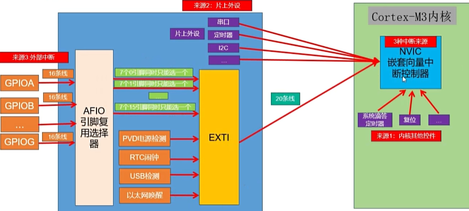

# NVIC

嵌套向量中断控制器：决定那个中断处理程序交给CPU

优先级分：抢占优先级和响应优先级

# EXTI

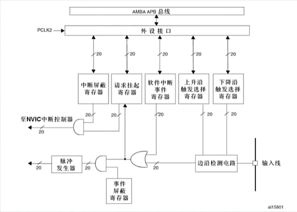

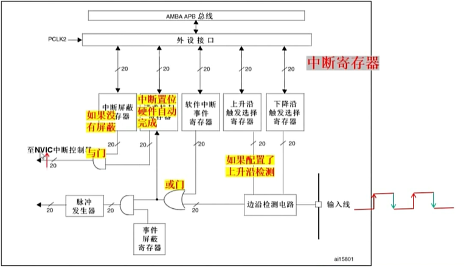

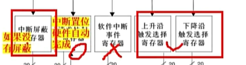

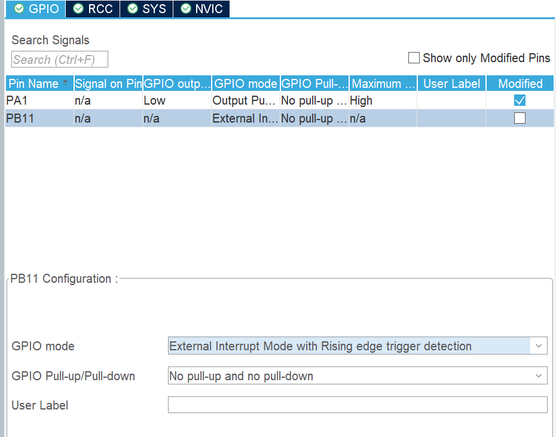

将PB11配置成中断触发

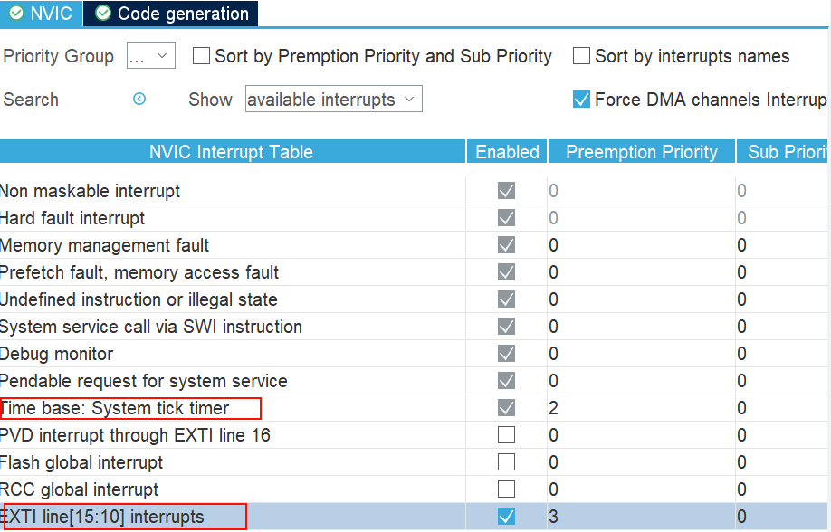

需要让自定义中断的优先级小于系统嘀嗒定时器，否则不会被打断

```c
/**
  * @brief This function handles EXTI line[15:10] interrupts.
  */
void EXTI15_10_IRQHandler(void)
{
  /* USER CODE BEGIN EXTI15_10_IRQn 0 */

  /* USER CODE END EXTI15_10_IRQn 0 */
  HAL_GPIO_EXTI_IRQHandler(GPIO_PIN_11);
  /* USER CODE BEGIN EXTI15_10_IRQn 1 */

  /* USER CODE END EXTI15_10_IRQn 1 */
}

/* USER CODE BEGIN 1 */
void HAL_GPIO_EXTI_Callback(uint16_t GPIO_Pin)
{
    if(GPIO_Pin == GPIO_PIN_11)
    {
        HAL_Delay(10);
        if(HAL_GPIO_ReadPin(GPIOB, GPIO_PIN_11) == GPIO_PIN_RESET)
        {
            HAL_GPIO_TogglePin(GPIOA, GPIO_PIN_1);
        }
    }
}
```

# USART

串行：一次一位传输，一般从低字节传输

并行：一次8/16/32位，

单工：单向传输

半双工：同一时间只能一方传输

全双工：可以同时双向传输

同步：有时钟

异步：无时钟

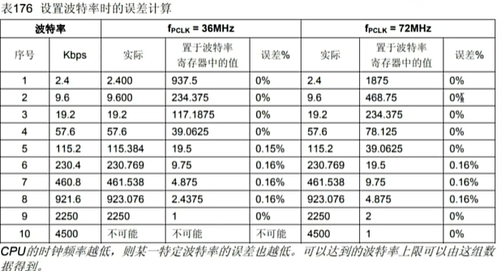

## 定长数据 轮询

```c
uint8_t msg[] = "hello world\n";

HAL_UART_Transmit(&huart1, msg, sizeof(msg) - 1, 1000);
HAL_Delay(1000);
```

```c
// 轮询收发
uint8_t re_msg[100];
uint8_t re_msg_size = 0;

if(HAL_UART_Receive(&huart1, re_msg, 10, 1000) == HAL_OK)
{
    HAL_UART_Transmit(&huart1, re_msg, 10, 1000);
}
```

## 变长数据 轮询

```c
uint8_t re_msg[100];
uint16_t re_msg_size = 0;

if(HAL_UARTEx_ReceiveToIdle(&huart1, re_msg, sizeof(re_msg), &re_msg_size, HAL_MAX_DELAY) == HAL_OK)
{
    HAL_UART_Transmit(&huart1, re_msg, re_msg_size, HAL_MAX_DELAY);
}
```

## 定长数据 中断

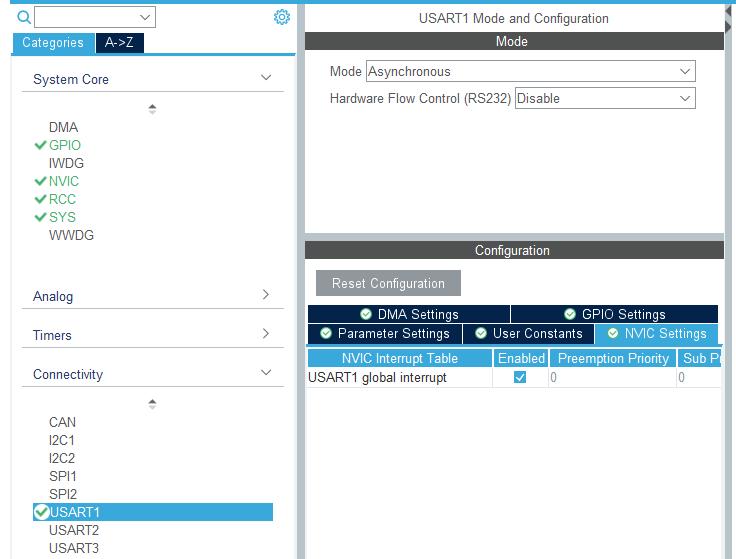


开启usart中断

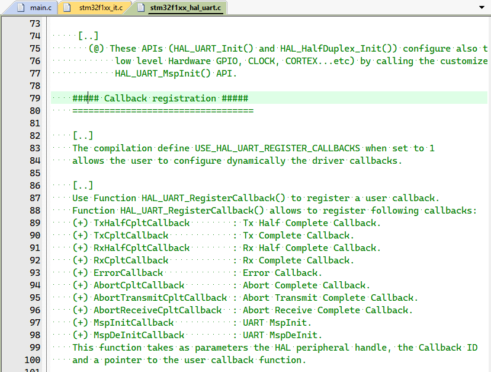

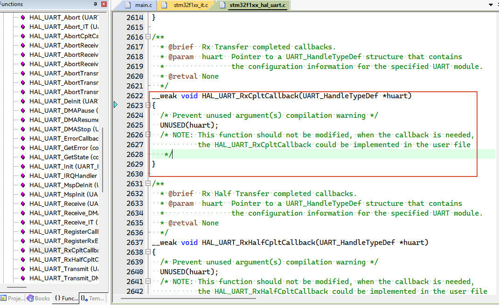

```c
  // 接收完毕标志位
  uint8_t isOver = 0;
  uint8_t buffer[100];
  uint16_t size = 0;

// 以中断方式进行接收
HAL_UART_Receive_IT(&huart1, buffer, 10);

if(isOver == 1)
{
    // 定长数据收发
    HAL_UART_Transmit(&huart1, buffer, 10, 1000);
    isOver = 0;
}


/**
  * @brief This function handles USART1 global interrupt.
  */
void USART1_IRQHandler(void)
{
  /* USER CODE BEGIN USART1_IRQn 0 */

  /* USER CODE END USART1_IRQn 0 */
  HAL_UART_IRQHandler(&huart1);
  /* USER CODE BEGIN USART1_IRQn 1 */

  /* USER CODE END USART1_IRQn 1 */
}

/* USER CODE BEGIN 1 */
// 接收完毕中断
extern uint8_t isOver;
void HAL_UART_RxCpltCallback(UART_HandleTypeDef *huart)
{
  isOver = 1;
}
/* USER CODE END 1 */
```

## 变长数据 中断

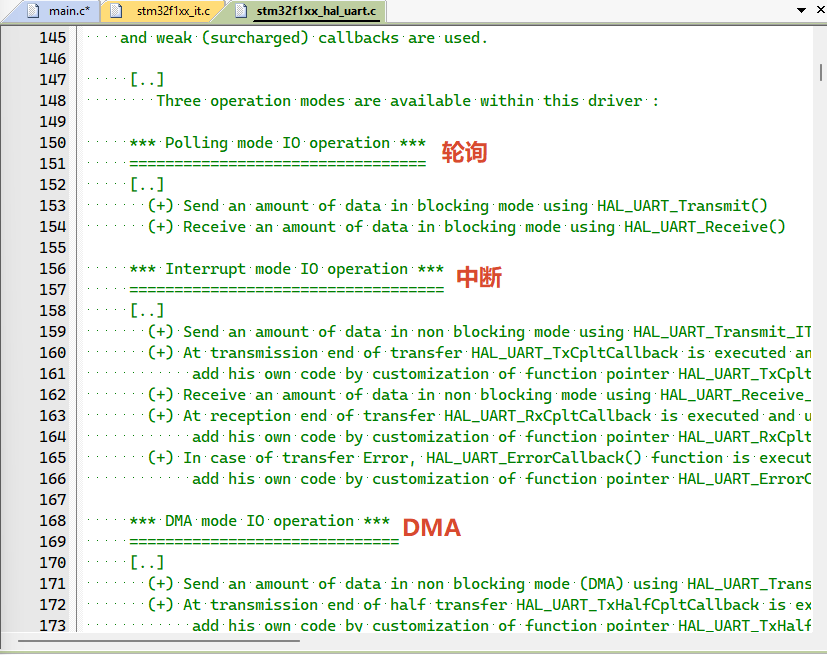

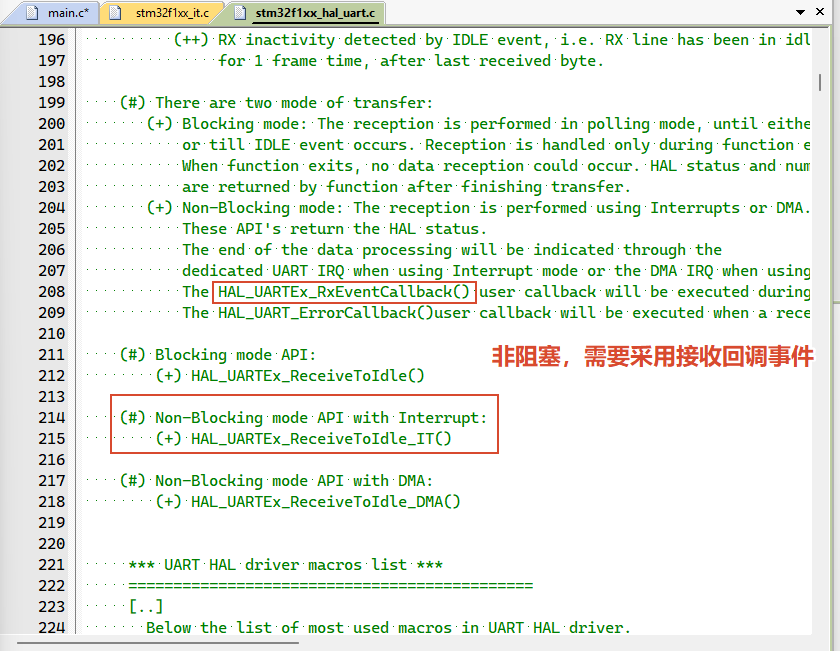

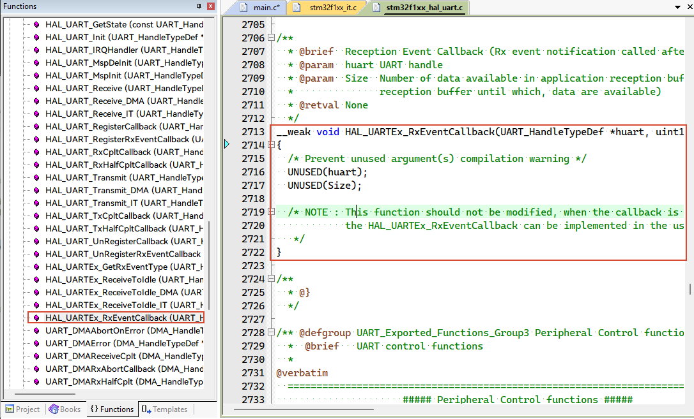

```c
// 接收完毕标志位
uint8_t isOver = 0;
uint8_t buffer[100];
uint16_t size = 0;    

// 以中断方式进行接收
HAL_UARTEx_ReceiveToIdle_IT(&huart1, buffer, sizeof(buffer));

if(isOver == 1)
{
    // 定长数据收发
    HAL_UART_Transmit(&huart1, buffer, size, 1000);
    isOver = 0;
}


// 接收完毕中断
extern uint8_t isOver;
extern uint16_t size;
void HAL_UARTEx_RxEventCallback(UART_HandleTypeDef *huart, uint16_t Size)
{
  isOver = 1;
  size = Size;
}
```

## 重写fputc

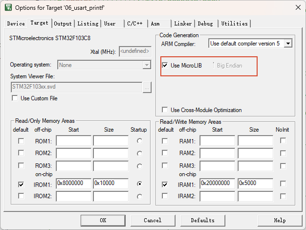

```c
// usart.h
#include <stdio.h>


// usart.c
/* USER CODE BEGIN 1 */
int fputc(int ch, FILE * file)
{
  HAL_UART_Transmit(&huart1, (uint8_t *)&ch, 1, 1000);
  return ch;
}
/* USER CODE END 1 */


// main
printf("hello world \n");
```

# I2C

是一种简单的双向两线制的总线协议，支持**同步串行半双工**

标准模式传输速率：100kbit/s

快速模式：400kbit/s

高速模式：3.4Mbit/s

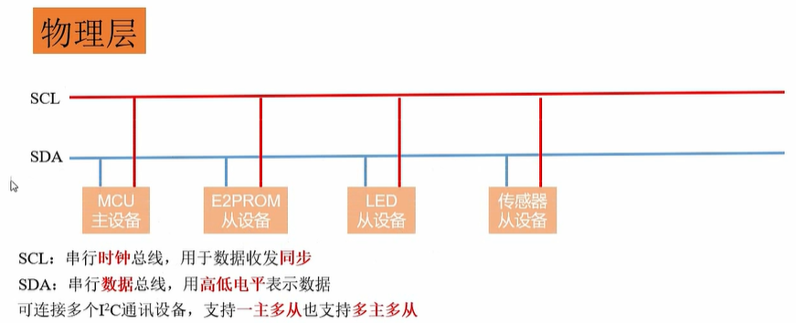

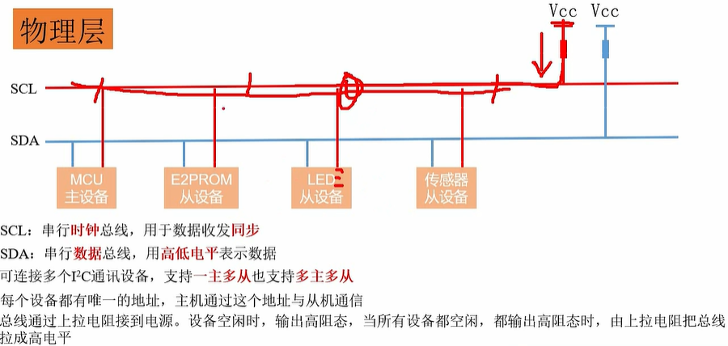


当有设备想要通信，则输出0，即整条总线全为低电平，占用整条总线


## 协议层

位传输：I2C是串行通信，并且是高位先行

起始信号：当SCL是高电平时，SDA线从高电平向低电平切换（拉低操作）

停止信号：当SCL是高电平时，SDA线从低电平向高电平切换

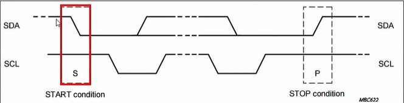

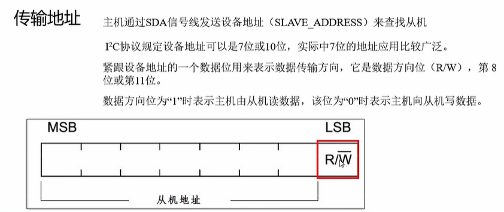

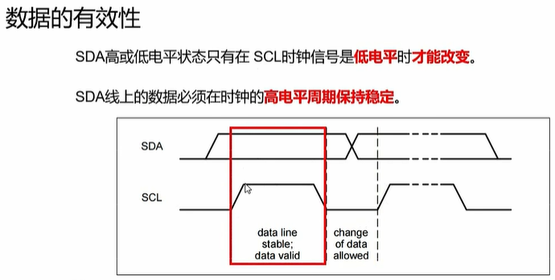

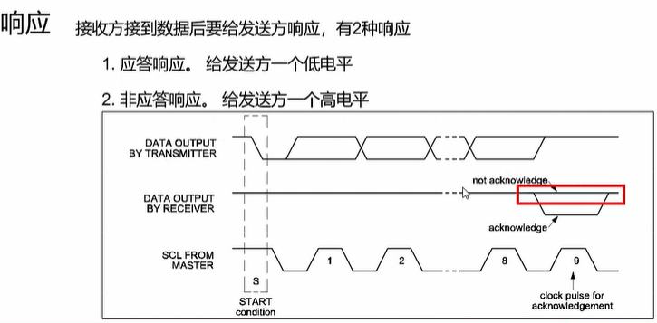

## EEPROM

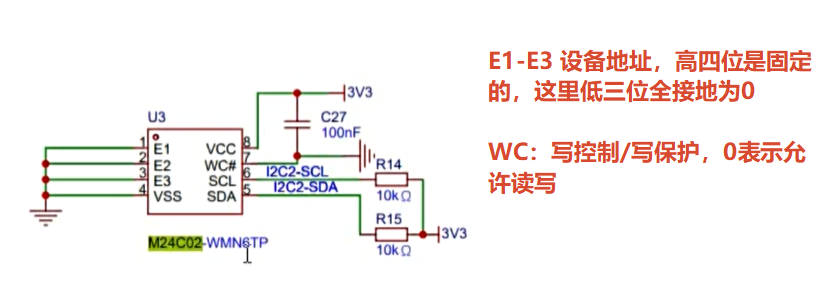

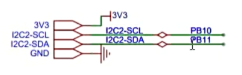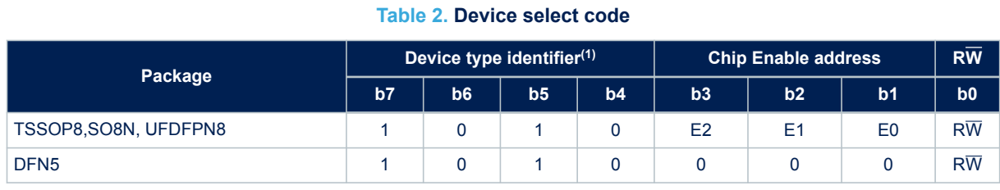


所以0xA1是读地址，0xA0是写地址

### 写时序（一个字节）

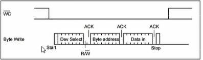

在WC为低电平时，主设备发一个start，发一个设备选择码（设备地址），加一位的读写操作，从设备返回一个低电平ACK作为应答，主设备发送一个写入的地址（从设备内部地址），从设备返回一个ack，主设备发送数据，从设备返回ack，循环，直到主设备低变高，表示发送停止

### 读时序（一个字节）

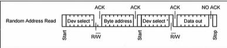

假写真读，目的是为了修改从设备内部地址

主设备发送start，发送从设备地址，发一位写入标志，从设备返回ack，主设备发内部地址，从设备返回ack，此为第一步修改内部计数器执向的地址

主设备发start，发送设备地址，发一位读标志，从设备返回ack，然后从设备开始发送出，主设备不需要ack，noack，主设备直接stop

### 单次写入多个字节时序

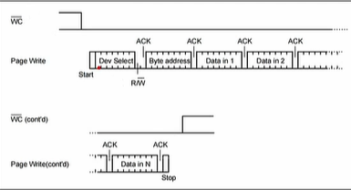

写入周期一般5ms，所以要等到ACK在发下一次写入

一次性写入多个字节，也叫做页写入，M24C02每页只有16个字节，每次只能写入单独的一个页中，所以一次性最多写入16个字节，当一次写入超过16个字节的时候，则超过的部分会重新从这页的首地址重新写入

### 单次读出多个字节

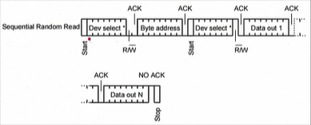

读取字节没有限制，可以任意读取

## 功能框图

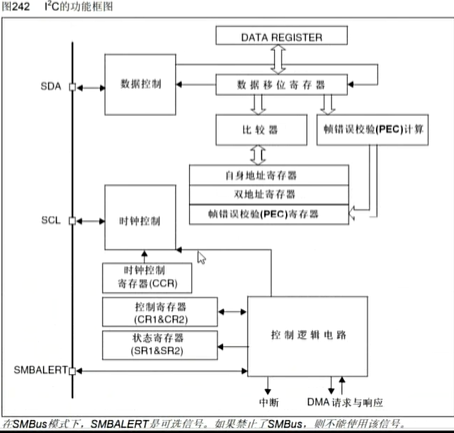


# 定时器

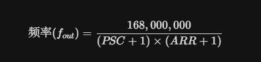

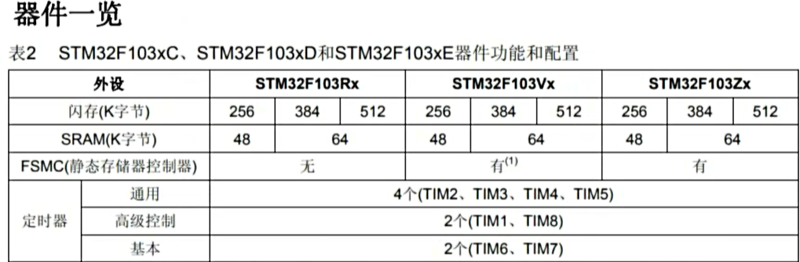

## 系统定时器

STM32F10xxx Cortex-M3编程手册

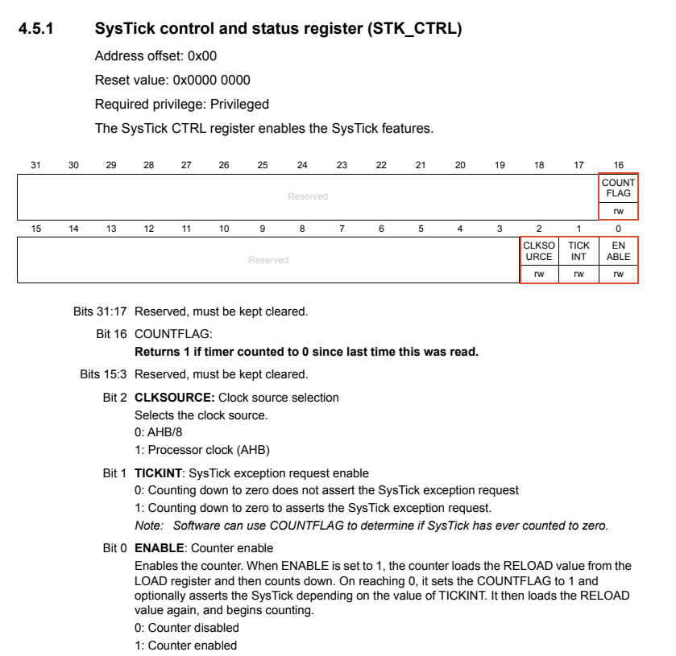

高16位是状态，低16位是控制

```c
// stm32f1xx_it.c

void SysTick_Handler(void)
{
  /* USER CODE BEGIN SysTick_IRQn 0 */

  /* USER CODE END SysTick_IRQn 0 */
  HAL_IncTick();
  /* USER CODE BEGIN SysTick_IRQn 1 */
  if(uwTick % 1000 == 0)
  {
    // HAL_GPIO_TogglePin(GPIOA, GPIO_PIN_1);
  }
  /* USER CODE END SysTick_IRQn 1 */
}
```

## 基本定时器

基本定时器包含一个16位自动装载计数器，由各自的可编程预分频器驱动，只能向上计数，没有外部IO，只能计时，不能对外部脉冲进行计数

功能：定时中断 主模式 触发DAC

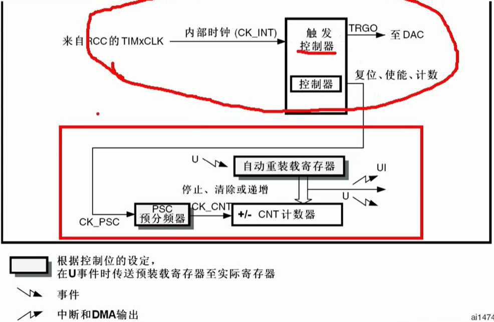

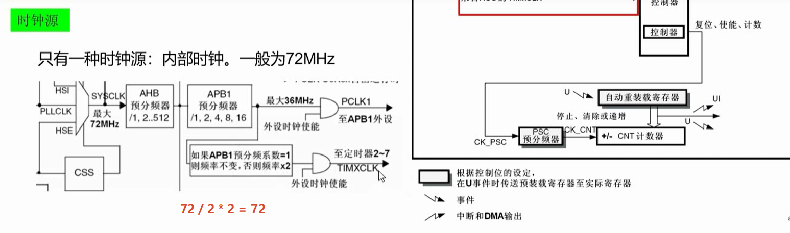

PSC预分频寄存器：1-65536之间的任意值，然后将分频后的信号作为计数器的时钟

自动重装载寄存器：包含预加载寄存器和影子寄存器，写数据到自动重装载寄存器时先写到预加载寄存器，然后再更新到影子寄存器，计数器是否溢出，是查看影子寄存器的值，寄存器CR1的ARPE位决定更新时机（是否预加载），没有预加载时，写入的值会立即更新到影子寄存器，有预加载时，写入的值会等到产生更新事件（计数器溢出）才更新到影子寄存器。

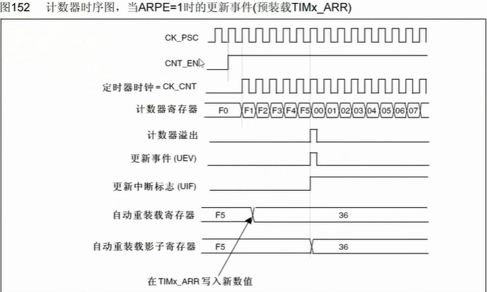


计数器寄存器：只能向上计数，从0开始自增，自增到自动重装载寄存器的值时，下一个时钟上升沿到来后，计数器产生溢出，从0重新计数，并产生更新事件UEV

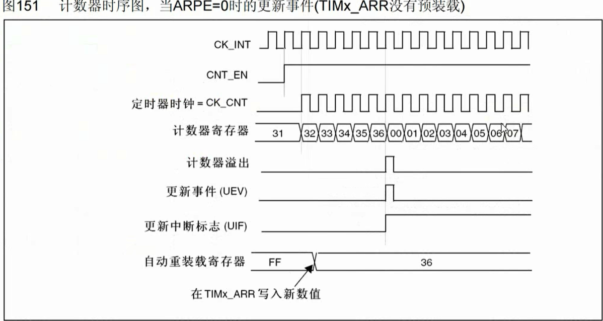

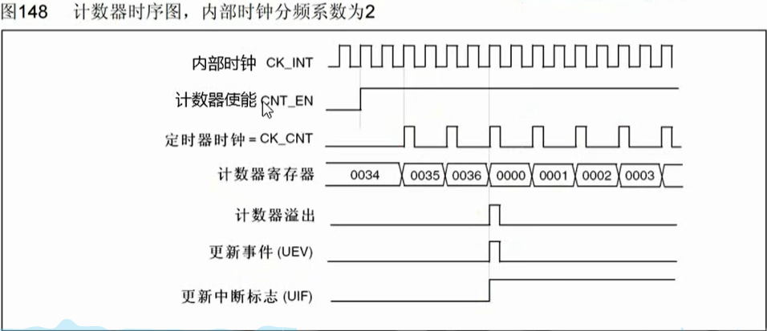

### 计算定时时间

多久产生一次更新事件（也就是计数器多久产生一次溢出）

预分频系数+1表示真正的分频值，1表示2分频，2表示3分频


计数器的周期

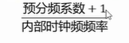

计数器累加多少次产生一次更新事件ARR

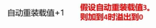

所以定时时间

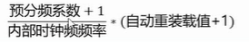

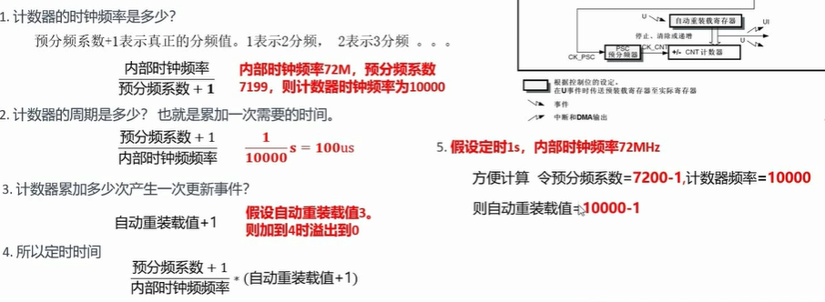

```c
// 在main中开启定时器
  /* USER CODE BEGIN 2 */
  HAL_TIM_Base_Start_IT(&htim6); // 开启定时器 6
  /* USER CODE END 2 */

// 定时器周期到期回调
void HAL_TIM_PeriodElapsedCallback(TIM_HandleTypeDef *htim)
{
  // hal 不需要手动清楚标志位
  if(htim->Instance == TIM6)
  {
    HAL_GPIO_TogglePin(GPIOC, GPIO_PIN_13);
  }
}
```

## 通用定时器

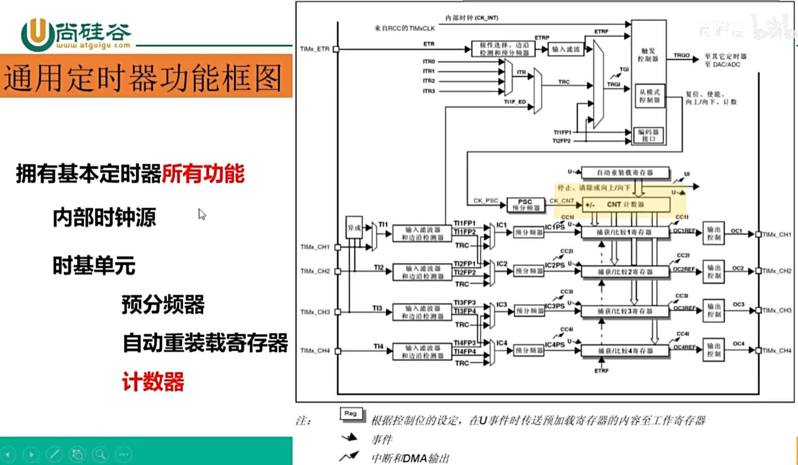

3种可选的时钟源
- 默认的内部时钟源，
- 外部时钟源1：（做输入捕获）
  - 使用定时器自身通道的输入信号作为时钟源
  - 每个定时器有4个通道
  - 只有通道1和通道2的信号可以作为时钟信号源
- 外部时钟源2：
  - 使用定时器的特殊引脚ETR引脚的信号作为时钟源
  - 每个通用定时器都有一个ETR引脚
  - ETR引脚信号经过极性选择，边缘检测，预分频器，输入滤波，得到信号ETR
- 3种可选的时钟源
  - 外部时钟源一般用于定时器级联
  - 大部分情况，内部时钟源足够使用
  - 不配置时钟源的情况下，默认选择的就是内部时钟源

### 计数模式

- 向上计数模式
  - 与基本定时器一样，都是从0开始加，一直加到自动重装载寄存器的值。
- 向下计数模式
  - 从自动重装载寄存器的值开始计数，直到减到0
- 中央对齐模式（向上和向下计数）
  - 从0开始向上计数，一直计数到自动重装载寄存器的值 - 1

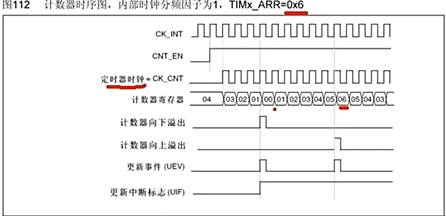

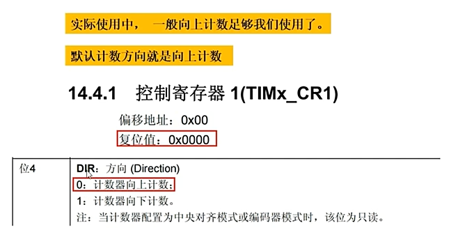

### PWM脉冲

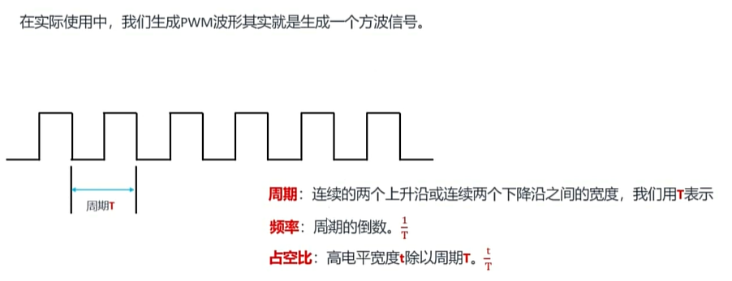

### 通用定时器输出比较

控制输出方波，大多用于输出PWM波形，捕获比较寄存器，每个定时器有4个，可以同时实现4路比较，输出部分：4路输出

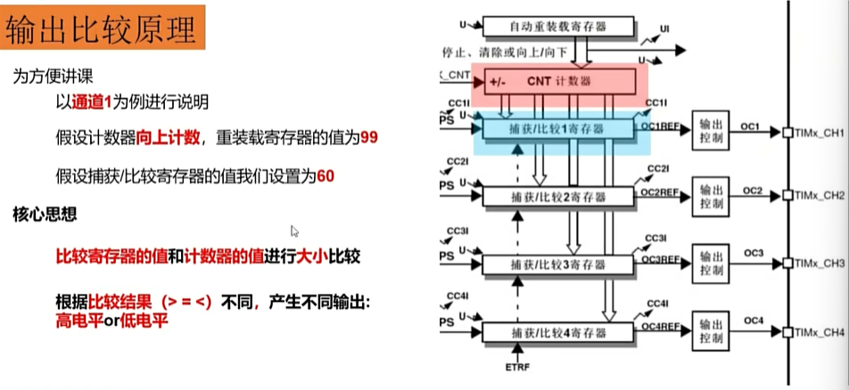

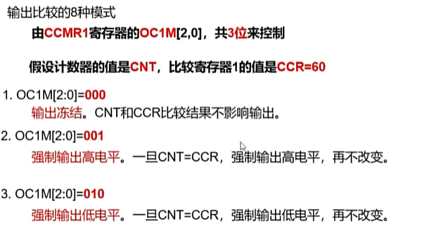

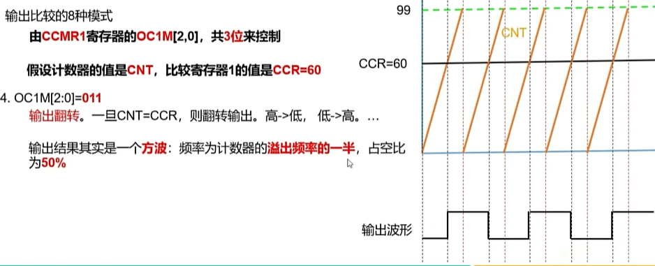

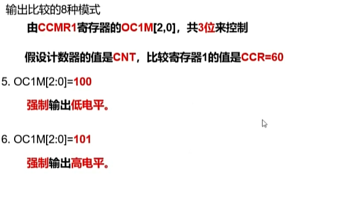

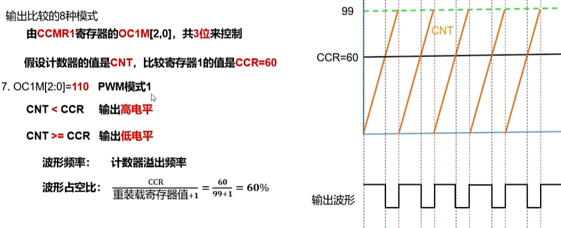

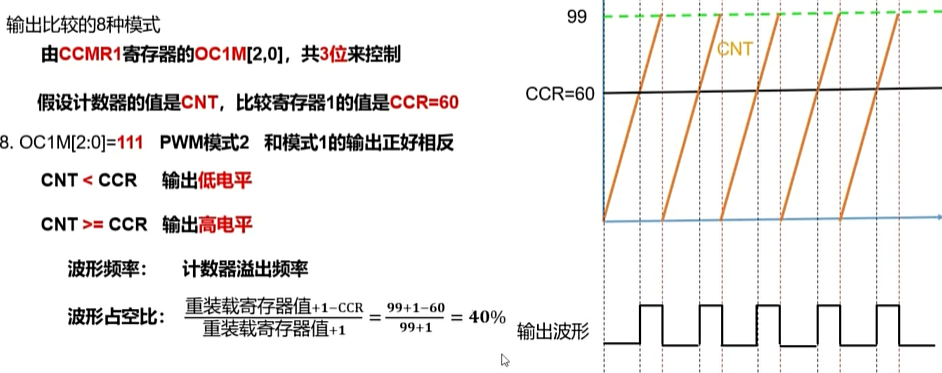

```c
void TIM5_SetDutyCycle(uint8_t duty)
{
  __HAL_TIM_SetCompare(&htim5, TIM_CHANNEL_2, duty);
}

  /* USER CODE BEGIN 2 */
  // 开启定时PWM
  HAL_TIM_PWM_Start(&htim5, TIM_CHANNEL_2);
  uint8_t duty = 0; // 占空比
  /* USER CODE END 2 */

// 通过调整占空比，改变PA1，复用的电平

```

### 通用定时器输入捕获

此功能可以捕获输入通道上信号的上升沿或者下降沿，多用于测量PWM的周期，只要测出连续的两个上升沿或者两个连续的下降沿的时间间隔，也可以测量占空比，只要测出一个上升沿和一个下降沿的时间间隔，然后除以周期即可


这里用TIM5 作为模拟PWM输出，用TIM4作为输入捕获，并将PA1和PB6物理连接


```c
void HAL_TIM_IC_CaptureCallback(TIM_HandleTypeDef *htim)
{
  if(htim->Instance == TIM4)//输入捕获
  {
    __HAL_TIM_SetCounter(&htim4,0);
  }
}
```

```c
  /* USER CODE BEGIN 2 */
  // 开启定时器
  HAL_TIM_PWM_Start(&htim5, TIM_CHANNEL_2);
  HAL_TIM_IC_Start_IT(&htim4, TIM_CHANNEL_1);

  /* USER CODE END 2 */

  /* Infinite loop */
  /* USER CODE BEGIN WHILE */
  while (1)
  {
    printf("T = %.2f ms, f = %.2f HZ\n", (__HAL_TIM_GET_COMPARE(&htim4, TIM_CHANNEL_1) / 1000.0), (1000000.0 / __HAL_TIM_GET_COMPARE(&htim4, TIM_CHANNEL_1)));

    HAL_Delay(1000);
    /* USER CODE END WHILE */

    /* USER CODE BEGIN 3 */
  }
  /* USER CODE END 3 */
```

### 定时器触发信号

触发输入信号（TRGI）：从外部过来（也可能是自己输入通道过来）到本定时器的信号，用来控制本定时器一些动作，比如复位。这个时0候本定时器就处于主从模式中的从模式。

触发输出信号（TRGO）：是本定时器输出到其他定时器或其他外设的信号，用于和其他定时器的级联（触发其他定时器的一些工作）或触发一些其他外设工作，这个时候本定时器就是主从模式中的主模式。


#### PWM输入模式


TIM5生成PWM信号，TIM4进行捕获，复位模式


tim.c

```c
// 周期
double TIM4_GetPWMCycle(void)
{
  return __HAL_TIM_GetCompare(&htim4, TIM_CHANNEL_1) / 1000.0;
}

// 频率
double TIM4_GetPWMFreq(void)
{
  return 1000000.0 / __HAL_TIM_GetCompare(&htim4, TIM_CHANNEL_1);
}

// 占空比
double TIM4_GetPWMDutyCycle(void)
{
  return __HAL_TIM_GetCompare(&htim4, TIM_CHANNEL_2) * 1.0 / __HAL_TIM_GetCompare(&htim4, TIM_CHANNEL_1);
}
```

main

```c
  /* USER CODE BEGIN 2 */
  HAL_TIM_PWM_Start(&htim5, TIM_CHANNEL_2);
  HAL_TIM_IC_Start(&htim4, TIM_CHANNEL_1);
  HAL_TIM_IC_Start(&htim4, TIM_CHANNEL_2);
  /* USER CODE END 2 */

  /* Infinite loop */
  /* USER CODE BEGIN WHILE */
  while (1)
  {
    printf("T = %.2f ms, f = %.2f Hz, duty = %.2f %%\r\n", TIM4_GetPWMCycle(), TIM4_GetPWMFreq(), TIM4_GetPWMDutyCycle());
    HAL_Delay(1000);
    /* USER CODE END WHILE */
```

## 高级定时器

除了拥有通用定时器外的所有功能，还具有，死区时间可编程的互补输出，断路输入信号（刹车输入信号），重复计数器


重复计数器包含2部分：重复次数计数器，REP寄存器（硬件叫RCR寄存器）

在基本定时器和通用定时器中，计数器每溢出1次，就会产生一个更新事件，在高级定时器中，计数器每溢出1次，会产生一个信号，让重复计数器的值-1，当重复计数器的值减到0，如果计数器再溢出1次，则会产生更新事件。重复计数器的初始化来源于RCR寄存器REP位，如果REP=2，则CNT计数器溢出3次产生一次更新事件，可以用重复计数器生成有限个周期的PWM

### 互补输出


高级定时器的通道1/2/3可以分别输出2路互补信号

互补信号：频率周期相等，相位相差180°

互补输出一般用于驱动H桥电路，H桥通常用于驱动电流比较大的负载，比如电机


CH1高电平，Q1和Q4导通，电机正转，CH1N高电平，Q3和Q2导通，电机反转，理论上CH1和CH1N永远反相，所以可以非常方便的控制电机的转动，实际情况下由于MOS管器件关断慢，开通快

如果Q1和Q4还没有完全关断，Q2和Q3导通，就会造成短路，导致器件烧毁，所以这种情况是禁止的

### 死区时间

延时一段时间再开通


OCxREF可以认为是标准信号，OCx和OCxN的低电平立即变化

用高级定时器输出5个周期的PWM，频率为2HZ


```c
  /* USER CODE BEGIN 2 */
  __HAL_TIM_ENABLE_IT(&htim1, TIM_IT_UPDATE);
  HAL_TIM_PWM_Start(&htim1, TIM_CHANNEL_1);
  /* USER CODE END 2 */
```

```c
void TIM1_UP_TIM10_IRQHandler(void)
{
  /* USER CODE BEGIN TIM1_UP_TIM10_IRQn 0 */

  /* USER CODE END TIM1_UP_TIM10_IRQn 0 */
  HAL_TIM_IRQHandler(&htim1);
  /* USER CODE BEGIN TIM1_UP_TIM10_IRQn 1 */
  // 关闭定时器
  HAL_TIM_PWM_Stop(&htim1, TIM_CHANNEL_1);
  /* USER CODE END TIM1_UP_TIM10_IRQn 1 */
}
```

# DMA

直接存储器存取，用来提供在外设和存储器之间或者存储器和存储器之间的高速数据传输，无需CPU干预，数据可以通过DMA快速移动，这就节省了CPU的资源来做其他操作

2个DMA控制器有12个通道（DMA1有7个通道，DMA2有5个通道），每个通道专门用来管理来自一个或者多个外设对存储器访问的请求，还有一个仲裁器开协调各个DMA请求的优先权。

DMA控制器和CortexM3核心共享系统数据总线，执行直接存储器数据传输，当CPU和DMA同时访问相同的（RAM或外设）时，DMA请求会暂停CPU访问系统总线达若干个周期，总线仲裁器执行循环调度，以保证CPU至少可以得到一半的系统总线（存储器或外设）带宽。


通道：DMA每个通道都可以接收多个外设的请求，但是同一时间只能接收一个，不能同时接收多个

仲裁器：仲裁器管理DMA通道分为两个阶段，第一阶段属于软件阶段，可以在DMA_CCRx寄存器中设置，有4个等级，非常高、高、中和低四个优先级。第二阶段属于硬件阶段，如果两个或则以上的DMA通道请求设置的优先级一样，则他们优先级取决于通道编号，编号越低优先级越高，比如通道1高于通道2

传输方向：无法从RAM到ROM，只能从ROM到RAM，RAM到外设

## ROM到RAM


普通的不使用中断回调的方式

```c
/* USER CODE BEGIN PV */
const uint8_t src[] = {10,20,30,40};

uint8_t dest[4] = {0};

// DMA传输结束标志
uint8_t dma_done = 0;
/* USER CODE END PV */


MX_USART1_UART_Init();
/* USER CODE BEGIN 2 */
printf("hello world\n");
printf("src = %p, dest = %p\n" , src, dest);
// 开启DMA
HAL_DMA_Start_IT(&hdma_memtomem_dma2_stream0,(uint32_t)src,(uint32_t)dest, sizeof(src));
/* USER CODE END 2 */

/* Infinite loop */
/* USER CODE BEGIN WHILE */
while (1)
{
  if(dma_done)
  {
    for (uint8_t i = 0; i<4; i++) {
      printf("%d\n",dest[i]);
    }
    dma_done = 0;
  }
  /* USER CODE END WHILE */
```

```c
void DMA2_Stream0_IRQHandler(void)
{
  /* USER CODE BEGIN DMA2_Stream0_IRQn 0 */

  /* USER CODE END DMA2_Stream0_IRQn 0 */
  HAL_DMA_IRQHandler(&hdma_memtomem_dma2_stream0);
  /* USER CODE BEGIN DMA2_Stream0_IRQn 1 */
  HAL_DMA_Abort_IT(&hdma_memtomem_dma2_stream0);
  dma_done = 1;
  /* USER CODE END DMA2_Stream0_IRQn 1 */
}
```


```c
const uint8_t src[] = {10,20,30,40};

uint8_t dest[4] = {0};

// DMA传输结束标志
uint8_t dma_done = 0;


void finishedCal(DMA_HandleTypeDef *_hdma);

  /* USER CODE BEGIN 2 */
  printf("hello world\n");
  printf("src = %p, dest = %p\n" , src, dest);
  // 全部发送完成
  HAL_DMA_RegisterCallback(&hdma_memtomem_dma2_stream0, HAL_DMA_XFER_CPLT_CB_ID, finishedCal);

  // 开启DMA
  HAL_DMA_Start_IT(&hdma_memtomem_dma2_stream0,(uint32_t)src,(uint32_t)dest, sizeof(src));
  
  
  /* USER CODE END 2 */


  /* USER CODE BEGIN 4 */
void finishedCal(DMA_HandleTypeDef *_hdma)
{
  printf("DMA over");
  HAL_DMA_Abort_IT(&hdma_memtomem_dma2_stream0);
  dma_done = 1;
}
/* USER CODE END 4 */
```

## RAM到串口


```c
  /* USER CODE BEGIN 2 */
  uint8_t src[] = {'a', 'b', 'c', 'd', 'e'};
  HAL_UART_Transmit_DMA(&huart1, src, sizeof(src));
  /* USER CODE END 2 */
```

# ADC

模拟数字转换器：用于将模拟信号转换为数字形式，以便在数字系统中进行处理

2个阶段：

采样阶段：ADC首先对模拟信号进行采样，即在一定时间内获取信号的瞬事值。

量化阶段：采样之后的模拟信号通过量化器，将其转换为相应的数字形式，这些数字通常是二进制代码

参考电压：ADC使用参考电压来确定模拟信号的幅度范围，通常ADC需要一个已知的电压作为参考，以便将模拟电压映射到数字代码

通道数：表示ADC能够同时处理的模拟输入通道数量，多通道ADC可以同时转换多个信号

采样率：表示ADC每秒可以进行多少次采样，采样率越高，ADC能够捕获更高频率的信号

分辨率：表示ADC可以将模拟信号分成多少个离散级别，以数字信号的位数N来表示，一般有10位，12位，16位等。12位有4096个离散级别。

转换时间：表示ADC从开始转换到完成转换所需的时间，转换时间通常由ADC的时钟频率和分辨率决定。

## ADC模块介绍

ADC，精度是12，但是存储在16位的寄存器上，所以有左对齐和右对齐两种方式，模拟看门狗特性允许程序检测输入电压是否超出用户自定义的高低阈值，ADC的数据时钟不能超过14MHz，是由PCLK2分频产生

f103 限制在14MHz，f407 限制在36MHz

## 逐次逼近型ADC工作原理

逐次逼近型（常用）：最常见的ADC类型，通过逼近法逼近模拟信号的大小

sigma-delta型：通过比较信号的累积值和一个参考值，产生一个高精度的输出（高精度，速度慢）

flash型：通过一组比较器和编码器，以高速并行方式进行转换，用于高速应用。（低精度，速度快）

逐次逼近型和用天平称重相似


## ADC功能框图


VDDA 模拟电源正

VSSA 模拟电源负

VREF+ 模拟参考电压正

VREF- 模拟参考电压负

输入通道：用来输入模拟电压的通道，一共多达18个通道（ADCx_IN0 - ADCx_IN15）对应着16个IO口，内部温度传感器（测量芯片温度）通道16，内部参考电压，通道17

输入通道组织：可能会进行多路转换，输入通道组是把多个输入通道组织在一起，然后按组内顺序进行转换。

一共有2个通道组：注入通道和规则通道

规则通道：规则通道内的通道转换完成后，会把转换后的结果存储到规则通道数据寄存器中，规则通道最多16个通道，由于规则通道的寄存器只有一个，当多路要转换时，寄存器内的值要及时取走，否则后边通道转换结果会覆盖前面的结果。一般会使用DMA把数据寄存器的值直接取走

注入通道：组内的通道转换完成后，会把转换后的结果存储到注入通道数据寄存器中，注入通道的转换可以打断规则通道的转换。

触发源：

软件触发（常用）：操作控制寄存器ADC_CR2的一些相关位

硬件触发：使用定时器TRGO触发

转换方式：

- ADC_CR1寄存器SCAN：扫描模式
  - 开启扫描模式：多通道，顺序扫描，挨个转换
  - 关闭扫描模式：只转换通道组中的第一个通道

- ADC_CR2寄存器CONT：连续转换
  - 开启连续模式：通道组内转换一轮之后，继续转换下一轮，不会停
  - 关闭连续模式：通道组内转换一轮之后，停止转换，等待下次启动，按次转换

- 中断：
  - 转换结束：注入通道和规则通道转换结束，都会产生 EOC
  - 注入转换结束：只有注入通道转换结束才会产生 JEOC
  - 模拟看门狗事件：设置阈值上下限，比较之后超出则产生中断 AWDIE

DMA请求：规则和注入通道转换结束后，除了产生中断外，还可以产生DMA请求，把转换好的数据直接存储在内存里边，注意只有ADC1和ADC3才能产生DMA请求

数据对齐：16位的寄存器只用到了其中的12位，可以是高12也可以是低12，右对齐：高4位补零，读取的值就是实际值，左对齐：低4位补零，读取的值就是实际值的16倍


转换时间：ADC使用若干个ADC_CLK周期对输入电压采样，总转换时间如下计算：

Tconv = 采样时间+12.5个ADC周期

当ADCCLK=14Mhz，假设采样时间为1.5周期

Tconv = 1.5 + 12.5 = 14 周期 = 1us

## 单通道数模转换

通道10-PC0


```c
  /* USER CODE BEGIN 2 */
  printf("hello world\n");

  // 开启校准 F4 不需要
  // HAL_ADCEx_Calibration_Start(&hadc1);

  // 启动AD转换
  HAL_ADC_Start(&hadc1);
  /* USER CODE END 2 */

  /* Infinite loop */
  /* USER CODE BEGIN WHILE */
  while (1)
  {
    // 获取转换结果进行计算
    double v = HAL_ADC_GetValue(&hadc1) * 3.3 / 4096;
    printf("v = %.3f\n", v);
    HAL_Delay(1000);
    /* USER CODE END WHILE */

    /* USER CODE BEGIN 3 */
  }
```

## 多通道转换

必须开DMA（循环模式）+ 关闭DMA通道中断


```c
  /* USER CODE BEGIN 2 */
  printf("Hello World\n");
  uint16_t data[2] = {0};
  // 启动ADC
  HAL_ADC_Start_DMA(&hadc1, (uint32_t *)data, 2);
  /* USER CODE END 2 */

  /* Infinite loop */
  /* USER CODE BEGIN WHILE */
  while (1)
  {
    printf("ADC1: %.2f, %.2f\n", data[0] * 3.3 / 4095, data[1]* 3.3 / 4095);
    HAL_Delay(1000);
    /* USER CODE END WHILE */
```

# SPI

SPI是一种高速的，全双工，同步的串行通信总线，有四根线：SCK，MOSI，MISO，CS（SS片选）


时钟的极性和相位

极性（CPOL）：通信的整个过程分为空闲时刻和通信时刻，空闲状态下SCK是低电平，CPOL是0


相位（CPHA）：直接决定SPI总线从那个跳变沿开始采样数据，CPHA=0时，表示第一个跳变沿开始采样


SPI四种工作模式


模式0和模式2，相位都是0


模式1和模式3，相位都是1


## W25Q32

只支持模式0和模式3，写的时候必须是先擦除，擦除后再写入，移位是高位优先


前八位：block号，4位：段号，4位：页号，4位：页内地址

### 写入注意事项

- 写入操作前，必须先进行写使能。
- 每个数据位只能由1改写为0，不能由0改写为1。
- 写入数据前必须先擦除，擦拭后，所有的数据位变为1，擦除必须按最小擦除单元进行。
- 连续写入多字节时，最多写入一页的数据，超过页尾位置的数据，会回到页首覆盖写入
- 写入操作结束后，芯片进入忙状态，不响应新的读写操作
- 擦除最小单位是段，写入最下单元是页

### 读取注意事项

- 直接调用读取时序，无需读使能，无需额外操作，没有页的限制
- 读取操作结束后不会进入忙状态，但不能在忙状态时读取

### 交换数据时序


## SPI外设


波特率发生器用于生成通信的同步时钟

NSS是片选信号，可以硬件自动控制，也可以使用软件控制

数据寄存器：数据寄存器对应两个缓冲区，一个用于写（发送缓冲），写操作将数据写到发送缓冲区内，一个用于读（接收缓冲）读操作将返回接收缓冲区里的数据。

移位寄存器：写入到发送缓冲区的数据，被送入到移位寄存器中，按位通过MOSI把数据发送出去，按位把通过MISI接收的数据存入到移位寄存器，接收数据完毕，数据被送入到接收缓冲区。

## HAL


# 存储器和寄存器


## RAM

### SRAM

静态随机存取存储器，只要保持上电，容量一般较低，用于高速缓存，芯片内部的寄存器可以看成是一种SRAM

### DRAM

动态随机存储器：用电容的电荷来表示数据，有电荷代表1，无电荷代表0，时间一长，代表1的电容会放电，代表0的电容会吸收电荷，因此需要定期刷新操作，这就是动态的特性

## ROM

read only memory 只读存储器 （已经出可以读写的ROM），指非易失性半导体存储器

### MASK ROM

掩膜ROM，只读，存储在内部的数据是出厂的时候固化的，优势是成本低

### PROM

可编程ROM，只供用户写入一次

### EPROM

可重复擦写的存储器（淘汰）

### EEPROM

电可擦拭存储器，擦除和写入都是用电路控制，不需要外部设备擦写

### FLASH

又称闪存，容量比EEPROM大，在擦除的时候，一般多个字节擦除

### 硬盘

又称磁盘

## STM32存储器

包含内部SRAM：可以以字节，半字（16位）或者全字（32位）访问，SRAM的起始地址是0x20000000
片内FLASH（最大2M）

## 存储器映射

存储器映射就是给芯片内部的所有外设寄存器和存储单元（如 Flash、RAM）分配一个唯一的“门牌号”（内存地址），让 CPU 可以像访问内存一样通过地址来操作硬件。


# CAN

控制器局域网，是功能丰富的车用总线协议，被设计用于在不需要主机的情况下，允许网络上单片机和仪器相互通信

基于消息传递协议，设计之初在车辆上复用通信线缆，以降低铜线使用量

## 物理层

一个CAN控制器，一般MCU提供，STM32内部提供CAN控制器

一个CAN收发器，需要专门芯片提供

控制器和收发器之间通过CAN_Tx和CAN_Rx引脚连接，收发器和CAN总线之间使用CAN_High和CAN_Low信号线连接


收发器把普通的逻辑电平信号转化成差分信号，通过差分线输出到CAN总线

当CAN线上接入多个设备时，就构成了CAN总线网络，根据接法不同，总线网络分为2种，闭环总线网络和开环总线网络

### 闭环总线网络

高速段距离，最大传输距离40m，最大传输速度1Mbps


### 开环总线网络

低速远距离，最大距离1KM。通信速度最高为125bps


### 差分信号

CAN_High 和 CAN_LOW中走的是差分信号，传统的单端信号传输，一根信号线，一根地线，差分传输是一种信号传输技术，差分传输在这两个线上都传输信号，这两个信号振幅相同，相位相反

差分信号优点：抗干扰能力强，干扰噪声一般会等值，同时被加载到两根信号线上，而其差值为0，即噪声对信号的逻辑意义不产生影响。有效抑制电磁干扰，

缺点：一定要两根等长，等宽，紧密靠近。

### CAN中的差分信号


## 协议层

CAN总线是广播类型的总线，意味着所有节点都可以侦听到所有传输的报文，无法单独将报文发送给指定节点，所有节点都将始终捕获所有报文，但是CAN硬件能够提供本地过滤功能，让每个节点对报文有选择性的做出响应

CAN使用的是短报文，最大实用负载是94位，报文中没有任何明确的地址，相反可以认为报文是通过内容寻址，也就是说，报文的内容隐式的确定其地址

CAN总线上有5种不同的报文类型：数据帧、错误帧、远程帧、过载帧、帧间隔

数据帧是最常见的报文类型，用于发送单元向接收单元发送数据

远程帧用于接收单元具有相同id的发送单元请求发送数据

错误帧：当检测出错误时向其他单元通知错误的帧

过载帧：不常用，

帧间隔：用于将数据帧及遥控帧与前边的帧分离开的帧，其中错误帧、过载帧、帧间隔都是由硬件自动完成的，没有办法用软件来控制，对于一般使用者来说，只需要掌握数据帧与遥控帧。数据帧和遥控帧有标准格式和扩展格式，标准格式有11位标识符，扩展格式有29位标识符

### 数据帧

#### 标准帧：11位 


帧起始：1bit，显性信号（逻辑0），表示数据帧或远程帧的开始，只能在总线空闲的时候才可以发送帧起始。

仲裁段：包括标识符位（长度为11，ID10 - ID0，高位优先）是一个功能性地址，CAN接收器通过标识符来过滤数据帧。不同节点的标识符是不能相同的。和远程发送请求位，用于区分该帧是数据帧还是远程帧，显性信号0代表数据帧，1代表远程帧

控制段：一共6位；

IDE（1位）区分标准格式和扩展格式，显性电平表示标准格式，隐形电平表示扩展格式；

R0：保留位；

DLC（4位）：数据段长度码，最多表示0-8；

数据段（64位）：0-8byte

CRC段：15位CRC校验位，1位界定符，隐形位，表示校验码结束

ACK段：1位ACK确认位，发送段的ACK确认位是隐性位，接收端收到正确的CRC校验位后，把这一位置为显性位，1位的界定符，隐性位，用于和后边的帧结束隔开

帧结束：（7位）帧结束，发送7个隐性位表示结束

扩展帧：29位


SRR：替代远程请求位，隐性信号
RTR：表示是数据帧还是远程帧
R1R0：保留位

### 总线仲裁


CAN总线处于空闲状态的时候，最先发送消息的单元获得发送权

多个单元同时开始发送，从仲裁段（报文ID）的第一位开始进行仲裁，连续输出显性电平最多的单元可以继续发送，即首先出现隐性电平的单元失去对总线的占有权变为接收，（即报文ID小的优先级高）

竞争失败，会自动检测总线空闲，在第一时间在次尝试发送

### CAN的位时序

