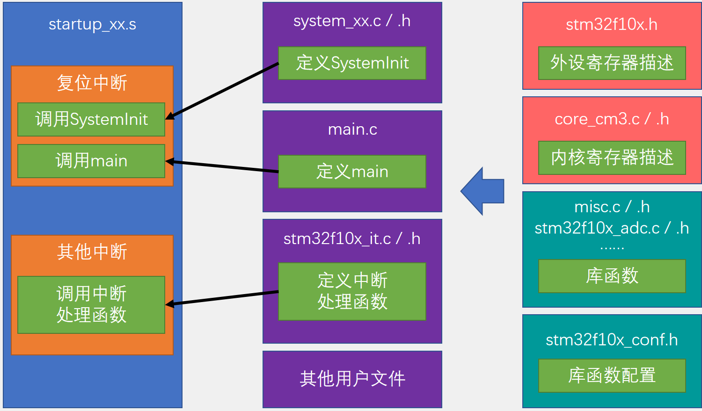
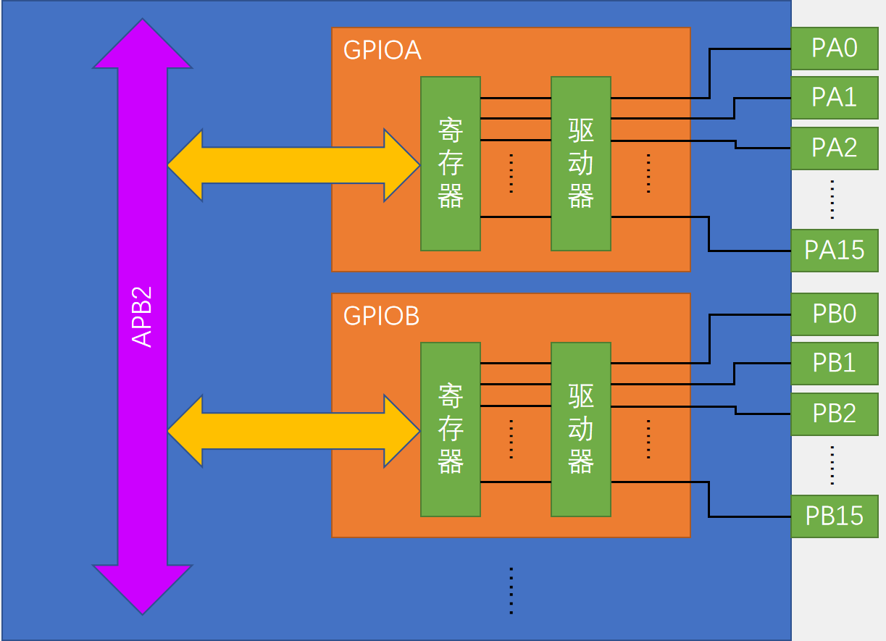
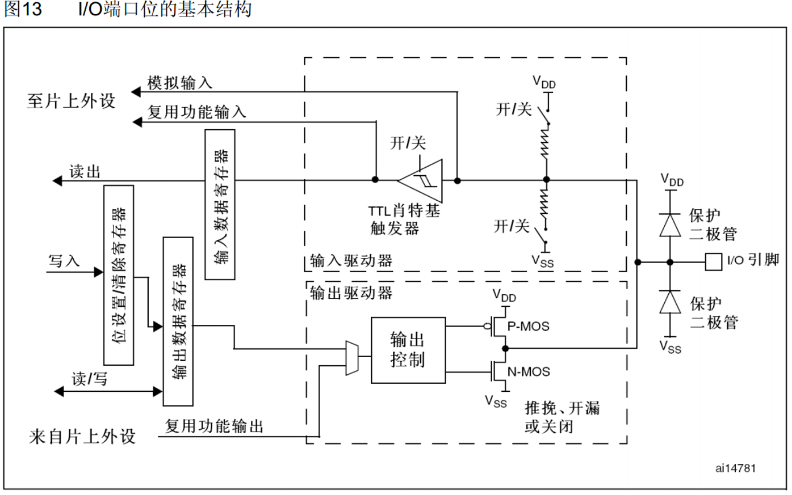
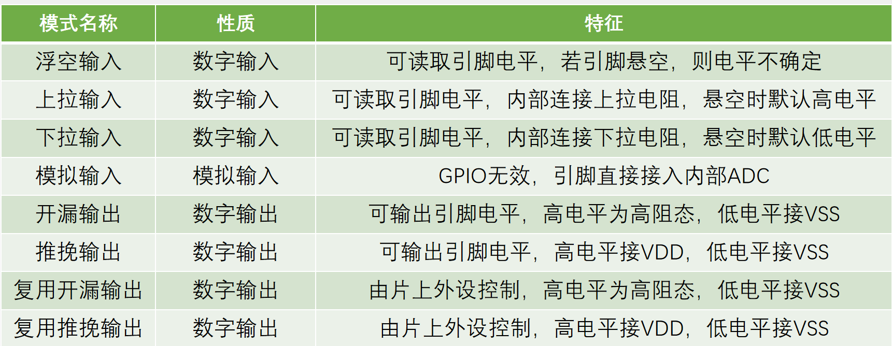

## 概念

### 片上资源/外设

| 英文缩写    | 名称                   | 英文缩写 | 名称               |
| ----------- | ---------------------- | -------- | ------------------ |
| **NVIC**    | **嵌套向量中断控制器** | CAN      | CAN通信            |
| **SysTick** | **系统嘀嗒时钟**       | USB      | USB通信            |
| RCC         | 复位和时钟控制         | RTC      | 实时时钟           |
| GPIO        | 通用IO口               | CRC      | CRC校验            |
| AFIO        | 复用IO口               | PWR      | 电源控制           |
| EXTI        | 外部中断               | BKP      | 备份寄存器         |
| TIM         | 定时器                 | IWDG     | 独立看门狗         |
| ADC         | 模数转换器             | WWDG     | 窗口看门狗         |
| DMA         | 直接内存访问           | DAC      | 数模转换器         |
| USART       | 同步/异步串口通信      | SDIO     | SD卡接口           |
| I2C         | I2C通信                | FSMC     | 可变静态存储控制器 |
| SPI         | SPI通信                | USB OTG  | USB主机接口        |

### 命名规则


###  系统结构


ICode：指令总线，用来加载程序指令

DCode：数据总线，用来加载数据，比如常量和调试数据

​	ICode和DCode主要是链接Flash闪存，Flash中存储编码程序

System：系统总线

AHB：高性能总线

APB：高级外设总线 APB2比APB1性能高一些，APB2一般和AHB同频率

​	因为AHB和APB的总线协议，总线速度，还有数据传输格式的差异，所以中间需要桥接完成数据的转换的缓存

DMA：不经过CPU，主要做一些数据搬运的工作，拥有和CPU一样的总线控制权

### 引脚定义


### 启动文件选择


### 工程架构



## GPIO

通用输入输出口，8种输入输出模式

引脚电平：0V~3.3V，部分可容忍5V

输出模式下可以控制端口输出高低电平，用于驱动LED，蜂鸣器，模拟通信协议输出时序等

输入模式下可以读取端口的高低电平或者电压，用于读取按键输入、外接模块电平信号输入、ADC电压采集、模拟通信协议接收数据等







### GPIO输出

#### 常用函数

```c
// 使能RCC
void RCC_AHBPeriphClockCmd(uint32_t RCC_AHBPeriph, FunctionalState NewState);
void RCC_APB2PeriphClockCmd(uint32_t RCC_APB2Periph, FunctionalState NewState);
void RCC_APB1PeriphClockCmd(uint32_t RCC_APB1Periph, FunctionalState NewState);


// GPIO
void GPIO_DeInit(GPIO_TypeDef* GPIOx); // 复位
void GPIO_AFIODeInit(void); // 复位
void GPIO_Init(GPIO_TypeDef* GPIOx, GPIO_InitTypeDef* GPIO_InitStruct); // 用结构体来初始化GPIO口 
void GPIO_StructInit(GPIO_InitTypeDef* GPIO_InitStruct); // 把结构体变量赋一个默认指

// GPIO 读
uint8_t GPIO_ReadInputDataBit(GPIO_TypeDef* GPIOx, uint16_t GPIO_Pin);
uint16_t GPIO_ReadInputData(GPIO_TypeDef* GPIOx);
uint8_t GPIO_ReadOutputDataBit(GPIO_TypeDef* GPIOx, uint16_t GPIO_Pin);
uint16_t GPIO_ReadOutputData(GPIO_TypeDef* GPIOx);

// GPIO 写
void GPIO_SetBits(GPIO_TypeDef* GPIOx, uint16_t GPIO_Pin); // 把指定端口设置为高电平
void GPIO_ResetBits(GPIO_TypeDef* GPIOx, uint16_t GPIO_Pin); // 把指定端口设置为低电平
void GPIO_WriteBit(GPIO_TypeDef* GPIOx, uint16_t GPIO_Pin, BitAction BitVal);
// 根据第三个参数的值来设定指定端口
void GPIO_Write(GPIO_TypeDef* GPIOx, uint16_t PortVal);
// 同时给16个端口进行写操作
```


GPIO八种模式

```c
typedef enum
{ GPIO_Mode_AIN = 0x0, // 模拟输入
  GPIO_Mode_IN_FLOATING = 0x04, // 浮空输入
  GPIO_Mode_IPD = 0x28, // 下拉
  GPIO_Mode_IPU = 0x48, // 上拉
  GPIO_Mode_Out_OD = 0x14, // 开漏
  GPIO_Mode_Out_PP = 0x10, // 推挽
  GPIO_Mode_AF_OD = 0x1C, // 复用开漏
  GPIO_Mode_AF_PP = 0x18 // 复用推挽
}GPIOMode_TypeDef;
```


#### 案例-LED闪烁


```c
#include "stm32f10x.h"                  // Device header
#include "Delay.h"
int main(void)
{
	// LED 闪烁 PA0
	
	RCC_APB2PeriphClockCmd(RCC_APB2Periph_GPIOA, ENABLE);
	GPIO_InitTypeDef GPIO_InitStructure;
	GPIO_InitStructure.GPIO_Mode = GPIO_Mode_Out_PP;
	GPIO_InitStructure.GPIO_Pin = GPIO_Pin_0;
	GPIO_InitStructure.GPIO_Speed = GPIO_Speed_50MHz;
	GPIO_Init(GPIOA, &GPIO_InitStructure);
//	GPIO_ResetBits(GPIOA, GPIO_Pin_0);
	while(1)
	{
		GPIO_WriteBit(GPIOA, GPIO_Pin_0, Bit_RESET);
		Delay_ms(100);
		GPIO_WriteBit(GPIOA, GPIO_Pin_0, Bit_SET);
		Delay_ms(100);
	}	
}
```


