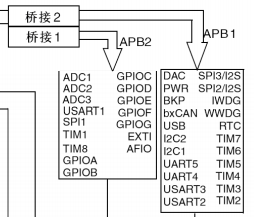
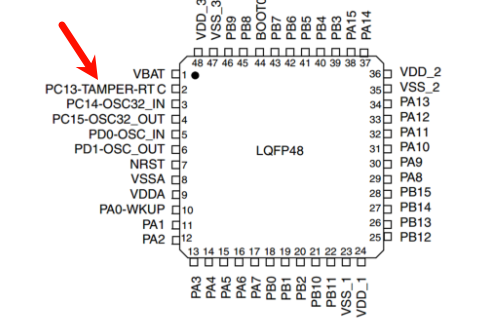
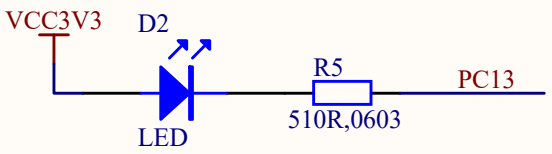
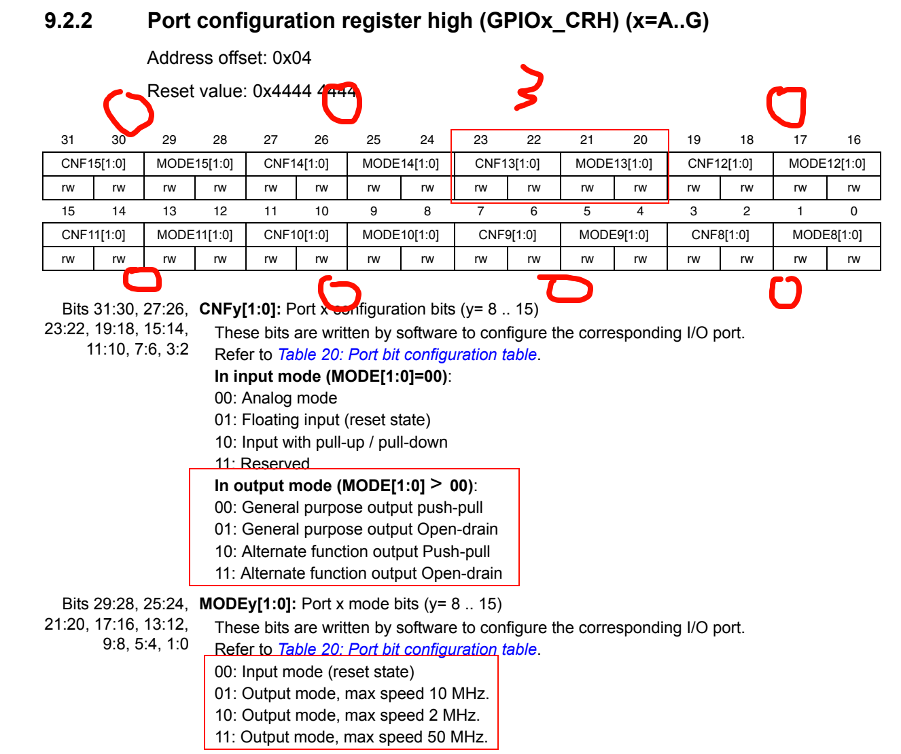
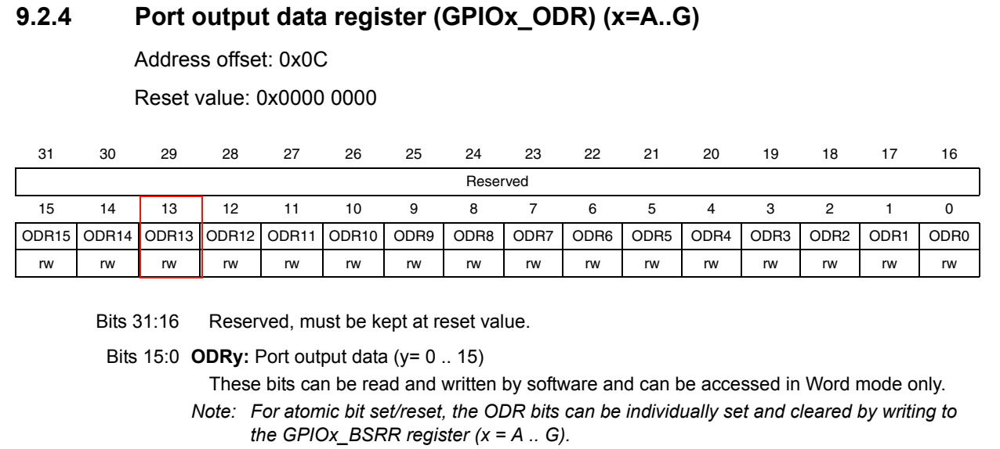

PC13 是 LED，



PC13，挂载在APB2总线上，并且13是高八位，在CRH上



输出模式，低电平点亮，推挽模式（既能高点平也能低电平）




然后由于是输出模式，所以配置odr（输出寄存器）




这一位写1就是高电平，写0就是低电平

### 寄存器操作

```c
#include "stm32f10x.h"                  // Device header

int main(void)
{
	// 打开GPIOC的时钟
	RCC->APB2ENR = 0x00000010;
	// 配置PC13口的模式，寄存器分为CRH高八位，和CRL低八位，这里是PC13，所以是高八位
	GPIOC->CRH = 0x00300000;
	// ODR
	GPIOC->ODR = 0x00000000; // 低电平亮，高电平灭
	
	while (1)
	{
		
	}
}

```


### 库函数

```c
	// 库函数配置
	// 1、使能时钟, 参数1：外设，参数2：状态
	RCC_APB2PeriphClockCmd(RCC_APB2Periph_GPIOC, ENABLE);
	
	// 2、配置端口模式 GPIO13
	GPIO_InitTypeDef GPIO_InitStructure;
	GPIO_InitStructure.GPIO_Pin = GPIO_Pin_13;
	GPIO_InitStructure.GPIO_Mode = GPIO_Mode_Out_PP; // 通用推挽
	GPIO_InitStructure.GPIO_Speed = GPIO_Speed_50MHz;
	GPIO_Init(GPIOC, &GPIO_InitStructure);
	
	// 配置ODR
	GPIO_SetBits(GPIOC, GPIO_Pin_13); // 设置高电平
	GPIO_ResetBits(GPIOC, GPIO_Pin_13); // 低电平
```


