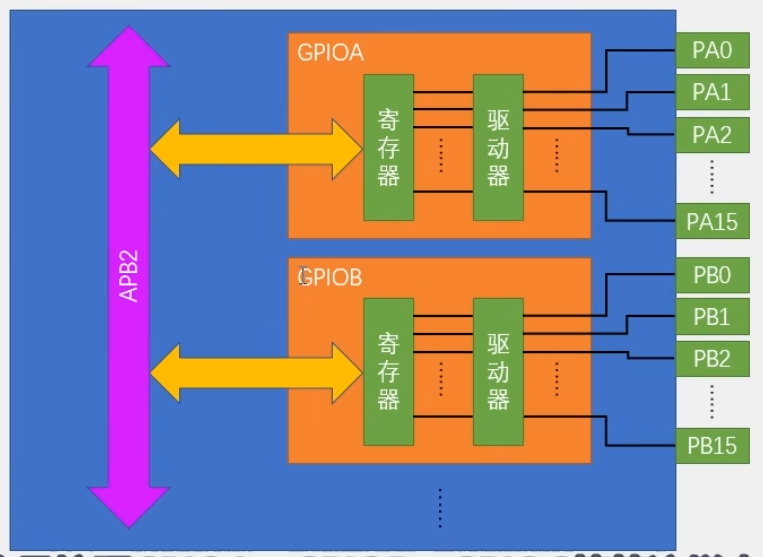
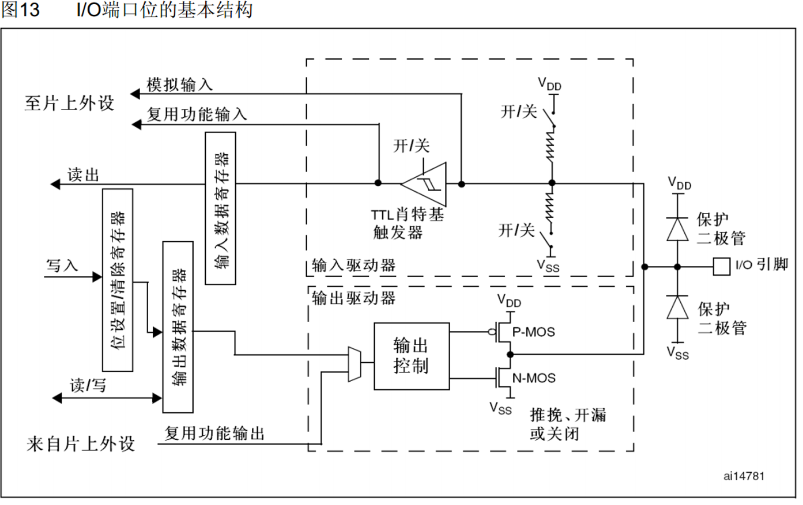
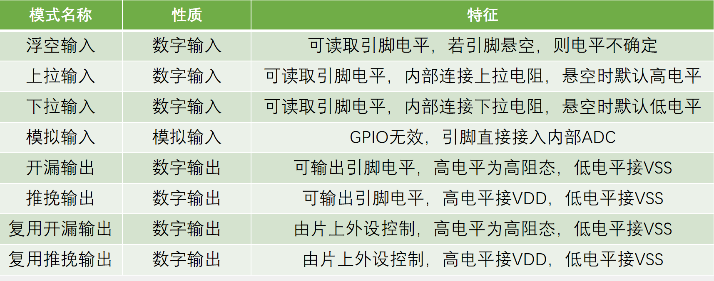
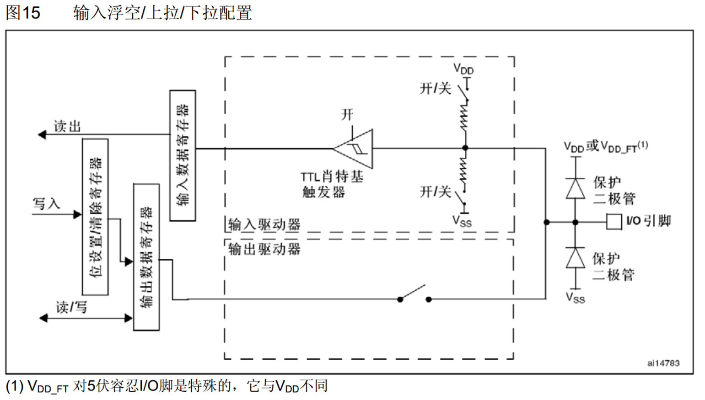
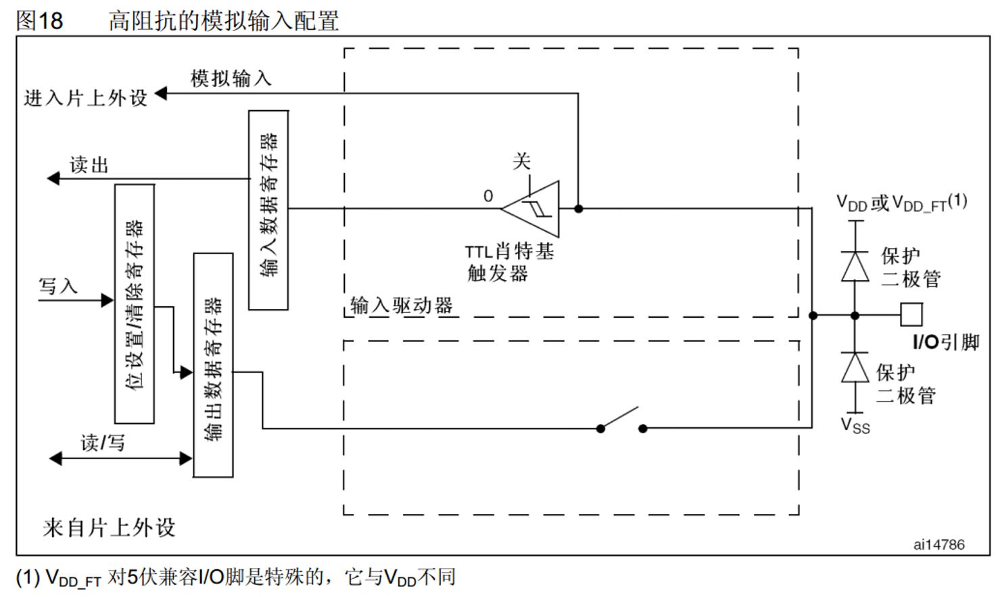
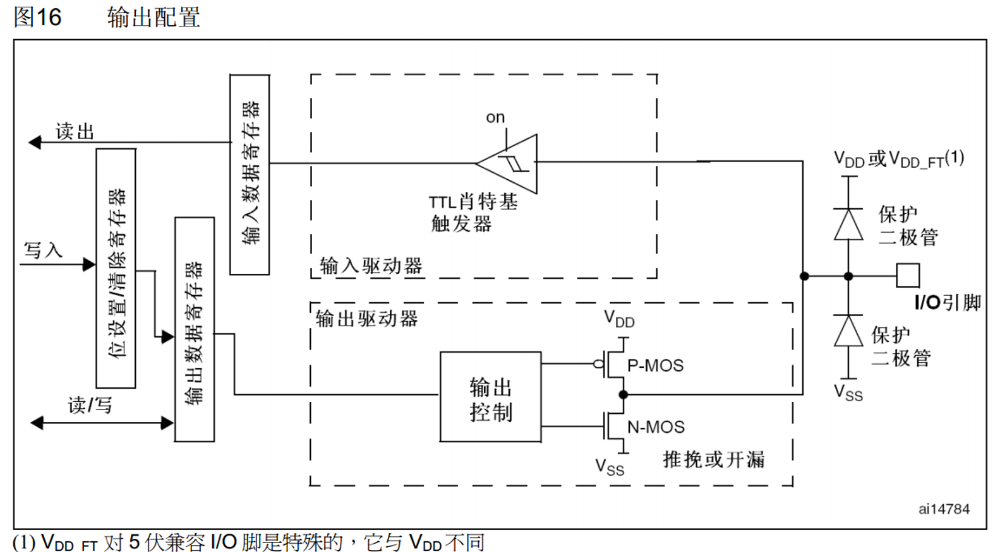
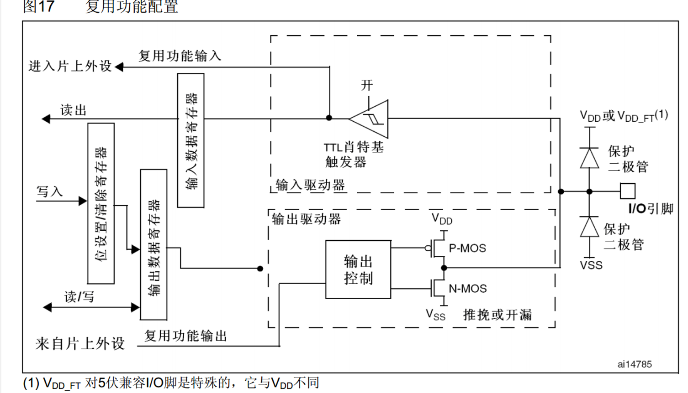

# GPIO

## 操作GPIO步骤

- 使能GPIO时钟
- 使用GPIO_Init初始化GPIO
- 使用输出或者输入函数控制GPIO口

```c
	RCC_APB2PeriphClockCmd(RCC_APB2Periph_GPIOA, ENABLE);
	GPIO_InitTypeDef GPIO_InitStructure;
	GPIO_InitStructure.GPIO_Mode = GPIO_Mode_Out_PP;
	GPIO_InitStructure.GPIO_Pin = GPIO_Pin_0;
	GPIO_InitStructure.GPIO_Speed = GPIO_Speed_50MHz;
	GPIO_Init(GPIOA, &GPIO_InitStructure);
//	GPIO_ResetBits(GPIOA, GPIO_Pin_0);
	while(1)
	{
		GPIO_WriteBit(GPIOA, GPIO_Pin_0, Bit_RESET);
		Delay_ms(100);
//		GPIO_WriteBit(GPIOA, GPIO_Pin_0, Bit_SET);
//		Delay_ms(100);
	}	


// 操作多个IO
GPIO_InitStructure.GPIO_Pin = GPIO_Pin_0 | GPIO_Pin_0 | GPIO_Pin_0;
```

RCC主要的3个函数

```c
void RCC_AHBPeriphClockCmd(uint32_t RCC_AHBPeriph, FunctionalState NewState);
void RCC_APB2PeriphClockCmd(uint32_t RCC_APB2Periph, FunctionalState NewState);
void RCC_APB1PeriphClockCmd(uint32_t RCC_APB1Periph, FunctionalState NewState);
```

GPIO库函数

```c
void GPIO_DeInit(GPIO_TypeDef* GPIOx); // 所指定的GPIO外设会被复位
void GPIO_AFIODeInit(void); // 复制AFIO外设

// 用结构体的参数初始化IO口
void GPIO_Init(GPIO_TypeDef* GPIOx, GPIO_InitTypeDef* GPIO_InitStruct);

// 可以把结构体变量赋值一个默认值
void GPIO_StructInit(GPIO_InitTypeDef* GPIO_InitStruct);


uint8_t GPIO_ReadInputDataBit(GPIO_TypeDef* GPIOx, uint16_t GPIO_Pin);
uint16_t GPIO_ReadInputData(GPIO_TypeDef* GPIOx);
uint8_t GPIO_ReadOutputDataBit(GPIO_TypeDef* GPIOx, uint16_t GPIO_Pin);
uint16_t GPIO_ReadOutputData(GPIO_TypeDef* GPIOx);


void GPIO_SetBits(GPIO_TypeDef* GPIOx, uint16_t GPIO_Pin); // 设置高电平
void GPIO_ResetBits(GPIO_TypeDef* GPIOx, uint16_t GPIO_Pin); // 设置低电平
void GPIO_WriteBit(GPIO_TypeDef* GPIOx, uint16_t GPIO_Pin, BitAction BitVal); // 根据指定的值来设置某个端口
void GPIO_Write(GPIO_TypeDef* GPIOx, uint16_t PortVal); // 同时对16个端口进行写入操作
```

GPIO八种工作模式

```c
typedef enum
{ GPIO_Mode_AIN = 0x0, // 模拟输入
  GPIO_Mode_IN_FLOATING = 0x04, // 浮空输入
  GPIO_Mode_IPD = 0x28, // 下拉输入
  GPIO_Mode_IPU = 0x48, // 上拉输入
  GPIO_Mode_Out_OD = 0x14, // 开漏输出
  GPIO_Mode_Out_PP = 0x10, // 推挽输出
  GPIO_Mode_AF_OD = 0x1C, // 复用开漏
  GPIO_Mode_AF_PP = 0x18 // 复用推挽
}GPIOMode_TypeDef;
```




寄存器：寄存器中有32位，因为stm32是32位，但是只有16个GPIO口，所以只有低16位被使用，通过对输出寄存器写1或者0就可以控制对应gpio口电平，通过输入寄存器读取就可以知道对应寄存器是高低电平

驱动器：用来增强信号驱动能力，寄存器只负责存储数据，需要驱动器来增大驱动能力




上拉下拉是为了给一个默认的电平，防止浮空

**施密特触发器：**是为了给输入电压进行整形的，如果输入电压大于某一阈值，如果输入电压大于某一阈值，那就会升为高电平，反之则会降为低电平，因为数字信号会失真，需要施密特触发器进行整形

**位设置清除寄存器：**可以单独设置某一位，而不影响其他位，因为输出寄存器只能整体进行读写











## 蜂鸣器

```c
#include "stm32f10x.h"                  // Device header
#include "Delay.h"
int main(void)
{
	// LED 闪烁 PA0
	
	RCC_APB2PeriphClockCmd(RCC_APB2Periph_GPIOA | RCC_APB2Periph_GPIOB, ENABLE);
	GPIO_InitTypeDef GPIO_InitStructure;
	GPIO_InitStructure.GPIO_Mode = GPIO_Mode_Out_PP;
	GPIO_InitStructure.GPIO_Pin = GPIO_Pin_0;
	GPIO_InitStructure.GPIO_Speed = GPIO_Speed_50MHz;
	GPIO_Init(GPIOA, &GPIO_InitStructure);
	
	// 蜂鸣器
	GPIO_InitStructure.GPIO_Pin = GPIO_Pin_12;
	GPIO_Init(GPIOB, &GPIO_InitStructure);

	while(1)
	{
		GPIO_WriteBit(GPIOA, GPIO_Pin_0, Bit_RESET);
		Delay_ms(100);

		GPIO_ResetBits(GPIOB, GPIO_Pin_12);
		Delay_ms(100);
		GPIO_SetBits(GPIOB, GPIO_Pin_12);
		Delay_ms(100);
	}	
}
```

## 按键控制LED

```c
// LED.h/c
#ifndef __LED_H__
#define __LED_H__

void LED_Init(void);
void LED_ON(void);
void LED_OFF(void);

#endif


#include "stm32f10x.h"                  // Device header               // Device header


void LED_Init(void)
{
	RCC_APB2PeriphClockCmd(RCC_APB2Periph_GPIOA, ENABLE);
	
	GPIO_InitTypeDef GPIO_InitStructure;
	GPIO_InitStructure.GPIO_Mode = GPIO_Mode_Out_PP;
	GPIO_InitStructure.GPIO_Pin = GPIO_Pin_0;
	GPIO_InitStructure.GPIO_Speed = GPIO_Speed_50MHz;
	GPIO_Init(GPIOA, &GPIO_InitStructure);
	
	GPIO_SetBits(GPIOA, GPIO_Pin_0);
}

void LED_ON(void)
{
	GPIO_SetBits(GPIOA, GPIO_Pin_0);
}

void LED_OFF(void)
{
	GPIO_ResetBits(GPIOA, GPIO_Pin_0);
}

```

```c
// key.h/c
#ifndef __KEY_H_
#define __KEY_H_

void KEY_Init(void);
uint8_t Key_GETNum(void);

#endif


#include "stm32f10x.h"                  // Device header
#include "Delay.h"
void KEY_Init(void)
{
	RCC_APB2PeriphClockCmd(RCC_APB2Periph_GPIOB, ENABLE);
	
	GPIO_InitTypeDef GPIO_InitStructure;
	GPIO_InitStructure.GPIO_Mode = GPIO_Mode_IPU;
	GPIO_InitStructure.GPIO_Pin = GPIO_Pin_11;
	GPIO_InitStructure.GPIO_Speed = GPIO_Speed_50MHz;
	GPIO_Init(GPIOB, &GPIO_InitStructure);
	
	GPIO_SetBits(GPIOB, GPIO_Pin_11);
}

uint8_t Key_GETNum(void)
{
	uint8_t key_num = 0;
	if(GPIO_ReadInputDataBit(GPIOB, GPIO_Pin_11) == 0)
	{
		Delay_ms(20);
		// 还没松手就一直循环
		while(GPIO_ReadInputDataBit(GPIOB, GPIO_Pin_11) == 0);
		Delay_ms(20);
		key_num = 1;
	}
	return key_num;
}


```

```c
#include "stm32f10x.h"                  // Device header
#include "Delay.h"
#include "LED.h"
#include "KEY.h"

int main(void)
{
	LED_Init();
	KEY_Init();
	uint8_t key_state = 0;
	static uint8_t led_status = 0;

	while(1)
	{
		key_state = Key_GETNum(); // 读取按键是否触发（1=按下并松开，0=无操作）
		
		if(key_state == 1) // 检测到有效按键
		{
			led_status = !led_status; // 翻转LED状态：0→1 或 1→0
			
			// 根据状态控制LED
			if(led_status == 1)
			{
				LED_ON();  // 亮灯
			}
			else
			{
				LED_OFF(); // 灭灯
			}
		}
	}	
}

```


