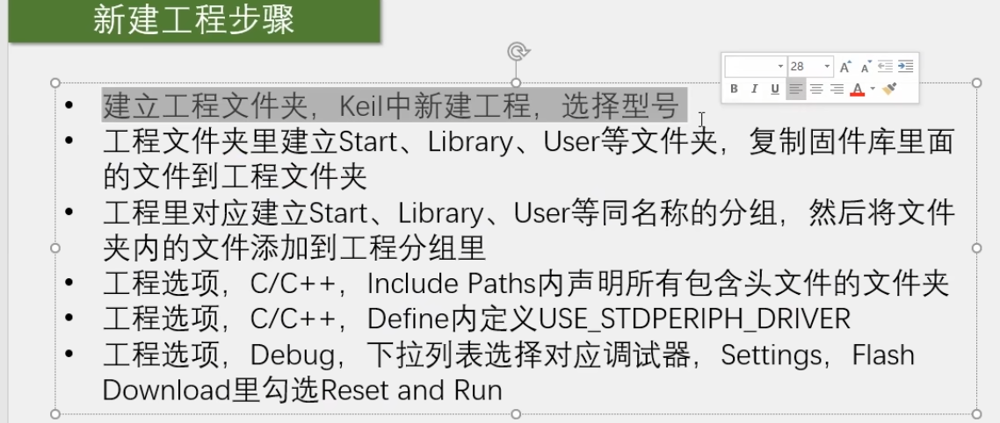

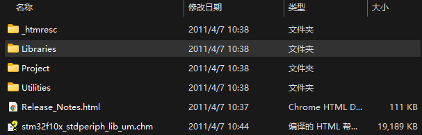

其中Libraries文件夹下是包含启动文件

`固件库\STM32F10x_StdPeriph_Lib_V3.5.0\Libraries\CMSIS\CM3\DeviceSupport\ST\STM32F10x\startup\arm`

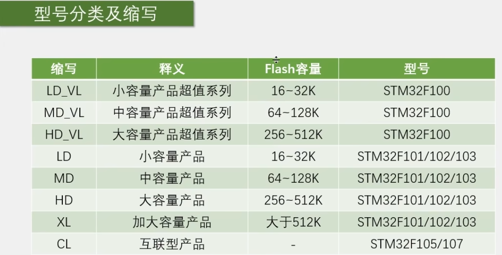

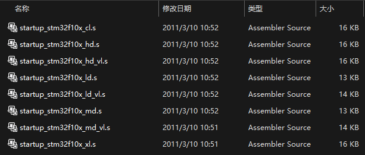

将该目录下所有文件复制到工程目录下`Start`目录下

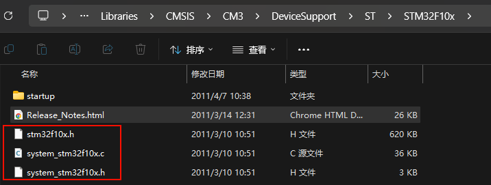

第一个文件是记录寄存器地址的

后两个是配置时钟的

将这三个文件也粘贴到Start目录下

添加内核寄存器描述文件，也粘贴到Start目录下

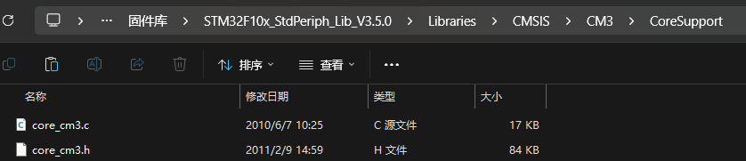

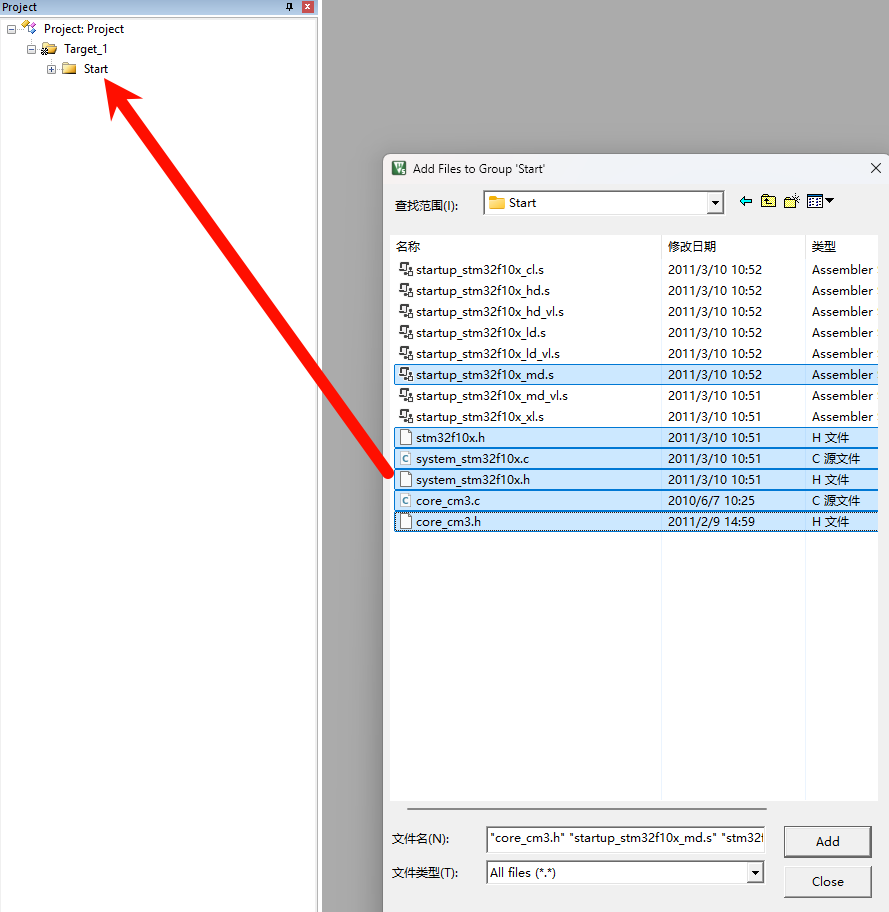

将之前的文件添加到Start组

点击魔术棒，添加头文件路径

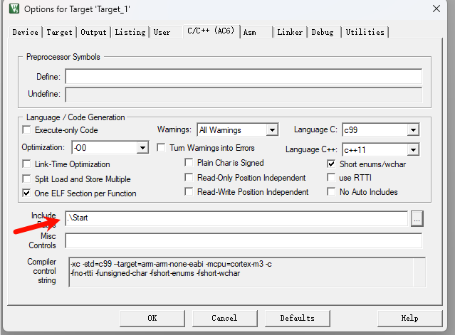

添加库函数，创建Library组和目录

将inc和src目录下的驱动库函数全部添加进来

`固件库\STM32F10x_StdPeriph_Lib_V3.5.0\Libraries\STM32F10x_StdPeriph_Driver\src`

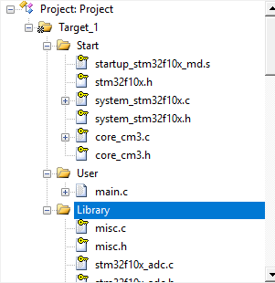

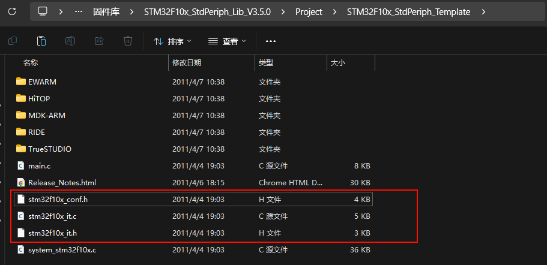

这个模板项目里边的conf文件是配置库函数头文件包含关系的

it文件是配置中断的

将这三个粘贴到User目录下

然后添加配置宏

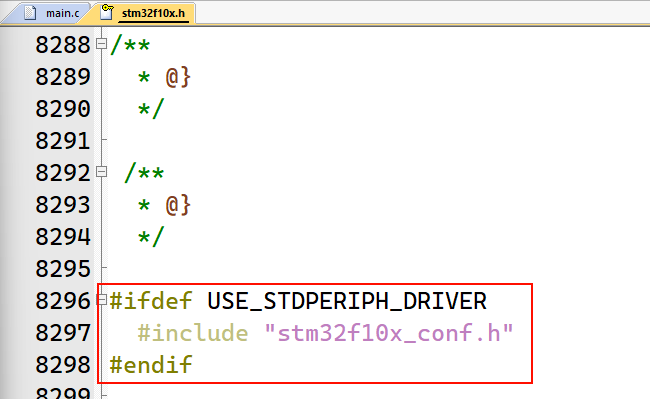

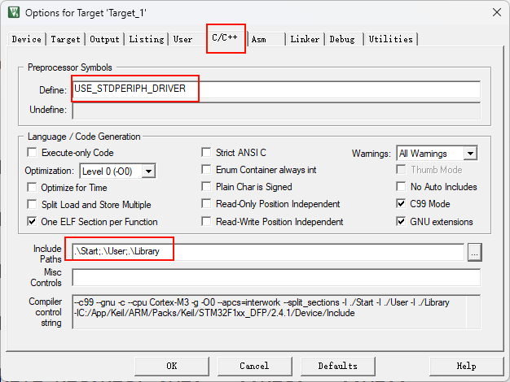

