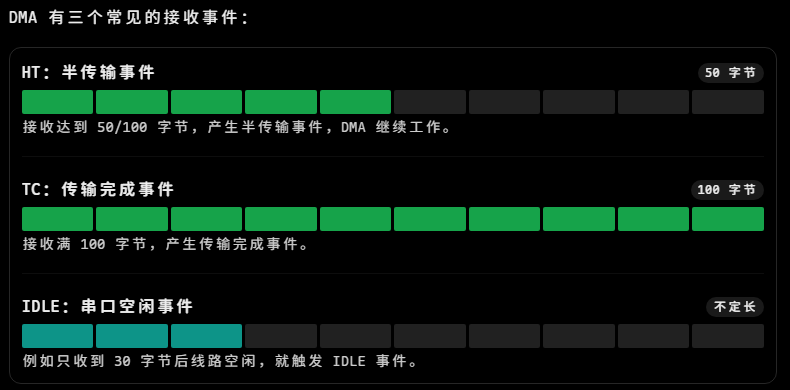

## HT模式

可以这样工作：
1. DMA 写满前 50 个数据，触发 HT 中断。
2. CPU 开始处理前 50 个数据，DMA 同时继续写后 50 个数据。
3. DMA 写满后 50 个数据，触发 TC 中断。
4. CPU 处理后 50 个数据，DMA 回到数组开头继续采集。
这样 CPU 和 DMA 就能并行工作，不需要等待整个缓冲区收满才开始处理。

这种方式通常叫做 双半缓冲处理（Ping-Pong Buffering）。
