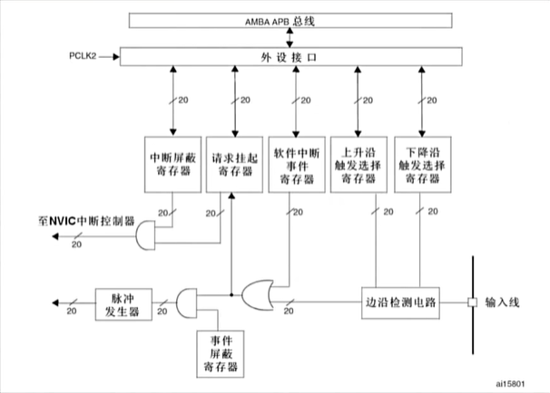
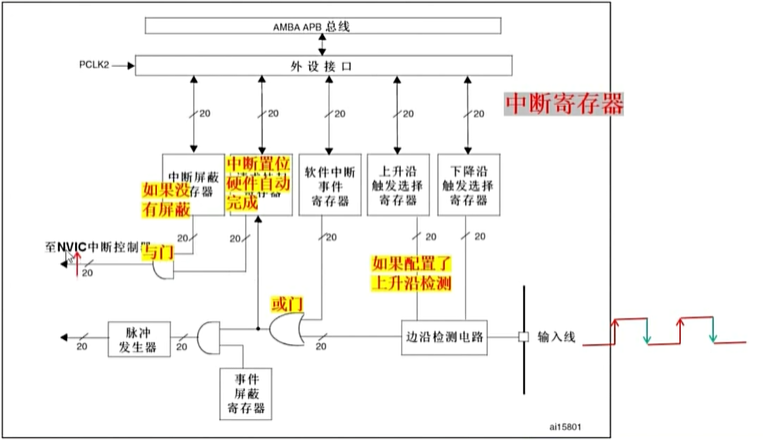
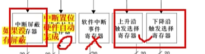
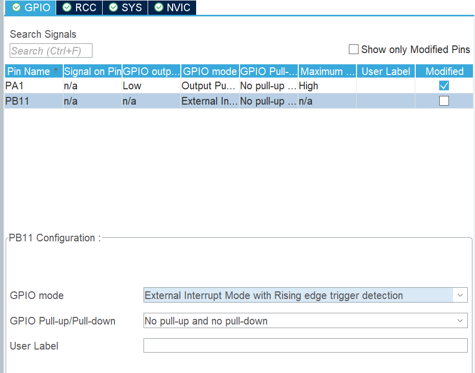
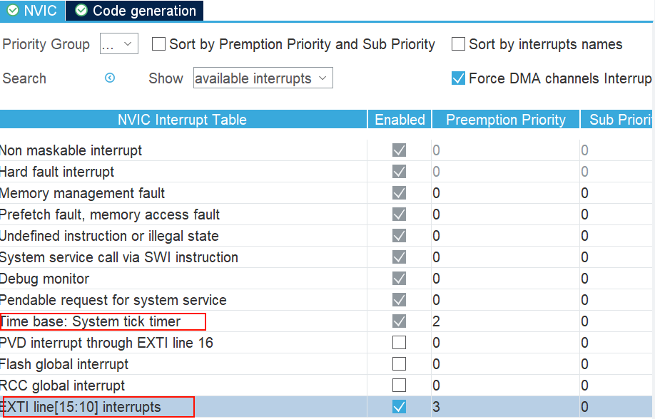
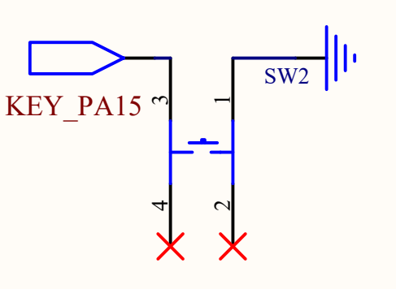

将PB11配置成中断触发



需要让自定义中断的优先级小于系统嘀嗒定时器，否则不会被打断



这里配置PA15为GPIO输入模式，默认高电平，按键按下为低电平

找到回调函数 HAL_GPIO_EXTI_Callback

```c
// 找到回调函数 
// Core\Src\stm32f4xx_it.c
void EXTI15_10_IRQHandler(void)
{
  /* USER CODE BEGIN EXTI15_10_IRQn 0 */

  /* USER CODE END EXTI15_10_IRQn 0 */
  HAL_GPIO_EXTI_IRQHandler(GPIO_PIN_15);
  /* USER CODE BEGIN EXTI15_10_IRQn 1 */

  /* USER CODE END EXTI15_10_IRQn 1 */
}


// 内部
void HAL_GPIO_EXTI_IRQHandler(uint16_t GPIO_Pin)
{
  /* EXTI line interrupt detected */
  if(__HAL_GPIO_EXTI_GET_IT(GPIO_Pin) != RESET)
  {
    __HAL_GPIO_EXTI_CLEAR_IT(GPIO_Pin);
    HAL_GPIO_EXTI_Callback(GPIO_Pin);
  }
}
```

```c
// main.c

/* USER CODE BEGIN 4 */
volatile uint8_t is_pressed = 0;
void HAL_GPIO_EXTI_Callback(uint16_t GPIO_Pin)
{
    if (GPIO_Pin == GPIO_PIN_15)
    {
        HAL_Delay(20);
        if (HAL_GPIO_ReadPin(GPIOA, GPIO_PIN_15) == GPIO_PIN_RESET)
        {
            // PA15 按键触发中断
            is_pressed = is_pressed ? 0 : 1;
        }
    }
}
/* USER CODE END 4 */
```
