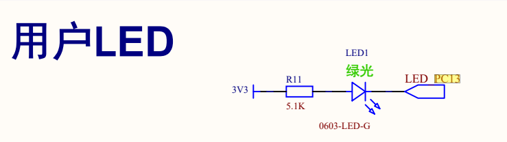

## cubemax配置
开启debug-sw
开启rcc-hse
配置pc13为推挽输出



低电平导通

```c
// main.c -> main() -> user code begin2
GPIO_PinState state;


// main.c -> main() -> while(1)

// 写入GPIO
HAL_GPIO_WritePin(GPIOC, GPIO_PIN_13, GPIO_PIN_RESET);
HAL_Delay(1000);
HAL_GPIO_WritePin(GPIOC, GPIO_PIN_13, GPIO_PIN_SET);
HAL_Delay(1000);

// 翻转GPIO
HAL_GPIO_TogglePin(GPIOC, GPIO_PIN_13);
HAL_Delay(500);
state = HAL_GPIO_ReadPin(GPIOC, GPIO_PIN_13);
```
