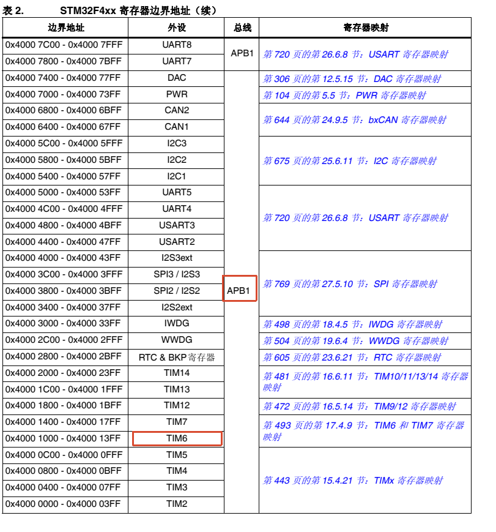
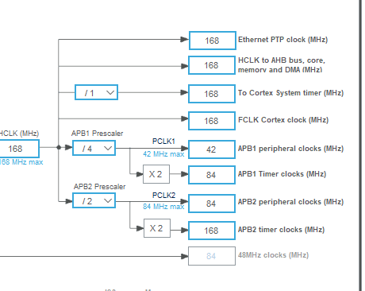
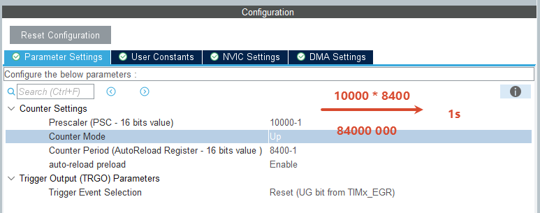
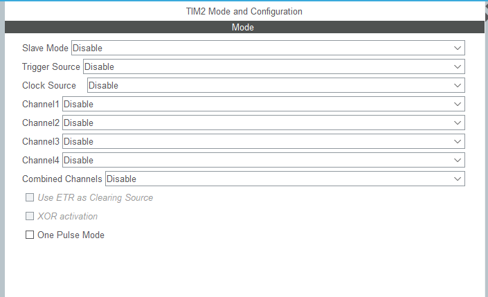
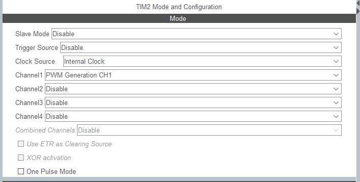
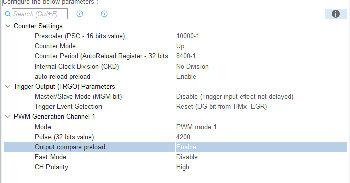

## 说明

| 系统定时器Systick | 每1ms产生一次中断，主要用来维护毫秒计数器 |
| :---: | :---: |
| 基本定时器 | 没有PWM输出通道，主要用来定时和触发，适合周期采样 |
| 通用定时器 | PWM输出、输入捕获、输出比较、编码器接口 |
| 高级定时器 | 互补PWM输出、死区时间插入、刹车输入、重复计数器 |

## 系统定时器

```c
// stm32f1xx_it.c

void SysTick_Handler(void)
{
  /* USER CODE BEGIN SysTick_IRQn 0 */

  /* USER CODE END SysTick_IRQn 0 */
  HAL_IncTick();
  /* USER CODE BEGIN SysTick_IRQn 1 */
  if(uwTick % 1000 == 0)
  {
    // HAL_GPIO_TogglePin(GPIOA, GPIO_PIN_1);
  }
  /* USER CODE END SysTick_IRQn 1 */
}
```

## 基本定时器

查看当前定时器在ABP1上还是APB2






普通模式：到ARR自动复位从0开始
OPM：单脉冲模式，到ARR自动停
Auto-reload preload：关闭情况：如果代码修改ARR，并且当前CNT已经超过修改后的ARR，那么CNT可能计数到65535（16位）才会重载；而开启则是预装载，会在下一次计数时使用新的ARR
TRGO：触发输出，让当前定时器向其他外设发送硬件触发信号
| 选项 | 含义 | 作用 |
| --- | --- | --- |
| Reset (UG bit from TIMx\_EGR) | 复位/更新请求触发 | 软件设置 UG 位时产生 TRGO 触发信号 |
| Enable (CNT\_EN) | 计数器使能触发 | 定时器计数器使能时输出触发信号 |
| Update Event | 更新事件触发 | 每次产生更新事件时输出 TRGO 触发信号 |


reset UG
```c
// 软件设置 UG 位，触发
// 向 TIM6 的 EGR 寄存器写入 UG = 1，请求产生一次更新事件
__HAL_TIM_GENERATE_EVENT(&htim6, TIM_EVENTSOURCE_UPDATE);


//UG 不只是触发 TRGO，它还会产生定时器更新事件，可能使计数器重新初始化、装载预装载寄存器的值

CPU 执行上述代码
      ↓
TIM6 的 UG 位被置 1
      ↓
产生更新事件（分支表示两条路，没有先后顺序）
      ├── TRGO 硬件触发
      │      ↓
      │   DAC 等外设
      │
      └── 定时器内部执行更新操作

```


cnt_en
```c
// 简单来说就是计时器在计数工作，就一直保持触发信号有效，否则一直不触发

CPU 启动 TIM6
      ↓
TIM6 的 CEN = 1
      ├── TIM6 开始计数
      │
      └── TRGO 输出高电平
                 ↓
          其他定时器检测到触发
                 ↓
          执行相应操作
```


update event
```c
TIM6 开始计数
      ↓
计数到 ARR
      ↓
产生 Update Event（分支表示两条路，没有先后顺序）
      ├── 更新中断（如果开启）
      │      ↓
      │   HAL_TIM_PeriodElapsedCallback()
      │
      └── TRGO 硬件触发
             ↓
          DAC 等外设
```

```c
HAL_TIM_Base_Start() // 启动定时器，不开启中断
HAL_TIM_Base_Start_IT() // 启动定时器，开启中断
HAL_TIM_Base_Stop()  // 这种会一直计数，不会触发更新事件
HAL_TIM_base_Stop_IT()

HAL_TIM_PeriodElapsedCallback() // 定时器到期回调 中断进入
```

```c
// mian.c

/* USER CODE BEGIN 2 */
// 启动定时器
HAL_TIM_Base_Start_IT(&htim6);
/* USER CODE END 2 */


/* USER CODE BEGIN 4 */
void HAL_TIM_PeriodElapsedCallback(TIM_HandleTypeDef *htim)
{
  if(htim->Instance == TIM6)
  {
    HAL_GPIO_TogglePin(GPIOC, GPIO_PIN_13);
  }
}
/* USER CODE END 4 */
```

## 通用定时器



| 配置项 | 作用 | 常见用途 |
| --- | --- | --- |
| Slave Mode | 从模式，决定定时器是否受外部触发控制 | 多定时器同步、外部信号计数 |
| Trigger Source | 选择从模式的触发信号来源 | TIM1 触发 TIM2 |
| Clock Source | 选择定时器计数时钟来源 | 内部时钟、外部时钟 |
| Channel1～4 | 配置定时器的四个输入输出通道 | PWM、输入捕获、输出比较 |
| Combined Channels | 将通道组合实现特定功能 | PWM 输入测量、编码器 |
| Use ETR as Clearing Source | 使用 ETR 外部信号清除输出比较参考信号 | 外部信号控制 PWM |
| XOR activation | 将部分输入通道信号进行异或组合 | 霍尔传感器接口 |
| One Pulse Mode | 单脉冲模式，触发后执行一次计数过程并停止 | 单次脉冲输出 |

Trigger Source（触发源）
- ITR0～ITR3：来自其他定时器的内部触发。
- TI1FP1：来自通道 1 的滤波后输入信号。
- TI2FP2：来自通道 2 的滤波后输入信号。
- ETRF：来自外部触发输入的滤波后信号。
需要注意，ITR0 不一定代表 TIM1，具体对应关系要看芯片参考手册中的定时器内部触发连接表。


定时器通道的常见用途
| 类型 | 常见模式 | 作用 |
| --- | --- | --- |
| 输出 | PWM Generation | 输出 PWM 波形 |
| 输出 | Output Compare | CNT 到达 CCR 时触发比较事件，可控制引脚或产生中断 |
| 输入 | Input Capture | 捕获外部信号边沿，记录 CNT 值 |
| 输入 | PWM Input | 测量外部 PWM 的频率和占空比 |
| 输入 | Encoder Mode | 通过两个通道读取编码器 |

### PWM输出





PWM Mode 1 在你当前的向上计数、高电平有效配置下：
- 当 CNT < CCR1：输出高电平。
- 当 CNT >= CCR1：输出低电平。

Output compare preload
它控制 CCR1 是否预装载。
Enable：新占空比通常在下一个更新事件生效。
Disable：写入 CCR1 后立即参与比较，可能使当前周期产生异常宽度的脉冲。

CH Polarity
控制 PWM 输出有效电平的极性。
- High：PWM Mode 1 有效期间输出高电平。
- Low：PWM Mode 1 有效期间输出低电平。


```c
// 启动PWM
HAL_TIM_PWM_Start(&htim2, TIM_CHANNEL_1); 

// 25% 占空比
__HAL_TIM_SET_COMPARE(&htim2, TIM_CHANNEL_1, 2100);

// 50% 占空比
__HAL_TIM_SET_COMPARE(&htim2, TIM_CHANNEL_1, 4200);

// 75% 占空比
__HAL_TIM_SET_COMPARE(&htim2, TIM_CHANNEL_1, 6300);
```


| 中断类型 | 触发条件 | HAL 回调函数 |
| --- | --- | --- |
| 更新中断（Update） | 计数器完成一个周期 | HAL\_TIM\_PeriodElapsedCallback() |
| PWM 比较中断（CC1） | CNT 与 CCR1 匹配 | HAL\_TIM\_PWM\_PulseFinishedCallback() |

| HAL 函数 | PWM 输出 | 更新中断 | 比较中断 |
| --- | --- | --- | --- |
| HAL\_TIM\_PWM\_Start() | 1 | — | — |
| HAL\_TIM\_PWM\_Start\_IT() | 1 | — | 1 |
| HAL\_TIM\_Base\_Start\_IT() | 不负责配置 PWM | 1 | — |

```c
// 启动 TIM2 CH1 PWM 输出
HAL_TIM_PWM_Start(&htim2, TIM_CHANNEL_1);

// 开启 TIM2 更新中断
HAL_TIM_Base_Start_IT(&htim2);
```


