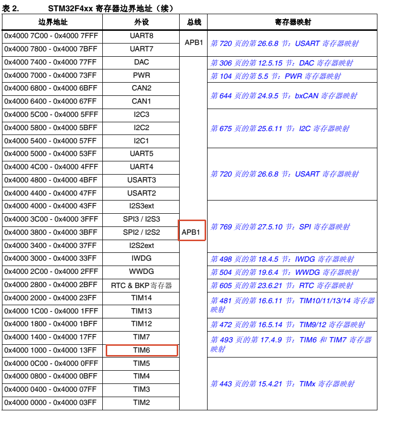
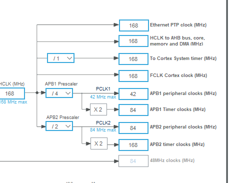
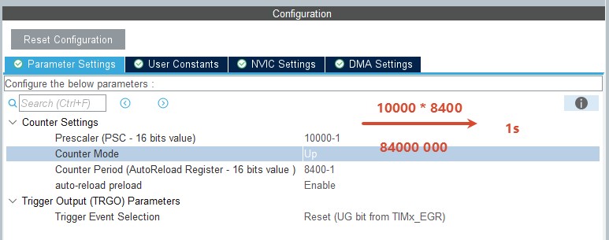

## 说明

| 系统定时器Systick | 每1ms产生一次中断，主要用来维护毫秒计数器 |
| :---: | :---: |
| 基本定时器 | 没有PWM输出通道，主要用来定时和触发，适合周期采样 |
| 通用定时器 | PWM输出、输入捕获、输出比较、编码器接口 |
| 高级定时器 | 互补PWM输出、死区时间插入、刹车输入、重复计数器 |

## 系统定时器

```c
// stm32f1xx_it.c

void SysTick_Handler(void)
{
  /* USER CODE BEGIN SysTick_IRQn 0 */

  /* USER CODE END SysTick_IRQn 0 */
  HAL_IncTick();
  /* USER CODE BEGIN SysTick_IRQn 1 */
  if(uwTick % 1000 == 0)
  {
    // HAL_GPIO_TogglePin(GPIOA, GPIO_PIN_1);
  }
  /* USER CODE END SysTick_IRQn 1 */
}
```

## 基本定时器

查看当前定时器在ABP1上还是APB2






普通模式：到ARR自动复位从0开始
OPM：单脉冲模式，到ARR自动停
Auto-reload preload：关闭情况：如果代码修改ARR，并且当前CNT已经超过修改后的ARR，那么CNT可能计数到65535（16位）才会重载；而开启则是预装载，会在下一次计数时使用新的ARR
TRGO：触发输出，让当前定时器向其他外设发送硬件触发信号
| 选项 | 含义 | 作用 |
| --- | --- | --- |
| Reset (UG bit from TIMx\_EGR) | 复位/更新请求触发 | 软件设置 UG 位时产生 TRGO 触发信号 |
| Enable (CNT\_EN) | 计数器使能触发 | 定时器计数器使能时输出触发信号 |
| Update Event | 更新事件触发 | 每次产生更新事件时输出 TRGO 触发信号 |


reset UG
```c
// 软件设置 UG 位，触发
// 向 TIM6 的 EGR 寄存器写入 UG = 1，请求产生一次更新事件
__HAL_TIM_GENERATE_EVENT(&htim6, TIM_EVENTSOURCE_UPDATE);


//UG 不只是触发 TRGO，它还会产生定时器更新事件，可能使计数器重新初始化、装载预装载寄存器的值

CPU 执行上述代码
      ↓
TIM6 的 UG 位被置 1
      ↓
产生更新事件（分支表示两条路，没有先后顺序）
      ├── TRGO 硬件触发
      │      ↓
      │   DAC 等外设
      │
      └── 定时器内部执行更新操作

```


cnt_en
```c
// 简单来说就是计时器在计数工作，就一直保持触发信号有效，否则一直不触发

CPU 启动 TIM6
      ↓
TIM6 的 CEN = 1
      ├── TIM6 开始计数
      │
      └── TRGO 输出高电平
                 ↓
          其他定时器检测到触发
                 ↓
          执行相应操作
```


update event
```c
TIM6 开始计数
      ↓
计数到 ARR
      ↓
产生 Update Event（分支表示两条路，没有先后顺序）
      ├── 更新中断（如果开启）
      │      ↓
      │   HAL_TIM_PeriodElapsedCallback()
      │
      └── TRGO 硬件触发
             ↓
          DAC 等外设
```

```c
HAL_TIM_Base_Start() // 启动定时器，不开启中断
HAL_TIM_Base_Start_IT() // 启动定时器，开启中断
HAL_TIM_Base_Stop()
HAL_TIM_base_Stop_IT()

HAL_TIM_PeriodElapsedCallback() // 定时器到期回调 中断进入
```

```c

```


