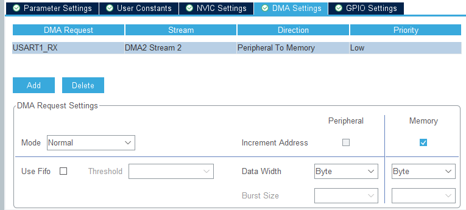

## 说明

| 接收方式 | HAL 函数 | 变长接收 | 是否阻塞 |
| --- | --- | --- | --- |
| 普通轮询接收 | HAL\_UART\_Receive() | 否，按指定长度 | 是 |
| 普通中断接收 | HAL\_UART\_Receive\_IT() | 否，按指定长度 | 否 |
| 普通 DMA 接收 | HAL\_UART\_Receive\_DMA() | 否，按指定长度 | 否 |
| 空闲轮询接收 | HAL_UARTEx_ReceiveToIdle() | 是 | 是 |
| 空闲中断接收 | HAL\_UARTEx\_ReceiveToIdle\_IT() | 是 | 否 |
| 空闲 DMA 接收 | HAL\_UARTEx\_ReceiveToIdle\_DMA() | 是 | 否 |

## 普通轮询接收 HAL_UART_Receive

```c
  /* USER CODE BEGIN 2 */
  // buffer缓冲区
  uint8_t buffer[100];
  // 回复消息 这里是5字节
  uint8_t msg[] = "ok\r\n";
  /* USER CODE END 2 */

  /* Infinite loop */
  /* USER CODE BEGIN WHILE */
  while (1)
  {
      // Receive每次都会从buffer[0]开始，所以不会移除
      if (HAL_UART_Receive(&huart1, buffer, 10, HAL_MAX_DELAY) == HAL_OK)
      {
          // sizeof() - 1，不发送末尾的\0
          HAL_UART_Transmit(&huart1, msg, sizeof(msg) - 1, HAL_MAX_DELAY);
      }
      /* USER CODE END WHILE */

      /* USER CODE BEGIN 3 */
  }
```


## 空闲轮询接收 HAL_UARTEx_ReceiveToIdle()

```c
  /* USER CODE BEGIN 2 */
  // buffer缓冲区
  uint8_t buffer[100];
  // 实际接收的字符数
  uint16_t rx_len = 0;
  /* USER CODE END 2 */

  /* Infinite loop */
  /* USER CODE BEGIN WHILE */
  while (1)
  {
    // 最多写buffer长度的字节，rx_len为实际接收长度
    if(HAL_UARTEx_ReceiveToIdle(&huart1, buffer, sizeof(buffer), &rx_len, HAL_MAX_DELAY) == HAL_OK)
    {
      HAL_UART_Transmit(&huart1, buffer, rx_len, HAL_MAX_DELAY);
    }
    /* USER CODE END WHILE */

    /* USER CODE BEGIN 3 */
  }
```


## 普通中断接收 HAL_UART_Receive_IT()

开启cubemax中的uart1的nvic

找到中断回调函数 HAL_UART_RxCpltCallback
```c
// Core\Src\stm32f4xx_it.c

/**
  * @brief This function handles USART1 global interrupt.
  */
void USART1_IRQHandler(void)
{
  /* USER CODE BEGIN USART1_IRQn 0 */
// 进入中断处理函数前
  /* USER CODE END USART1_IRQn 0 */
  HAL_UART_IRQHandler(&huart1);
  /* USER CODE BEGIN USART1_IRQn 1 */
// 进入中断处理函数后
  /* USER CODE END USART1_IRQn 1 */
}


// 在 HAL_UART_IRQHandler(&huart1); 内部，找到 UART_Receive_IT(huart);
void HAL_UART_IRQHandler(UART_HandleTypeDef *huart)
{
// ...
    /* UART in mode Receiver -------------------------------------------------*/
    if (((isrflags & USART_SR_RXNE) != RESET) && ((cr1its & USART_CR1_RXNEIE) != RESET))
    {
      UART_Receive_IT(huart);
      return;
    }
  }
  // ...
}


// 在 UART_Receive_IT(huart); 内部最低部，找到 HAL_UART_RxCpltCallback(huart);

static HAL_StatusTypeDef UART_Receive_IT(UART_HandleTypeDef *huart)
{
// ... 函数的最底部
  #if (USE_HAL_UART_REGISTER_CALLBACKS == 1)
          /*Call registered Rx Event callback*/
          huart->RxEventCallback(huart, huart->RxXferSize);
  #else
          /*Call legacy weak Rx Event callback*/
          HAL_UARTEx_RxEventCallback(huart, huart->RxXferSize);
  #endif /* USE_HAL_UART_REGISTER_CALLBACKS */
        }
        else
        {
          /* Standard reception API called */
  #if (USE_HAL_UART_REGISTER_CALLBACKS == 1)
          /*Call registered Rx complete callback*/
          huart->RxCpltCallback(huart);
  #else
          /*Call legacy weak Rx complete callback*/
          HAL_UART_RxCpltCallback(huart);
  #endif /* USE_HAL_UART_REGISTER_CALLBACKS */
        }
      // ...
}


// 函数原型
/**
  * @brief  Rx Transfer completed callbacks.
  * @param  huart  Pointer to a UART_HandleTypeDef structure that contains
  *                the configuration information for the specified UART module.
  * @retval None
  */
__weak void HAL_UART_RxCpltCallback(UART_HandleTypeDef *huart)
{
  /* Prevent unused argument(s) compilation warning */
  UNUSED(huart);
  /* NOTE: This function should not be modified, when the callback is needed,
           the HAL_UART_RxCpltCallback could be implemented in the user file
   */
}
```

```c
// main.c

/* USER CODE BEGIN PV  全局变量 main函数外*/
// 接收完毕标志位 
volatile uint8_t is_over = 0;
uint8_t buffer[100];
/* USER CODE END PV */


// main-> <-while

/* USER CODE BEGIN 2 */
// 以中断方式进行接收，只需要启动一次，满10个字节进入中断
HAL_UART_Receive_IT(&huart1, buffer, 10);
/* USER CODE END 2 */

while (1)
{
    if (is_over == 1)
    {
        // 定长数据收发
        HAL_UART_Transmit(&huart1, buffer, 10, 1000);
        is_over = 0;
        // 重新启动下一轮10字节接收
        HAL_UART_Receive_IT(&huart1, buffer, 10);
    }
    /* USER CODE END WHILE */

    /* USER CODE BEGIN 3 */
}


/* USER CODE BEGIN 4 */
// 串口接收完成回调，回调中不要做耗时操作
void HAL_UART_RxCpltCallback(UART_HandleTypeDef *huart)
{
    if (huart->Instance == USART1)
    {
        is_over = 1;
    }
}
/* USER CODE END 4 */
```

## 空闲中断接收 HAL_UARTEx_ReceiveToIdle_IT()

开启cubemax中的uart1的nvic

找到中断事件函数  HAL_UARTEx_RxEventCallback
```c
// Core\Src\stm32f4xx_it.c

/**
  * @brief This function handles USART1 global interrupt.
  */
void USART1_IRQHandler(void)
{
  /* USER CODE BEGIN USART1_IRQn 0 */
// 进入中断处理函数前
  /* USER CODE END USART1_IRQn 0 */
  HAL_UART_IRQHandler(&huart1);
  /* USER CODE BEGIN USART1_IRQn 1 */
// 进入中断处理函数后
  /* USER CODE END USART1_IRQn 1 */
}


// 在 HAL_UART_IRQHandler(&huart1); 内部，找到 UART_Receive_IT(huart);
void HAL_UART_IRQHandler(UART_HandleTypeDef *huart)
{
// ...
    /* UART in mode Receiver -------------------------------------------------*/
    if (((isrflags & USART_SR_RXNE) != RESET) && ((cr1its & USART_CR1_RXNEIE) != RESET))
    {
      UART_Receive_IT(huart);
      return;
    }
  }
  // ...
}


// 在 UART_Receive_IT(huart); 内部最低部，找到 HAL_UART_RxCpltCallback(huart);

static HAL_StatusTypeDef UART_Receive_IT(UART_HandleTypeDef *huart)
{
// ... 函数的最底部
  #if (USE_HAL_UART_REGISTER_CALLBACKS == 1)
          /*Call registered Rx Event callback*/
          huart->RxEventCallback(huart, huart->RxXferSize);
  #else
          /*Call legacy weak Rx Event callback*/
          HAL_UARTEx_RxEventCallback(huart, huart->RxXferSize);
  #endif /* USE_HAL_UART_REGISTER_CALLBACKS */
        }
        else
        {
          /* Standard reception API called */
  #if (USE_HAL_UART_REGISTER_CALLBACKS == 1)
          /*Call registered Rx complete callback*/
          huart->RxCpltCallback(huart);
  #else
          /*Call legacy weak Rx complete callback*/
          HAL_UART_RxCpltCallback(huart);
  #endif /* USE_HAL_UART_REGISTER_CALLBACKS */
        }
      // ...
}


// 函数原型
/**
  * @brief  Rx Transfer completed callbacks.
  * @param  huart  Pointer to a UART_HandleTypeDef structure that contains
  *                the configuration information for the specified UART module.
  * @retval None
  */
__weak void HAL_UART_RxCpltCallback(UART_HandleTypeDef *huart)
{
  /* Prevent unused argument(s) compilation warning */
  UNUSED(huart);
  /* NOTE: This function should not be modified, when the callback is needed,
           the HAL_UART_RxCpltCallback could be implemented in the user file
   */
}
```

```c
// main.c

/* USER CODE BEGIN PV  全局变量 main函数外*/
// 接收完毕标志位 
volatile uint8_t is_over = 0;
uint8_t buffer[100];
volatile uint16_t rx_len = 0;
/* USER CODE END PV */


// main-> <-while

/* USER CODE BEGIN 2 */
// 空闲中断接收数据
HAL_UARTEx_ReceiveToIdle_IT(&huart1, buffer, sizeof(buffer));
/* USER CODE END 2 */

/* Infinite loop */
/* USER CODE BEGIN WHILE */
while (1)
{
  if(is_over == 1)
  {
    HAL_UART_Transmit(&huart1, buffer, rx_len, HAL_MAX_DELAY);
    is_over = 0;
    // 空闲中断接收数据
    HAL_UARTEx_ReceiveToIdle_IT(&huart1, buffer, sizeof(buffer));
  }
}


/* USER CODE BEGIN 4 */
void HAL_UARTEx_RxEventCallback(UART_HandleTypeDef *huart, uint16_t Size)
{
  if(huart->Instance == USART1)
  {
    is_over = 1;
    rx_len = Size;
  }
}
/* USER CODE END 4 */
```


## 普通DMA接收 HAL_UART_Receive_DMA()

替换HAL_UART_Receive_IT()即可

## 空闲DMA接收 HAL_UARTEx_ReceiveToIdle_DMA()


配置DMA，并开启uart和DMA的中断


```c
// main.c

/* USER CODE BEGIN PV */
volatile uint8_t is_over = 0;
uint8_t buffer[100];
volatile uint16_t rx_len = 0;
/* USER CODE END PV */


/* USER CODE BEGIN 2 */
// 开启DMA接收
HAL_UARTEx_ReceiveToIdle_DMA(&huart1, buffer, sizeof(buffer));
// 关闭DMA半传输中断
__HAL_DMA_DISABLE_IT(huart1.hdmarx, DMA_IT_HT);
/* USER CODE END 2 */

while (1)
{
    if (is_over == 1)
    {
        is_over = 0;

        HAL_UART_Transmit(&huart1, buffer, rx_len, 1000);

        // 重新启动DMA接收 //环形dma不需要手写，但是回调中size需要单独处理
        if (HAL_UARTEx_ReceiveToIdle_DMA(&huart1, buffer, sizeof(buffer)) == HAL_OK)
        {
            __HAL_DMA_DISABLE_IT(huart1.hdmarx, DMA_IT_HT);
        }
    }
}


/* USER CODE BEGIN 4 */
void HAL_UARTEx_RxEventCallback(UART_HandleTypeDef *huart, uint16_t Size)
{
    if (huart->Instance == USART1)
    {
        rx_len = Size;
        is_over = 1;
    }
}
/* USER CODE END 4 */
```


