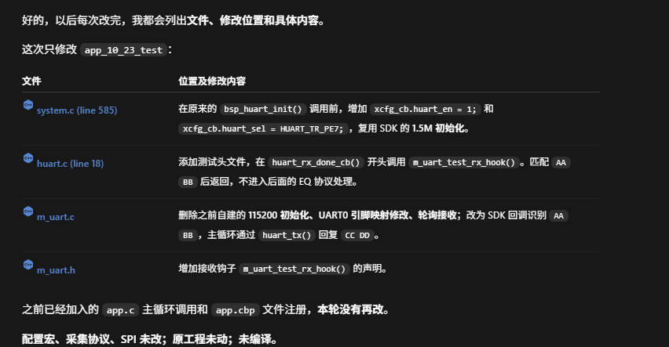

```c
// app.c

void user_app_task_hook(void)
{
    app_task();
    m_ble_process();

    // 新增：系统就绪、采集启动后初始化，内部保证只执行一次
    if (s_runtime_ready && s_app_collecting) {
        m_uart_test_init();
    }

    // 新增：轮询接收 AABB，匹配后回复 CCDD
    m_uart_test_process();
}
```


